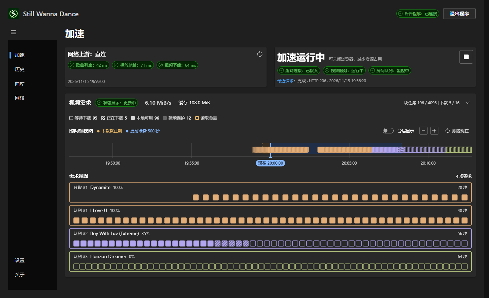
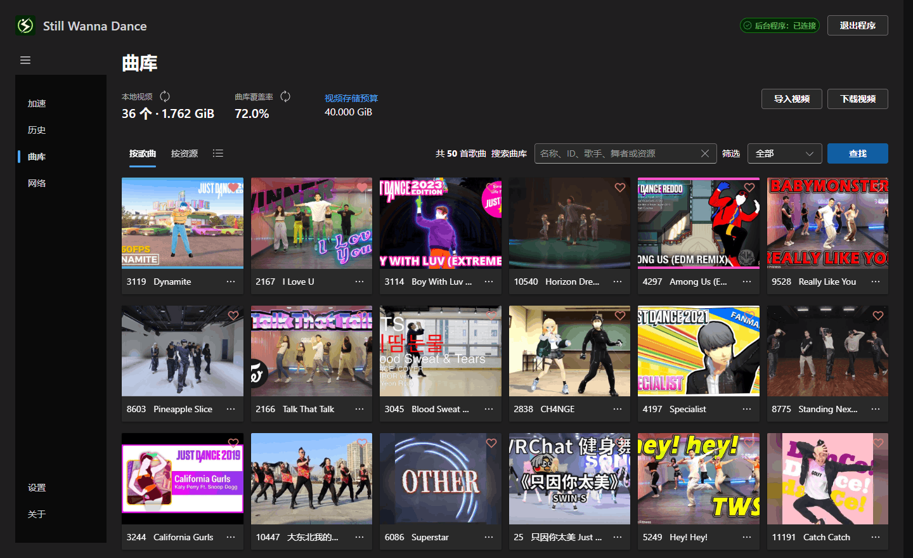
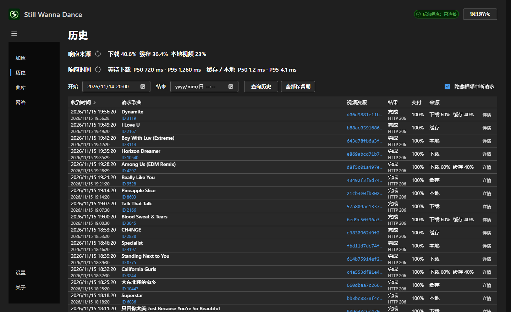

  

<h1 align="center">Still Wanna Dance</h1>

<strong>Load failed? But I still wanna dance!</strong>

Get the next video ready for WannaDance in VRChat on Windows.

  
  
  
  
  
  

  <a href="README.md">简体中文</a> · <strong>English</strong> 
  <a href="https://github.com/SW26010/still-wanna-dance/releases"><strong>Download</strong></a> ·
  <a href="#quick-start">Quick start</a> ·
  <a href="docs/console.md">User guide</a> ·
  <a href="https://github.com/SW26010/still-wanna-dance/issues">Report an issue</a>

Still Wanna Dance (SWD) is an open-source video playback companion: **prepare the room queue ahead of time and reuse local files on repeat plays** to reduce downloading and waiting. Manage it in your browser while the app runs in the Windows system tray.

A **[global block scheduler driven by playback timing](docs/block-scheduler-design.md)** prepares the data needed soonest and shares downloads between playback and preloading. Connection measurements guide path selection, while song demand guides local video retention. The app combines a **Go** backend, a **React + Fluent UI v9** WebUI, and embedded **Mihomo** proxy support.

## What you can do

- **Prepare videos ahead of time**: preload the room queue and stream while downloading.
- **Manage your library**: search, preview, favorite, or block songs; import existing videos and download missing ones.
- **Plan your storage**: prioritize frequent picks within a budget, retain favorites, and import preferences from VRCX history.
- **See and control downloads**: check speed, progress, and request history; choose direct connections, external SOCKS5, or embedded Mihomo nodes and inspect their connection status.

## A look inside

**Acceleration: connection status, download progress, and upcoming video demands.**

More screenshots: library and history

**Library: browse song covers, search, manage favorites, preview videos, and manage local files.**

**History: look up playback requests, delivery results, response sources, and time to first video data.**

These screenshots show the current WebUI with public song metadata and available covers for top-ranked songs in the bundled default scores. Missing covers use the app's bundled category artwork. Speeds, progress, requests and statistics, favorites, and local availability are sample data, not benchmark results. The interface supports light, dark, and system themes. Screenshots and detailed guides are currently in Chinese.

## Quick start

1. **Download and run.** Get the Windows x64 portable ZIP from [Releases](https://github.com/SW26010/still-wanna-dance/releases), extract the whole package to a writable folder, and run `SWD.exe`.
2. **Read and accept the terms.** The app opens the WebUI by default and prepares your configuration, database, and video folders automatically.
3. **Start acceleration.** Click `加速 → 开始加速`, complete Windows authorization when prompted, then enter WannaDance and request a song. Check connection and download status in the WebUI.

**Why does it need administrator permission?** SWD modifies the Windows hosts file to route WannaDance playback requests through your PC. By default, stopping acceleration or exiting normally restores the routing SWD configured; restoration failures are reported. See [game routing and restoration](docs/console.md#hosts).

**Want to keep videos for next time?** By default, SWD uses temporary blocks without retaining ordinary complete videos. You can choose a storage budget or unlimited retention under Settings → Storage (`设置 → 存储`), save, and restart when prompted. You can try acceleration with the defaults first.

Closing the browser leaves acceleration and queue preloading running. Reopen the WebUI from the tray, or choose `退出程序` to exit. If you disabled automatic routing restoration, enable and save it again before disabling or uninstalling SWD, then exit normally and check the result. See the [user guide](docs/console.md#hosts) for the setting.

## Common questions

**Does it accelerate all playback?** SWD currently targets WannaDance's in-game HTTP playback. SHA is not supported. HTTPS playback remains encrypted pass-through and does not use local videos or block caching. See [supported scope](docs/scope.md) for compatibility details.

**Can I play completely offline?** If a song mapping and usable local file already exist, SWD can serve the video locally. This is not a complete offline mode; missing videos and other game functions may still need the network.

**How can I confirm the game is using SWD?** Start acceleration, request a song in the game, and look for its playback requests in Video Demands or History. Backend connection status means the WebUI can reach SWD; game connection status means routing is configured. If no request arrives, try rejoining the world or restarting VRChat to refresh DNS. If requests arrive but downloading is slow, check the upstream connection on the Network page.

**Is the video budget a hard disk limit?** No. It governs retention of complete videos, including favorites. When priority retention is enabled, favorites are kept first within the same budget but can still be removed when space is insufficient. Temporary blocks, the database, and videos in use can take disk usage above that budget. “Do not retain” still permits temporary disk writes.

**How much space should I allocate?** Choose a budget that fits your disk. Once retention is enabled, frequently requested songs will build up over time. The [historical storage study](docs/research/cache-priority.md) explores capacity and coverage; its coverage figures are not measured playback speedups.

[Game validation records](docs/live-acceptance-backlog.md) cover cold and local playback, queue handoffs, multiplayer synchronization, and routing restoration on exit. SWD reduces waiting through preloading and local reuse. Downloading new videos depends on available network bandwidth and upstream delivery; decoding and in-game playback controls belong to the player.

## Help and contribute

- [User guide](docs/console.md) · [Queue preloading](docs/queue-prefetch.md) · [Upgrades and backups](docs/packaging.md#覆盖升级与备份)
- [Report an issue or suggest a feature](https://github.com/SW26010/still-wanna-dance/issues): include the app version, Windows version, steps, and expected versus actual behavior. Download a diagnostic ZIP under About → Help → Report an issue (`关于 → 使用帮助 → 反馈问题 → 下载诊断包`); it includes request history and SWD/VRChat logs for the selected period. Check the contents for private paths, player and room information, links, and credentials before sharing; the ZIP is not automatically redacted.
- [All documentation](docs/README.md)

Code, documentation, and user feedback are welcome. For source builds, tests, and packaging, see the [development guide](docs/development.md) and [packaging guide](docs/packaging.md).

## License

Current distributions use [GNU GPLv3](LICENSE); new project contributions use `GPL-3.0-only`. [Historical MIT grants](LICENSE-MIT) remain valid. See [LICENSING.md](LICENSING.md) and [third-party notices](THIRD-PARTY-NOTICES.txt). Formal releases include corresponding source in the same Release; ordinary use does not require downloading it.

The software license does not grant rights to third-party video or music. Use content only with the necessary authorization or another lawful basis, and read the [terms and content rights notice](internal/legal/TERMS.txt). This repository contains no videos or complete game logs.
