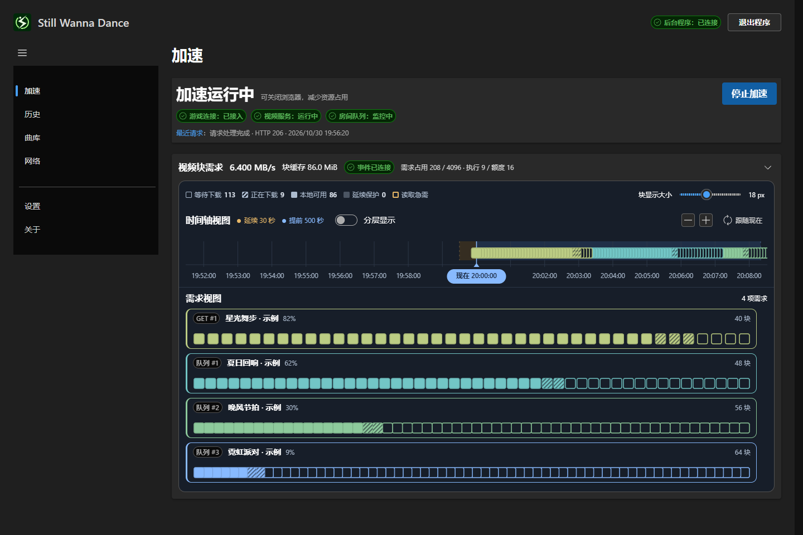
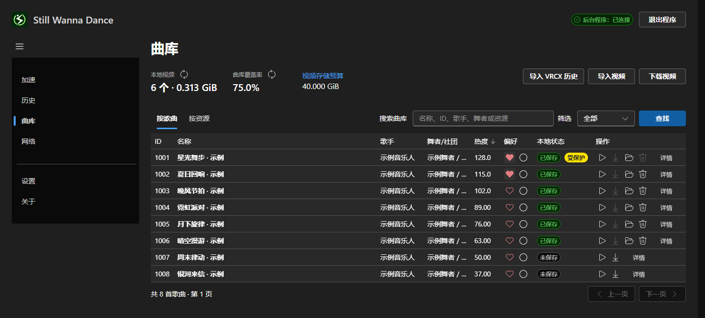
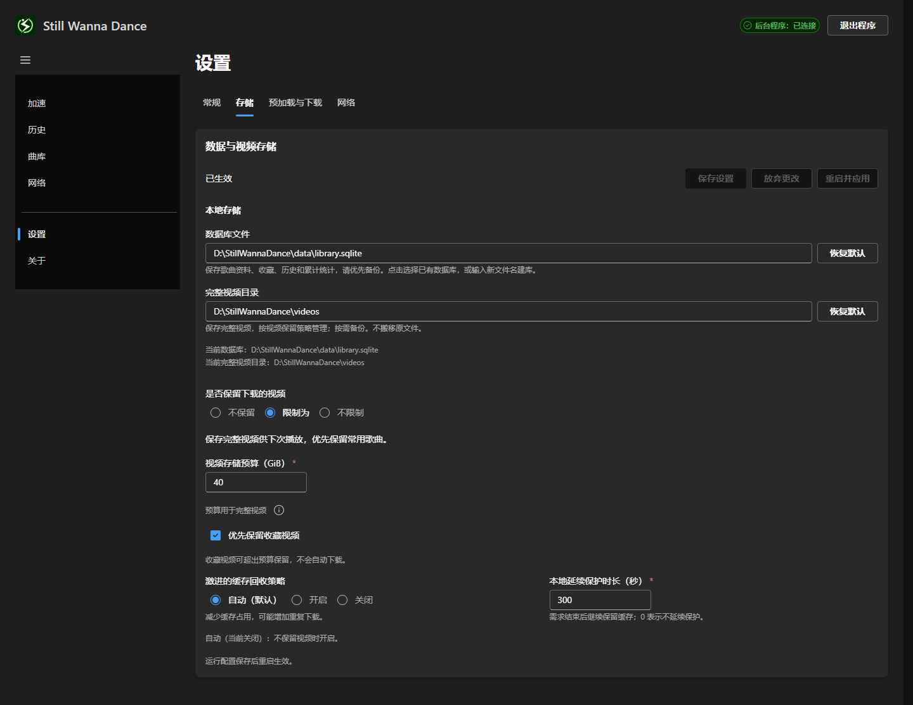

  

<h1 align="center">Still Wanna Dance</h1>

<strong>Load failed? But I still wanna dance!</strong>

为 Windows 上的 VRChat WannaDance 玩家准备好下一首视频。

  
  
  
  
  
  

  <strong>简体中文</strong> · <a href="README.en.md">English</a> 
  <a href="https://github.com/SW26010/still-wanna-dance/releases"><strong>下载程序</strong></a> ·
  <a href="#快速开始">快速开始</a> ·
  <a href="docs/console.md">使用指南</a> ·
  <a href="https://github.com/SW26010/still-wanna-dance/issues">反馈问题</a>

Still Wanna Dance（SWD）是一款开源视频播放辅助工具：**提前准备房间队列里的视频，重复播放时复用本地文件**，减少下载与等待。日常操作在浏览器中完成，程序在 Windows 托盘运行。

采用**[按播放时间驱动的全局块调度](docs/block-scheduler-design.md)**，优先准备即将需要的数据，让播放与预加载共享下载。结合通道测量选择连接，并按歌曲需求热度管理本地视频。后端使用 **Go**，WebUI 基于 **React + Fluent UI v9**，同时集成 **Mihomo** 代理能力。

## 它能帮你做什么

- **提前准备视频**：跟随房间队列预加载，首次下载支持边下边播。
- **管理自己的曲库**：搜索、预览、收藏或屏蔽歌曲，导入已有视频，下载缺失视频。
- **安排存储空间**：按预算优先保留常用歌曲；支持收藏保留与 VRCX 历史偏好导入。
- **掌握下载情况**：查看速度、进度和请求历史；选择直连、外部 SOCKS5 或内嵌 Mihomo 节点，并检查连接状态。

## 界面预览

**加速：一眼查看游戏接入、下载进度和接下来要准备的视频。**

更多界面：曲库与存储设置

**曲库：搜索歌曲，管理收藏、视频预览和本地文件。**

**存储设置：视频目录、空间预算与收藏保留。**

截图为当前 WebUI，歌曲、速度和进度使用示例数据，不代表性能测试结果。界面支持浅色、暗色及跟随系统主题。

## 快速开始

1. **下载并运行。** 从[发布页面](https://github.com/SW26010/still-wanna-dance/releases)下载 Windows x64 portable ZIP，完整解压到可写目录，双击 `SWD.exe`。
2. **阅读并同意使用条款。** 程序默认打开 WebUI，并自动准备配置、数据库和视频目录。
3. **开始加速。** 点击「加速 → 开始加速」，按提示完成 Windows 授权；进入 WannaDance 并请求一首歌曲，在页面查看接入和下载状态。

**为什么需要管理员授权？** 程序会修改 Windows 的 hosts，将 WannaDance 播放请求接入本机。默认在正常停止加速或退出时恢复本程序设置的接入；恢复失败会提示。详见[游戏接入与恢复](docs/console.md#hosts)。

**想把视频留到下次？** 默认使用临时视频块、不保留普通完整视频。可在「设置 → 存储」选择保留预算或「不限制」，保存后按提示重启应用；不设置也能先体验加速。

关闭浏览器后，加速和队列预加载仍在后台运行。可以从托盘重新打开 WebUI，结束使用时点击「退出程序」。如果曾关闭自动恢复直连，请在停用或卸载前重新开启并保存，再正常退出、确认恢复结果；位置见[使用指南](docs/console.md#hosts)。

## 常见问题

**所有播放都能加速吗？** 目前面向 WannaDance 的游戏 HTTP 播放，暂不支持 SHA。HTTPS 播放保持加密透传，不使用本地视频或视频块缓存。具体兼容情况见[支持范围](docs/scope.md)。

**有本地视频就能完全离线吗？** 已有歌曲映射且本地文件可用时，可以直接读取，减少对上游的依赖；这不是完整离线模式，缺失视频和其他游戏功能仍可能需要网络。

**为什么显示已连接，游戏还是没播放？** 「后台程序：已连接」表示网页能访问 SWD，「游戏连接：已接入」表示接入配置已就绪，都不代表游戏已经成功播放。接入后没有收到请求时，可尝试重进世界或重启游戏刷新 DNS，并在「网络」检查状态。

**视频预算是磁盘占用的硬上限吗？** 不是。它用于管理完整视频的保留空间；临时块、数据库、正在使用的视频，以及启用保留的收藏，都可能使实际占用超过预算。默认「不保留」也会临时写盘。

**应该给视频留多少空间？** 按可用磁盘空间设置即可。开启视频保留后，常用歌曲会逐渐积累；空间与覆盖率的关系见[历史回测](docs/research/cache-priority.md)，回测覆盖率不等于实际加速比例。

已有冷／热播放、队列交接、多人同步和退出恢复等实机验证记录，具体构建、结果与限制见[验证记录](docs/live-acceptance-backlog.md)。实际效果仍取决于上游、本机网络和播放器。

## 帮助与参与

- [使用指南](docs/console.md) · [队列预加载](docs/queue-prefetch.md) · [升级与备份](docs/packaging.md#覆盖升级与备份)
- [提交问题或建议](https://github.com/SW26010/still-wanna-dance/issues)：请附程序版本、Windows 版本、操作步骤和预期／实际结果；分享日志前移除私人路径、凭据等信息。
- [完整文档](docs/README.md)

欢迎贡献代码、文档和使用反馈。从源码构建、运行测试或打包，请阅读[开发指南](docs/development.md)与[打包说明](docs/packaging.md)。

## 开源许可

当前发行版采用 [GNU GPLv3](LICENSE)，自有新贡献使用 `GPL-3.0-only`；[历史 MIT 授权](LICENSE-MIT)仍有效。完整授权说明见[LICENSING.md](LICENSING.md)，第三方依赖见[相关声明](THIRD-PARTY-NOTICES.txt)。正式版对应源码随同一 Release 提供，普通使用无需下载源码。

软件许可不包含视频、音乐等第三方内容的授权。请在具有必要授权或其他合法依据时使用相关内容，并阅读[使用条款与内容权利声明](internal/legal/TERMS.txt)。仓库不包含视频或完整游戏日志。
