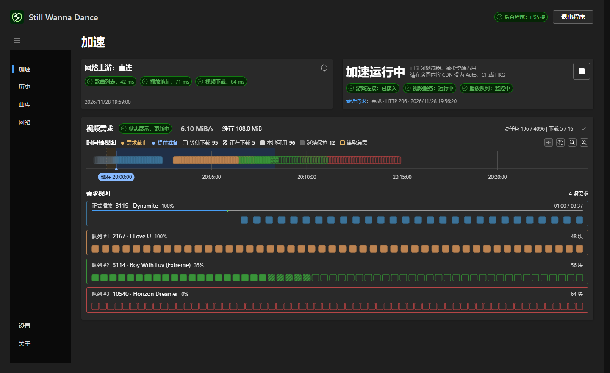
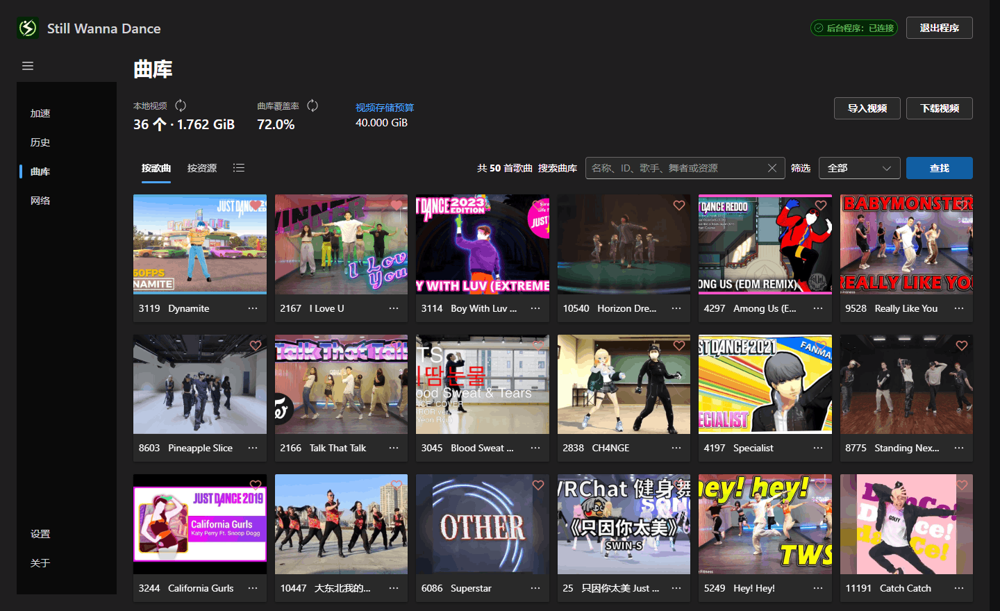
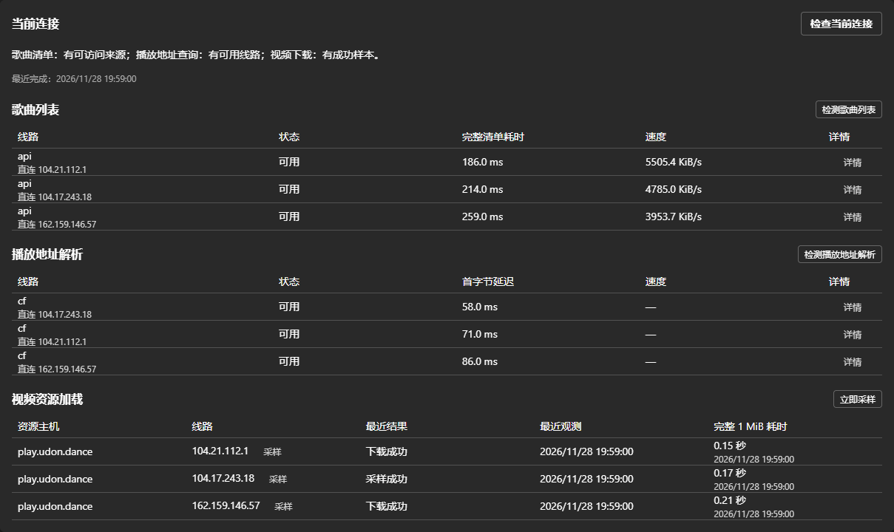

  

<h1 align="center">Still Wanna Dance</h1>

<strong>Load failed? But I still wanna dance!</strong>

为 Windows 上的 VRChat WannaDance 玩家准备好下一首视频。

  
  
  
  
  
  

  <strong>简体中文</strong> · <a href="README.en.md">English</a> 
  <a href="https://github.com/SW26010/still-wanna-dance/releases"><strong>下载程序</strong></a> ·
  <a href="#快速开始">快速开始</a> ·
  <a href="docs/console.md">使用指南</a> ·
  <a href="https://github.com/SW26010/still-wanna-dance/issues">反馈问题</a>

Still Wanna Dance（SWD）是面向 VRChat WannaDance 的视频加速与管理工具，提前准备播放内容，减少重复下载与播放等待。

采用**[按播放时间驱动的全局块调度](docs/block-scheduler-design.md)**架构，将播放、预加载与手动下载统一为块级需求，以预计使用时间驱动下载优先级与启动窗口，按需调节全局并发，并在多个请求间共享下载任务。

后端使用 **Go**，WebUI 基于 **React + Fluent UI v9**，同时集成 **Mihomo** 代理能力。

## 核心功能

- **全局调度**：根据播放需求动态调整下载优先级，优先保障紧急任务，避免预加载对当前播放的资源争用。
- **本地复用**：重复播放优先读取本地视频，按存储预算优先保留常用歌曲，减少重复下载与带宽消耗。
- **曲库管理**：集中管理本地视频与歌曲收藏、屏蔽，结合请求历史与响应统计掌握实际使用情况。
- **灵活连接**：默认采用 CF IP 动态优选加多路并发，可满足绝大部分场景。也可切换到内置的 Mihomo（Clash）或外部 SOCKS5 服务。
- **轻量界面**：通过 WebUI 完成日常管理，关闭浏览器即可释放界面资源，后台加速与预加载持续运行。

## 界面预览

**加速：一眼查看游戏接入、下载进度和接下来要准备的视频。**

更多界面：曲库与网络

**曲库：通过封面浏览和搜索歌曲，管理收藏、视频预览和本地文件。**

**网络：在「当前连接」查看歌曲列表、播放地址解析和视频资源加载的各条直连线路。**

截图为当前 WebUI，采用内置默认分数靠前歌曲的公开资料与可用封面，缺图时使用程序内置类别封面。网络图中的 IP 选自内置 CF IP 列表。截图中的耗时、速度、下载进度、收藏和本地保存状态均使用示例数据。界面支持浅色、暗色及跟随系统主题。

## 快速开始

1. **下载并运行。** 从[发布页面](https://github.com/SW26010/still-wanna-dance/releases)下载 Windows x64 portable ZIP，完整解压到可写目录，双击 `SWD.exe`。
2. **阅读并同意使用条款。** 程序默认打开 WebUI，并自动准备配置、数据库和视频目录。
3. **开始加速并点歌。** 在「加速」页点击「开始加速」，按提示完成 Windows 授权。进入 WannaDance，在房间设置中将 CDN 选为 **Auto、CF 或 HKG**，然后点一首歌。

**为什么需要管理员授权？** 程序会修改 Windows 的 hosts，将 WannaDance 播放请求接入本机。默认在正常停止加速或退出时恢复本程序设置的接入；恢复失败会提示。详见[游戏接入与恢复](docs/console.md#hosts)。

**想把视频留到下次？** 默认使用临时视频块、不保留普通完整视频。可在「设置 → 存储」选择保留预算或「不限制」，保存后按提示重启应用；不设置也能先体验加速。

关闭浏览器后，加速和队列预加载仍在后台运行。可以从托盘重新打开 WebUI，结束使用时点击「退出程序」。

**停用或卸载前如何恢复直连？** 到「关于 → 使用帮助 → 备份与升级」点击「恢复游戏直连」。这会停止加速，即使此前关闭了自动恢复也能使用。看到恢复成功或无需恢复的提示后，再退出程序。[游戏接入与恢复](docs/console.md#hosts)

## 常见问题

**游戏里选哪个 CDN？** 在 WannaDance 房间里选 **Auto、CF 或 HKG**，SWD 就能为游戏的 HTTP 播放提前下载并复用视频。SHA 暂不支持。HTTPS 播放走加密透传，由原站提供视频。具体兼容情况见[支持范围](docs/scope.md)。

**哪些视频可以直接从本机播放？** SWD 已识别歌曲与文件的对应关系，且本地视频可用时，点歌就能直接读取。缺少的视频需要联网下载，其他游戏功能按各自的联网要求运行。

**如何确认游戏正在使用 SWD？** 在游戏里点歌后，点击「加速」页的「最近请求」进入历史，核对刚才点歌的时间和歌曲。「视频需求」也会显示提前准备的队列歌曲，可在这里看预加载进度。「后台程序：已连接」表示网页能访问 SWD，「游戏连接：已接入」表示接入配置就绪。若没有新请求，先检查房间 CDN 是否选了 Auto、CF 或 HKG，再尝试重进世界或重启游戏。若已有请求但下载慢，可到「网络」页测速。

**视频预算管哪些文件？** 预算用于管理保留的完整视频。临时块和数据库另占空间，正在使用的视频会受到保护，实际磁盘占用可能暂时超过预算。默认「不保留」使用临时块支持边下边播。

**应该给视频留多少空间？** 按可用磁盘空间设置即可。开启视频保留后，SWD 会优先留下常点歌曲的视频，方便下次直接从本机播放。在一份历史点歌样本中，按 60 天半衰期评分，20 GiB 的预算平均能覆盖每天约 51% 的不同歌曲，50 GiB 约为 68%。[查看不同预算的回测结果](docs/research/cache-priority.md)

在一次 1 Mbps 限速的实机测试中，下一首歌还在预加载时，正式播放器接手了同一下载任务，玩家正常切歌并继续播放。冷启动、本地命中、多人同步和退出恢复也都有逐项记录。[慢网切歌实测](docs/acceptance/live-acceptance-20261028-01.md) · [实机验证汇总](docs/live-acceptance-backlog.md)

## 帮助与参与

- [使用指南](docs/console.md) · [队列预加载](docs/queue-prefetch.md) · [升级与备份](docs/packaging.md#覆盖升级与备份)
- [提交问题或建议](https://github.com/SW26010/still-wanna-dance/issues)：请附程序版本、Windows 版本、操作步骤和预期／实际结果。可在「关于 → 使用帮助 → 反馈问题」点击「下载诊断包」，收集所选时间段的请求历史及 SWD／VRChat 日志；诊断包不会自动脱敏，分享前请检查私人路径、玩家与房间信息、链接及凭据等内容。
- [完整文档](docs/README.md)

欢迎贡献代码、文档和使用反馈。从源码构建、运行测试或打包，请阅读[开发指南](docs/development.md)与[打包说明](docs/packaging.md)。

## 开源许可

当前发行版采用 [GNU GPLv3](LICENSE)，自有新贡献使用 `GPL-3.0-only`；[历史 MIT 授权](LICENSE-MIT)仍有效。完整授权说明见[LICENSING.md](LICENSING.md)，第三方依赖见[相关声明](THIRD-PARTY-NOTICES.txt)。正式版对应源码随同一 Release 提供，普通使用无需下载源码。

软件许可不包含视频、音乐等第三方内容的授权。请在具有必要授权或其他合法依据时使用相关内容，并阅读[使用条款与内容权利声明](internal/legal/TERMS.txt)。仓库不包含视频或完整游戏日志。
