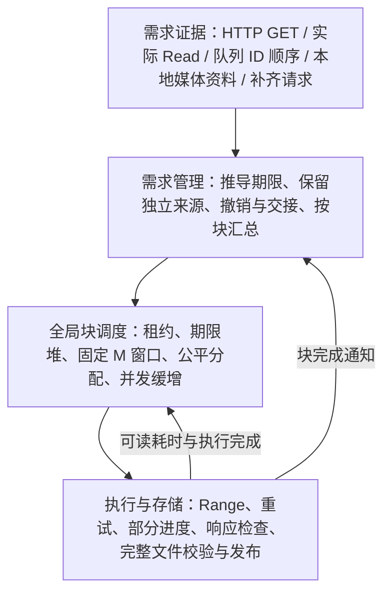

# 以期望完成时间驱动的全局块调度

> 本页说明当前已实现的块调度架构。下载需求与资源管理的后续目标和待决问题，统一维护在 canonical 文档[下载需求与资源管理设计](download-resource-design.md)；其中已确认的目标不表示本页对应实现已改变。下载窗口已实现固定 M；后续新增 `need-by + 30 秒` 的下载延续截止，并且不保留块下载暂停／恢复；下载延续截止和暂停恢复尚待迁移，下文分别说明当前行为。

**本次重构的核心设计，是把播放、预读、队列和补齐统一表达为对内容块的独立需求，再用“何时需要这块数据”驱动全局下载。** 视频语义留在需求管理层；调度核心只处理内容块、期望完成时间、需求有效期、真实读取阻塞和执行额度。

这使三个问题各有明确的答案：`ReadyBy` 决定先准备哪些块；固定提前量 `M` 决定何时允许启动；可启动积压驱动并发逐路增长，包括已入窗任务与允许提前执行的独立补齐需求。并发量由运行中的需求形成，无需预先反推一个目标并发数。同一块无论被多少来源需要，都共享一次执行，各来源仍能独立退出。

本文说明当前设计及其理由；具体参数、协议和资源边界见[下载并发规则](download-concurrency.md)，逐次实现与自动检查见[开发记录](block-scheduler-validation.md)。

## 为什么从整视频调度改成块需求

重构前已经具备 1 MiB Range 分块和共享下载，但调度同时受整视频 P0～P4、视频任务席位、每视频固定 worker 和全局 HTTP 额度约束。一段真实读取与同一视频中很晚才用到的数据容易继承同一个视频等级；跨层限额也使块在到达全局竞争之前就被挡住。

设计目标有三项：减少同时发起大量连接带来的 CPU 启动尖峰，在单路受限时利用多路下载供给数据，并把下载能力用在即将需要的块上。对应的机制是全局缓增、共享执行额度和块完成期限；实际收益须由新版本的对照验收确认。

| 问题 | 重构前的组织方式 | 当前设计 |
| --- | --- | --- |
| 先下载什么 | 按整个视频分级，再在视频内部选择块 | 所有来源转成块需求；普通块比较最早期望完成时间，实际读取缺块单独标记 Blocking |
| 共享与撤销 | 围绕共享视频任务安排席位、优先级和重连宽限 | 保留每份来源需求，按块汇总；撤销一份不会抹掉其他需求，交接也有独立租约 |
| 何时增加并发 | 视频席位、每视频 3+1 worker、总请求 6/后台 4 的多层约束 | 一个全局块调度器控制网络执行；普通额度从 1 路按需缓增至 16 路，Blocking 可立即超限 |
| 如何提前准备 | 视频等级和近端读取窗口表达紧迫程度 | 从自己的 HTTP 请求、媒体大小和时长推导绝对 ReadyBy，再用固定 M 窗口准入 |

这次变化的重点是**需求、时间和执行的统一建模**。既有的分块传输、文件一致性、缓存校验和发布继续由资源层负责。

## 四层职责



需求管理层认识 GET、队首、普通队列、补齐和交接，负责将来源语义转换成通用属性。调度器不识别歌曲、视频等级或“继任者”；同等紧急的任务通过不透明 `Owner` 公平分配。资源层提供兼容的内容身份和执行器，继续管理实体版本、选路、临时文件、强 ETag 及最终 MD5 校验。

产品以 MD5、大小和块号标识内容块，并由资源会话约束实体及选路一致性。URL 本身不作为共享身份。文件级生命周期仍然存在，网络执行额度统一交给块调度器；`MaxLocalValidations` 只限制本地文件校验，并非网络并发数，CLI 继续使用 `-max-downloads`。

## 三个独立问题：何时需要、是否仍需要、是否正在等

| 属性 | 回答的问题 | 不能混用的语义 |
| --- | --- | --- |
| `ReadyBy` | 希望这个块最晚何时完整可读？ | 期限已过仍可能急需，不能据此取消任务，也不是下载超时 |
| `LeaseUntil` | 这份需求有效到何时？ | 决定需求存亡，不代表缓存文件保留期，也不延长执行超时 |
| `Blocking` | 这一刻是否确实有 Read 等待这个缺块？ | GET 到达、整部视频、固定开头窗口及预读均不能自动获得此标记 |
| `Opportunistic` | 是否另有有效的无期限普通需求，允许提前使用空额度？ | 只绕过启动窗口，不绕过普通额度和缓增，不等于 Blocking |

独立需求有可更新、可关闭的身份，核心以句柄管理。主动撤销是正常路径，租约到期负责兜底；关闭或过期后的旧更新不能复活需求。续期必须依据来源仍然有效，不能因为下载还在进行就给自己续命。无有效需求时停止执行，任务元数据最多保留 30 秒供重接；临时进度是否保留由另一套有界存储策略决定。

例如块 K 同时被 A 的实际读取、B 的预读和补齐需要：A 退出只撤销 A 的贡献，B 的 ReadyBy 和补齐的提前准入仍有效；B 再退出，补齐可继续使用普通额度。K 始终只有一个共享任务。已经执行的块在仍有有效需求时自然完成，优先级变化不触发抢占。

合并时先排除失效来源，再处理覆盖关系：**同块有有效 GET 时，交接不参与调度属性竞争；独立队首和普通队列仍照常参与。** 然后汇总实际 Blocking、最早有限 ReadyBy 及独立的 Opportunistic 权限。任何有效来源都能维持任务存活，各份租约分别到期；交给核心的最晚 LeaseUntil 只是摘要的最终有效期，不能让已经到期的紧迫属性继续生效。

## 交接表达有限需求，不识别继任关系

交接由需求管理层在来源退出时计算一次，再与其他来源一起汇总。每块在同一次摘要更新中撤销旧贡献并加入交接，避免中间出现“无人需要”而误取消执行：

| 来源事件 | 下载需求处理 |
| --- | --- |
| GET 取消或关闭 | 交接最多保留 2 秒；`ReadyBy = 原 ReadyBy + 2 秒` |
| 队首从队列消失 | 交接最多保留 20 秒；`ReadyBy = 原 ReadyBy + 5 秒` |
| 普通队列项删除 | 直接撤销该来源 |
| 队首与普通项互换 | 原地更新来源与期限，不生成交接 |
| 读取推进 / Seek、块完成、引擎关闭 | 不生成交接 |

交接清除 Blocking 和提前准入权限，租约固定为来源退出时刻加宽限；通知处理延迟、重复关闭及无关更新都不能延长它。交接不再生成交接，原始来源仅记录在转换日志，运行时只保留算好的通用属性。

新 GET 直接登记自己的需求并复用相同块，不必判定它是不是旧请求的继任者。新需求可以只接上部分块；其他块按各自租约结束。新队列需求也能共享下载，但不会继承旧 GET 的紧迫性或续长旧交接。本地保护按有限使用需求的独立提前窗口生效，最后一份块需求结束后延续 60 秒；已移除队列专属 30 秒文件保护。

交接已按完整使用范围维护，包含已下载未消费块；有效期按真实退出时刻冻结，need-by 只在原值上平移。来源集合输出不含来源身份的 blockUse 摘要，下载协调器不再持有来源贡献或交接数组，本地保护复用同一整合投影。具体规则以[下载需求与资源管理设计](download-resource-design.md#常规播放交接与同块需求重新接入)为准；块文件存储与下载停止语义继续后续迁移。

## 用自身数据推导播放与队列期限

VRC 队列日志只提供歌曲 ID 的顺序和变化；标题、时长和媒体大小来自本地资料。大小 `S` 优先取同一 MD5 的 `media.byte_size`，来源是已验证资源 URL 的 `s`；新 URL 尚未入库时可直接使用其已验证大小。时长 `D` 取匹配资源的歌曲清单 `end`，作为完整媒体时长近似，不减 `start`。该选择的样本依据见[视频元数据研究](research/video-metadata-20261015.md)。

地址解析成功即可将 URL 观察与对应资源大小一起保存，无需等待视频正文下载，也不覆盖清单已有的歌曲映射。这样尚未缓存的视频也能利用已知大小细化期限；解析失败、旧结果及事务边界见[资源元数据验证](song-url-metadata-validation.md)。

设 `t₀` 是 GET 刚到达的时刻，`a` 是按实际响应语义解释的 Range 起始字节，`b` 是块起点，均在媒体范围内：

```text
平均总码率 R       = 8 × S / D
估计播放位置       = D × a / S
GET 块 ReadyBy(b)  = t₀ + max(0, D × (b − a) / S)
预计媒体结束 E     = t₀ + D × (1 − a / S)

队首开始 Q₁        = min(所有当前有效 GET 播放时钟的 E)
第 j 首开始 Qⱼ     = Q₁ + 前面各首预计时长之和
队列块 ReadyBy(b)  = Qⱼ + Dⱼ × b / Sⱼ
```

上述 GET 期限只用于与实际请求字节区间相交的块。起点位于块内时，该相交块的负偏移截为 0；起点之前的整块和结束位置之后的整块不产生该 GET 的需求，完整补齐必须有独立来源。`ReadyBy` 表达需要数据的时刻，提前策略统一放在后面的 `M`，不在这里再减一次提前量。读取推进和下载进度不重置 `t₀`；有限 Range 的结束字节限制下载需求，但不当成整部媒体的播放终点。无 Range 对应整文件，合法单 Range 支持后缀形式；If-Range 不匹配而返回整文件时，需求范围和估算起点一并恢复为整文件。HEAD、无效和多段 Range 不提供播放时钟。

没有 GET 依据时，以首次队列到达时刻建立基准。最后一个 GET 传输结束后保留最后算出的队列起点，因为传完不等于播完；不保留历史 GET 集合，也不为此延长下载需求。后来的有效 GET 可以重建基准，重复队列快照不将其不断顺延；重排及元数据变化重算受影响的期限，移除后迟到的地址解析不能复活旧成员。

缺失值使用一致的补全规则：大小和时长都有时直接计算；只缺一项时按 2 Mbps 推导缺项；两者都缺时使用 45 MiB、210 秒，派生码率约 1.8 Mbps。未知队列占位仍计入典型时长。估计值只用于调度，不写回媒体事实，不用于 HTTP 长度、Range 边界或完整性检查。

这是一种播放时间近似。当前直接取所有有效 GET 时钟的最早结束值，没有按连续正文行为筛掉尾部索引或探测请求；这些请求可能让队列提前准备。变码率、预读、Seek、暂停和播放器缓冲也会造成偏差，不能声称所有估计都必然早于实际需要。真实 Read 缺块由 Blocking 兜底，效果与代价仍需观测。

## 用固定 M 窗口决定启动

`M` 是完整下载提前量：普通有限期限块在 `ReadyBy ≤ now + M` 时入窗，入窗时刻为 `ReadyBy - M`。等号可启动，仍需执行额度；未入窗候选等待堆首定时事件。已经执行的块不重复申请额度。所有块共用 M，期限排序不变，不保存逐块预计启动时间。

默认 M 为 500 秒，控制台「提前准备时间 M（秒）」及引擎配置范围为 120～86400 秒，0 使用默认值，保存并重启后生效。约 67 秒是 1 MiB 块在 0.125 Mbps 下的纯传输基准，120 秒下限不保证慢网或排队下及时完成。旧的小值直接拒绝，不作迁移。

动态耗时估算 T、衰减状态及 start_urgent 诊断已删除。成功标准块仍报告实际准入至可读耗时，供测速完成块计数和日志使用；该观测不影响启动窗口、排序或额度。尾块、部分续传、失败执行及顺序 200 不混入标准块观测。清理仍占用 active，直到执行退出。

例如视频大小 50 MiB、时长 1000 秒，GET 在 t₀ 从 10 MiB 开始，20 MiB 处的块 ReadyBy 为 t₀ + 200 秒。M=120 秒时，该块在 t₀ + 80 秒入窗。实际缺块读取可独立贡献 Blocking，无期限补齐仍可使用空余普通额度；两者不改变播放时钟。

## 并发由可启动积压驱动

“可启动积压”包括已入窗的有限期限任务，以及具有有效独立补齐需求、允许提前执行的任务；两者都可能因普通额度已满而等待，也都能驱动缓增。

普通开放额度 `open` 从 1 开始。调度器先按期限立即复用已有空额度，只有存在可启动积压、且 `active ≥ open` 时，才每 250 ms 最多新增一路，普通软上限为 16。无可启动积压即停止增长；执行和可启动工作都清空后回到 1。连续替补不会每块重新等待 250 ms。

已接入资源在确认 Range 支持及实体身份后，展开各有效来源所覆盖的全部未完成块：GET 按请求区间，队列和独立补齐按整文件。没有每视频固定候选数或独立并发额度，单视频在需求入窗且持续积压时也能逐步用满 16 路。首次响应头前只调度一个初始化块，冷 Range 从请求区间内的块开始；并发接入的读者共用当前初始化请求，确认实体后各自恢复区间边界。上游返回顺序 200 时仍只执行一次整文件回退。

固定“当前块及后面两块”的读取窗口已删除，普通 GET 需求统一表达预先准备，实际 Read 等待只给当前块贡献 Blocking，多读者独立撤销。已下载区间仍有 GET 读者消费时保留资源会话，不生成区间外补齐任务；最后一个来源退出后沿原交接、暂停检查点和回收规则处理。只有完整文件校验成功才发布正式缓存。任务容量沿用全局保护，超容量推迟注册并等待容量变化，Blocking 可回收尚未执行的普通候选容量，不通过隐藏候选改变排序。

两种窗口例外必须分别理解：

- **Blocking**：实际缺块等待立即执行，绕过窗口、缓增和 16 路软上限；仍计入总 active，受任务/资源容量约束，同块继续去重。
- **Opportunistic**：无期限补齐可在有限期限堆首尚未入窗时使用普通额度；同块兼有有限期限和补齐时保留两种准入依据，但只有一次执行。已入窗的有限期限候选优先，补齐撤销只撤掉自身提前权限。

所有执行直到正文关闭与收尾结束才从 active 扣除。普通准入仍要求 `active < open`，因此 open=4、4 路普通加 2 路 Blocking 时，总 active=6；回落到 4 仍不补位，回落到 3 才能补一路。Blocking 出现、消失或普通期限临近都不取消仍有有效需求的在途请求。

此规则按多路能够增加有效供给的假设工作，不做总带宽整形。固定 M 不能保证任意数量的同期限块准时，实际总带宽不足时增加并发也未必增加吞吐。迟到须同时核对 ReadyBy 的依据、M、窗口内排队、并发准入及执行故障，不能只归因于 T 不够精确。

## 事件驱动与生命周期边界

核心一个事件循环持有任务和索引堆，等待需求变化、执行完成或最近的入窗/增路/租约/孤儿回收时刻。已入窗但满额度的任务等待完成或缓增事件，不把过去的入窗时间反复装成立即触发的定时器。没有每 500 ms 全任务汇总、排序和目标并发反推，也没有每块独立的轮询协程。

定位共享块、汇总该块的有限来源、调整相关索引即可响应变化。单个堆项调整为 O(log N)，检查堆首是否入窗为 O(1)；同 Owner 的公平性更新可能调整该组多个块，不能把整个事件处理夸大为恒定成本。网络、磁盘和正文关闭在执行器中完成，调度事件循环不等待这些操作。

事件驱动不等于系统没有定时工作：资源协调器仍每 10 秒确认来源并续 30 秒活跃租约；VRC 日志按[队列文档](queue-prefetch.md#日志检测与频率)增量读取。缓冲只在实际执行时取得，资源会话、全局任务/需求数量与暂停检查点均有限，具体上限见[运行规则](download-concurrency.md)。

调度等待不消耗网络尝试预算：实际 HTTP 请求的响应头及正文共用一次 DownloadTimeout，默认 10 分钟；重试候选各自重新计时，不按剩余候选数平分，不另加包含重试的整轮执行时限。顺序 200 使用同一本次尝试时限，本地校验/发布各自计时。更早的父级取消与任务截止仍然生效。ReadyBy 不充当取消截止时间。来源撤销、租约到期、调用方取消、执行失败和引擎关闭继续独立控制生命周期；跨重启不恢复部分下载。

## 实现依据与验证状态

2026-10-15 核对范围：远端 `origin/main` 为 `5c26d2cd7b4896e6bf5e1108ba89b07e2424163a`，本地实现为 `5f3614b0d989204c58c46a990752c0c49a80fe78`，其间 38 个提交。本文将讨论「全局调度器设计 (4)」（`01a13e93-907a-70a0-a5ee-a017d2026373`）的最终模型与现有代码对应，读者无需访问聊天记录即可理解约定。

| 设计约定 | 实现与回归入口 |
| --- | --- |
| 独立需求、共享任务、租约与公平分配 | [scheduler.go](../internal/blocksched/scheduler.go)、[scheduler_test.go](../internal/blocksched/scheduler_test.go)、[orphan_test.go](../internal/blocksched/orphan_test.go) |
| 来源过滤、有限交接、不识别继任者 | [block_demands.go](../internal/cacheproxy/block_demands.go)、[demand.go](../internal/cacheproxy/demand.go)、[block_demands_test.go](../internal/cacheproxy/block_demands_test.go) |
| GET / 队列绝对期限与缺失值规则 | [media_timing.go](../internal/cacheproxy/media_timing.go)、[playback_timing.go](../internal/cacheproxy/playback_timing.go)、[queue_timing.go](../internal/cacheproxy/queue_timing.go) 及同名 `_test.go` |
| 窗口、缓增、采样与准入例外 | [control.go](../internal/blocksched/control.go)、[duration.go](../internal/blocksched/duration.go)、[window_test.go](../internal/blocksched/window_test.go)、[opportunistic_test.go](../internal/blocksched/opportunistic_test.go) |
| 真实 Range、可读采样、超时及混合需求 | [scheduled_range.go](../internal/cacheproxy/scheduled_range.go)、[block_duration_test.go](../internal/cacheproxy/block_duration_test.go)、[execution_timeout_test.go](../internal/cacheproxy/execution_timeout_test.go)、[opportunistic_demand_test.go](../internal/cacheproxy/opportunistic_demand_test.go) |

早期实现中的“剩余字节→所需吞吐→目标并发”、两秒追赶、500 ms 采样、无收益回退、竞争暂停和恢复冷却均已被后续实现取代。[开发记录](block-scheduler-validation.md)保留这些过程及失败证据，不作为当前运行规则；参数以当前 3 秒 T 初值、30 秒 M 为准。

**开发实现已有自动回归记录；当前模型的实机效果仍待 LA-040，开播时间近似及交接观测联动 LA-041，地址解析补齐大小联动 LA-042。** 关联的 LA-008/018/037/038/039 继续保留。旧固定 worker 的吞吐/CPU 实验和历史游戏报告不能证明新模型已降低卡顿、CPU 峰值或在所有网络下提速。

本次文档核对不改变产品行为，不新增实机项，也不更改已有验收状态；下一轮操作与证据要求以[待验收台账](live-acceptance-backlog.md)为准。
