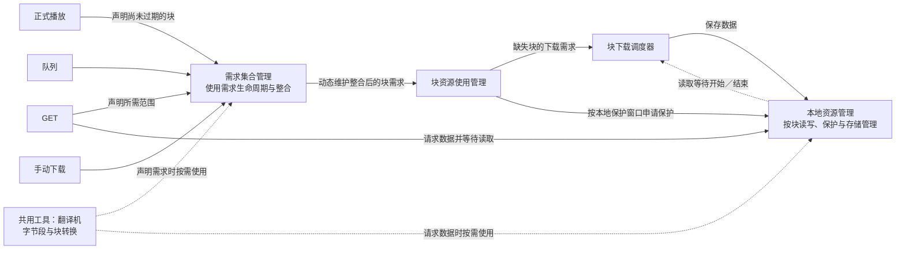

# 下载需求与资源管理设计

桌面程序的默认播放路径见[正式播放需求与 GET 入口](#正式播放需求与-get-入口)。

更新日期：2026-11-18。

本文是下载需求与资源管理的唯一权威设计文档（canonical）。第一部分维护现行规则及理由，第二部分记录实现接口、已落实的决策和验证边界。后续规则变化在这里更新，不另建并行的现行方案。

**2026-11-13 已落实：** need-by 与实际读取等待分离，块截止只结束受影响 GET 的来源；统一交接保留原 N、关闭普通启动资格，按创建事件确定范围及固定有效期。设计来源为 `d4152f81`，现行规则已迁入本页，验证及历史失败见[开发记录](validation/block-scheduler-validation.md)。同日已观察冷加载主动截止及重请求；[正式开播后专项](acceptance/live-acceptance-20261113-05.md)同时发现 owner 重试后时间轴回零，恢复原进度未通过。适用范围和待跟进事实见[验收台账](live-acceptance-backlog.md)，不外推为所有黑屏或同步问题已解决，也不据此直接更改截止契约。

**数据库 v9 地址模型：** 地址归属、写入、复用与失败处理以[媒体地址模型](song-catalog-design.md#媒体地址模型)为唯一依据。地址不存查询歌曲、时间或失败标记，下载与调度责任继续遵循本页。

本文承接 2026-10-18 的手绘记录及后续讨论；原始记录保留为历史材料，发生冲突时以本文为准。2026-10-19 已完成本轮代码实现及开发验证，按独立目的分阶段提交；真实 VRC 播放表现仍按第二部分积攒，不外推为实机通过。不考虑旧配置、旧临时数据的兼容或迁移。

现有代码的架构依据、运行参数和落盘契约分别见[当前全局块调度设计](block-scheduler-design.md)、[下载并发规则](download-concurrency.md)和[存储约定](storage.md)。这些文档说明对应实现细节；本文负责统一规则、职责边界及决策状态。实现变化时同步更新对应说明，不能仅修改本文就宣称行为已经改变。

**实现状态（2026-10-21）：歌曲屏蔽与收藏已接入歌曲入口准入、本地资源管理及 WebUI。** 核心需求集合、块资源使用管理和块下载调度器保持不变；行为及验证边界见第 8 项和[开发验证记录](validation/song-policy-validation.md)。

播放地址解析与监测固定使用 CF 入口，不提供选择或 HKG 回退；持久化地址只复用 CF 来源。该约束留在地址解析与选择边界，不向调度器传入上游分类或新增 Blocking 策略。CF 入口不保证返回地址的实际提供方；详见[统一回源选路](console.md#统一回源选路)和[资源域名规则](resource-domains.md)。进一步减负的讨论保留在[上游减负的候选方向](#上游减负的候选方向未实施)，不属于现行行为。

## 正式播放需求与 GET 入口

正式播放需求代表房间中正在播放的歌曲。它提供该次播放的时间锚点，并在播放器断开 GET、等待重试的空挡，继续为后续块提供下载依据。

### 播放锚点与生命周期

同一时刻最多有一份正式播放需求。路由或开播日志提供歌曲身份。同步行使用当时已关联的歌曲，以目标进度和日志时刻建立或校准播放锚点。尚无歌曲关联时忽略该次同步。已确认的 owner 开播可采用目录起点。开播回调或独立角色日志确认本机为跟随者时，撤销推定的目录起点，保留歌曲关联和已收到的同步目标。首次可关联的同步到达前，跟随者 GET 沿用常规准入。角色证据不足或相互矛盾、无法确认当前身份时，按未知角色处理。

有效同步校准本次播放。重复事件幂等，新播放先撤销上一份需求，即使两次是同一首歌。新鲜的房间 `Playing synced` 确认切到另一首曲库歌曲时，先撤销旧曲，等有效开播或同步建立新时钟。共享时间线识别房间选曲。确认选曲后，旧播放器的停止回调撤销当前正式播放，房间继续等待已选歌曲建钟。自然结束撤销旧曲后，同一或下一日志秒收到的旧播放器停播回调仍属该次结束。停止按钮撤回待开播的选曲，由随后的回调确认明确停播。房间时间线在本地暂停、卡顿和 GET 重试期间持续推进。日志暂时不可读时沿用已有时钟和截止。

为保留真实日志中常见的“先同步、后开播”进度，时间线不按两行的间隔判定重播，这也意味着上一轮只收到同步便自然结束、期间又没有新路由或停播记录时，owner 重播同曲可能要等下一次同步才重新建立正式需求。

替换播放时，旧锚点和旧块引用一并释放。核对新播放的媒体版本和歌曲准入期间，非 owner GET 走常规准入，避免同曲重播时用上一轮的 need-by 误发 504。队列沿用最近发布的基准，核对结束后一次发布替换结果。按[队列预计使用时间](#队列预计使用时间)的规则建立新排期、沿用旧排期或恢复滚动。若两次播放使用同一媒体，旧正式来源又是维持下载的最后一份需求，会话可能在新引用登记前退出。后续块可能要等下一笔获准的 GET 或其他下载来源重新启动会话。

播放事件早于最近已接受的事件或晚于读取时刻时忽略。按日志顺序迟到超过 4 秒的开播不能建立时钟。同一外链已有可信开播时刻时，重复回调沿用该时刻；其他迟到开播会撤销旧时钟。具名开播仍可为下一条新鲜同步提供歌曲 ID；开播时刻和目录起点均不作为这次播放的锚点。无法识别歌曲的开播会清空旧关联。迟到的角色证据与已知角色冲突时，角色降为未知，否则保留此前已确认的角色。迟到的路由不能确认新歌或撤销预览的回调关联，迟到的同步不能校准进度。匿名同步只使用该行到达时已知的歌曲关联；已有路由时，同步可以先于开播回调。明确的停播或结束仍然有效：具名事件结束匹配歌曲，匿名事件结束当前播放，两者均保留房间角色。

4 秒时限也适用于已确认的 owner。延迟读到的一条具名开播能说明当时播了哪首歌，但仅凭这一行推算当前进度，可能在补读历史日志时给已经结束的播放登记块引用。等待新鲜同步的代价是，这期间 GET 仍能取块，重试空挡却可能失去正式播放引用。若实机记录显示 owner 开播经常晚读、随后缺少同步，且下载确实在重试空挡中断，可据此复评 owner 的时限。

正式来源只在有效开播或同步时核对歌曲版本、目录结束位置和文件大小。目录须给出可表示的正时长。资料不全时只保留日志锚点，GET 沿用已有响应规则，包括已确认 owner 的提前响应头。资料随后补齐，下一次有效同步重新查询当前映射。元数据齐全、歌曲准入通过并建立正式时钟时固定媒体版本，即使块容量暂时不足也保留该时钟。

首次准入或扩展块范围时检查歌曲屏蔽状态。例如，容量满时可以只建立时钟，持有零个块。若此后用户屏蔽该歌，下一次同步补登记块时须采用当前偏好，否则它仍会占用刚腾出的容量。空轮询无需复查。首次准入被拒或查询失败时，下一次有效同步重新核对版本。已有来源扩展失败时继续按校正后的时钟释放原有块。

同步位置达到或越过片尾、房间时钟自然走到预计结束时刻，都会释放正式块引用和版本绑定。后续有效同步回到片内时，根据当前歌曲映射重新建立需求。明确停止或结束、换房或离房、退出游戏、日志文件轮换或截断、关闭引擎都会撤销相应播放；具名结束只影响匹配歌曲。逐块释放和预计播放结束由定时器驱动。

正式播放和队列的共享日志监听随播放网关启动，同一轮读取按文件顺序分派正式播放和队列事件；停止、故障或启动回滚时清空角色、正式来源和队列需求。重启监听时从现有日志末尾开始。队列快照解析错误或日志暂时不可读时撤销队列需求，正式时钟按自身生命周期推进。离房、日志轮换或截断同时重置两种状态时，先撤销队列并冻结队首交接的 need-by，再清除正式播放时钟。

设锚点的日志时刻为 `T`、媒体进度为 `P` 秒，匹配歌曲及媒体版本的目录结束时间为 `D` 秒、文件大小为 `S` 字节。预计播放结束时刻为 `T + (D − P) 秒`。块首字节位置 `x` 的正式播放 need-by 为 `N(x) = T + (D × x / S − P) 秒`。时间余量取零；字节位置到媒体时间沿用[已评估的线性估算](research/issue-51-media-time-map-20261117.md)。

### 重试空挡与逐块释放

正式播放通过现有需求集合持有尚未过自己 need-by 的块，与 GET、队列等来源共享同一块执行。每个来源保留自己的时钟。对每块，只要 `now > N(x)`，正式播放就主动释放该块的使用引用；在 `now == N(x)` 时仍有效。释放不生成交接，也无需等到 `N(x) + 30 秒`。其他来源仍按各自的使用范围和截止决定是否继续下载，最后一份引用结束后的本地保护按既有规则处理。

正式播放日志只登记未来块的引用。容量不足时保留播放时钟和已持有的未来块。下一次有效同步到达时，按当时的容量和进度尝试补齐范围。首次 GET 或其他下载来源按既有流程启动资源会话，开播日志本身不解析下载地址或启动回源。原有具备交接资格的来源统一交接 **2 秒**。GET 退出超过 2 秒后，已有会话仍可凭正式播放引用继续下载后续块。

### 正式播放器的 Range 入口

对已确认的非 owner，入口以 `NSPlayer/` 请求标识、有效的单范围 GET、与当前播放锚点匹配的歌曲和媒体版本作为判断条件。在登记 GET 需求前，入口根据锚点计算目标块的 `N`，并向本地资源管理只读查询块是否就绪。即使正式播放已释放目标块，入口仍可从歌曲锚点计算其 `N`。

1. 取 Range 首字节所在块。若该块已就绪，只有当起点距下一块边界至多 **8192 字节**、且请求范围确实包含下一块的字节时，才检查紧邻的下一块。这一容错覆盖播放器在缺块前的小幅回读。
2. 目标块已确认未就绪且 `now > N` 时，直接返回带 `Cache-Control: no-store` 的 **504**。判定使用实际命中块的块首位置。该次请求不登记块需求、读取等待或交接。每次请求独立判断，包括重载后仍落在同一缺块的请求。
3. 其他请求按已有 HTTP 规则处理，包括角色或块状态未知、歌曲或版本无法匹配、时长不明确以及尚未超过 `N` 的情况。完全冷的资源尚无本地块记录时，GET 走常规准入，可以启动首次下载。后续请求仍按当时的块状态判断。没有明确歌曲 ID 的资源直链走普通 GET，即使媒体 MD5 与当前歌曲相同。条件请求沿用标准 HTTP 优先级：应返回 304 或 412 时直接响应，条件允许读取该 Range 时再按缺块判断。HEAD、WebUI 预览和普通浏览器请求沿用各自入口。

游戏内本地预览与房间播放器可以同时请求同一视频，HTTP 入口可见的歌曲、媒体版本和播放器标识可能相同。非 owner 的同曲预览可能因此命中房间时钟已越过的本地缺块，并在上游仍能供数时提前收到 504。这里接受该边界结果，保留同一套准入规则。HTTP 入口以可见的请求信息、房间时钟和本地可读性作判断，块下载状态仍由调度层管理，预览日志关联仍用于识别播放时钟的来源。[同视频并行请求实机记录](acceptance/live-acceptance-20261014-02.md#get-空窗重叠与-p0-宽限复核)

已确认的 owner 正常登记 GET 需求。若同一资源的旧会话正在退出且本地没有可用的完整文件，GET 等待清理完成后再接入，响应头也会相应推迟。下载层统一负责会话接续，HTTP 层根据实际取得的资源处理 Range 和条件请求。对于有效的部分内容响应，响应层在等待首块数据前刷新合法的 **206**，随后按承诺的范围交付正文。块执行可换用同 MD5、同大小的备用地址，按已承诺的响应范围继续供数，包括已交付部分正文的 GET。原请求时钟与截止持续有效。已发头后若到原截止仍无法供数，则中断未完成响应。该策略降低因主动 504 触发房间重载的风险。已有[实机对照](acceptance/live-acceptance-20261117-04.md)仍观察到长期断流后的回零。

开发验收覆盖跨越 2 秒交接期的无 GET 空挡、无请求时逐块过期与整首到期、切歌后旧回调到达，以及已释放块仍可在入口命中 504。入口边界包括恰好等于 `N`、恰好前退 8192 字节、Range 止于块边界及 owner 首块一直不可读的情况。[开发验证记录](validation/block-scheduler-validation.md#2026-11-18-正式播放与-get-入口)

## 术语与命名

视频业务中的“缓存”专指单次引擎运行内产生、可复用的视频块缓存，不跨运行恢复；已校验并正式发布、可跨运行保留的完整文件称为“本地视频”。两者合称“本地资源”。操作系统文件缓存、DNS 缓存等通用技术术语须带明确限定，不与视频持久化存储混用。

容量设置的全称为“本地视频持久化存储预算”，统一简称“视频存储预算”；界面标签为“视频存储预算（GiB）”，下方说明的第一句使用全称。预算仅针对完整本地视频，不计视频块缓存、合并临时副本或数据库，也不承诺实际磁盘占用的硬上限；零预算及保护、回收规则见第 6 项。

用户可分别指定数据库文件、完整视频目录和临时视频缓存位置；数据库保存歌曲资料、资源关系和统计，视频目录管理完整视频及其必要的同卷发布暂存。明确创建、打开与切换规则见[存储契约](storage.md)。视频块缓存默认放在 EXE 旁 `work/` 的实例区，可在设置中另选目录，保存后重启生效。发布／导入暂存仍放在视频卷，以维持同卷发布约束。预算、引用保护和回收规则不因路径变化改变。旧验证报告、研究和原始证据中的“缓存”按当时语境解释，不追溯改写为新的运行期块语义。

块大小由引擎 `cacheproxy.Config.BlockSize` 在创建时确定，单位为字节，0 使用 `DefaultBlockSize`（1 MiB）；同一引擎内全部下载、需求投影、读取、保护及块存储使用同一固定尺寸。引擎与临时块不支持运行中切换尺寸；不同引擎可独立选择，重建引擎后可更换尺寸，已发布的完整视频仍按原 MD5 文件复用。当前用户配置和设置页面使用默认值，尚未开放调整。

这是为后续用户配置预留的引擎接口，不预先定义用户可选档位或推荐范围。引擎只拒绝负值及无法容纳额外检测字节的缓冲长度；开放设置时需结合并发内存、请求/文件开销及真实播放验证确定范围。4096 个唯一使用块及非 GET 门槛仍按块计数，不随尺寸折算；启动提前量 M 也不自动调整。调度器由调用方通过 `SampleBytes` 指定完整块耗时的采样字节数，尾块仍排除；隔离测速固定采用默认引擎尺寸。块观察输出实际 `byteOffset` 与 `bytes`，界面不再由块号假定 1 MiB 换算。

## 一、已达成共识的事项

### 1. 目标与职责边界

以块需求统一表达 正式播放、GET、队列和手动下载对视频内容的使用要求，分开处理使用需求、下载执行和本地资源保护。各模块是职责边界，不预先规定必须各自建立服务、工作协程或独立队列。

| 职责 | 已确认的目标 |
| --- | --- |
| 需求来源 | 正式播放、GET、队列、手动下载声明需要哪个视频、哪个范围、什么时候需要；需求的结束由来源自身决定。 |
| 翻译机（共用工具） | 提供可复用的视频字节段与视频块转换能力；来源向需求集合管理声明需求，或向本地资源管理请求数据时，均可按需使用。它不是流程中的独立必经阶段。 |
| 需求集合管理 | 根据上游使用需求的发布、更新与撤销进行整合，动态维护它对块资源使用管理的需求；不根据块是否已下载、本地是否存在来决定使用需求是否结束。 |
| 块资源使用管理 | 根据整合后的需求及准备窗口协调本地保护；缺失块交给块下载调度器，按下载窗口安排执行；窗口内已有及下载后形成的本地块都应受到相应保护。 |
| 块下载调度器 | 根据缺失块的普通下载需求与本地读取等待安排执行，独立维护 Blocking。下载任务的生命周期与使用需求的生命周期分开。 |
| 本地资源管理 | 对外提供按块使用视频的能力，统一负责文件组织、缓存读写、可用性、读取等待、保护、视频存储预算与预留、保留取舍、回收、合并、校验和发布。其他模块通过接口使用这些能力，不另行维护文件或存储预算。接口实现见第二部分。 |

上游来源身份及各自的需求贡献由需求集合管理维护。上游需求变化时，需求集合管理重新整合，向块资源使用管理新增、更新或撤销相应的块需求。块资源使用管理只关心整合后的块需求，不关心原始来源是谁，也不承担来源之间的整合。

转换工具的虚线表示按需复用，不是必经的调度阶段。字节/块计算复用 ranges.go 的范围工具；本地读取向块下载调度器成对报告缺块等待的开始与结束，由调度器维护 Blocking 并作用于既有共享块任务，不另建下载通道。

### 2. 使用需求独立于下载完成

使用需求的生命周期由需求本身决定，不能因下载完成而结束。块已经存在于本地、刚刚下载完成或仍然缺失，都可以同时有有效使用需求。

对于 GET，来源身份持续到该 GET 结束，所需范围随块级消费完成逐步缩减。需求集合在截止重评时确认仍有到期的缺块，才因需求截止结束该 GET 并撤销其剩余需求。块级消费与需求截止分别见第 3、4 项。

下载完成表示资源可用性发生变化；它可以结束相应下载工作，但不能自动抹掉仍有效的使用需求和本地保护依据。需求来源退出时，也必须区分该来源的贡献与其他来源仍保留的需求。

完整使用范围现由来源集合遍历并直接生成无来源身份的 blockUse 摘要，下载协调器在此之后过滤已有块并提供缺块执行器，实际读取等待由调度器独立处理；本地保护与下载计划共用来源遍历和资格解释。摘要分别提供下载的最早有限 need-by、机会下载权限、最晚有效期和最早重算时刻，以及全部有限使用需求的最早本地保护 need-by。闭准入贡献不改变独立开放来源的下载时钟，也不抹掉仍有效的使用与保护依据。来源登记、退出和交接转移在同一把锁下更新；唯一块引用归零时立即以真实事件时刻处理本地延续，再合并唤醒下游。无需另设常驻服务或来源保护记录。

### 3. GET 读取与急需信息

GET 收到请求后，一方面声明所需范围，另一方面向本地资源管理请求数据。正常缺块等待表现为读取返回较慢，GET 无需自己判断或操纵 Blocking；本地资源管理感知正在等待的缺块，并将急需信息传达给下载调度。

**Blocking 仅由块下载调度器解释和维护。** 需求集合管理、交接需求和块资源使用管理不保存、接收、整合或清除 Blocking；它不属于使用需求接口。需求集合仅按来源范围、时钟、退出原因和真实退出时刻生成交接，交接不继承读取等待的紧迫性，need-by 保持原来源时钟。

本地资源管理只报告“某块开始被读取等待／该等待结束”的事实。[`spoolReader.Read`](../internal/cacheproxy/stream.go) 在确实等待缺失数据时登记独立等待，本次 Read 正常返回或出错时撤销。GET 的读取被取消，无论客户端断开、服务端取消还是主动关闭 Reader，本地读取都必须通过同一清理路径及时撤销自己的等待；清理可重复调用，不影响其他读取者。GET 到达、已有本地数据及普通本地校验等待不产生等待登记。

调度器按块汇总实际等待：仍有任一读者等待就保持 Blocking，最后一个等待结束才解除。解除 Blocking 本身不取消仍有普通或交接需求的下载，也不暂停在途执行；需求截止、取消及清理规则继续独立适用。等待可以早于任务登记，或发生在旧任务收尾期间；不得丢失等待、复活已终止任务或建立同块并行执行。

等待登记携带该读取自身的上下文，登记、请求块投影、调度合入、执行准入及观测均检查其有效性。执行准入前若最后一个读取已经取消，应按剩余有效需求重新整合并选择任务，不能沿用缓存的 Blocking。读取已取消时，即使异步撤销尚未完成，也不能再凭旧等待登记新执行；正常返回和取消继续共用可重复清理路径。这是通用读取生命周期判断，不按 GET 截止或交接原因增加特判。

实际读取等待只贡献 Blocking 与独立的 WaitSince，不改写任何来源的 need-by，也不产生新的截止。

协调器仍负责为缺块提供执行器。调度器向它提供当前需要取回的块号及注册顺序，以接入尚未登记的任务及回收后的重取；实际读取所需块优先注册，避免普通任务先占满元数据容量。该接口不暴露等待时刻、读者身份或紧迫属性。任务提交和普通需求更新均不携带 Blocking，真实等待与普通需求的调度合并只在调度器内部完成。

“持续等待并读完”描述正常读取路径，不表示忽略客户端取消或隐藏读取错误。

#### 按块确认消费并撤销需求

采用块级逐步撤销，继续使用现有 HTTP 传输机制。**消费完成表示某块中属于该 GET 的全部所需字节，已经被 HTTP 响应写入层接受。** 这个边界不表示客户端已经收到、解码或播放完成。

- 根据实际 200/206 视频响应的范围和写入返回的字节数推进消费位置；Reader 的读取或 Seek 位置不作为交付依据。
- 某块所需字节全部交付后，只撤销该 GET 对该块的贡献；首尾只请求了块内一部分时，该部分交付完成即可。
- GET 的来源身份仍持续到请求结束；取消或失败时统一撤销剩余需求。逐块完成与整个来源退出必须区分，不能把进度推进误当作来源退出交接。
- 其他来源的需求独立保留并重新参与整合；最后一份块需求结束后，按第 4 项进入本地延续保护，不直接等同于删除数据。

当前单个连续响应使用“响应范围与已交付位置”记录进度，仅在块需求结束时批量通知缩减范围，进度状态保持常数大小。冷热读取共用消费机制；消费位置与原始时间基准分离，不能因推进消费位置而改变剩余块的 need-by。

已实现 HTTP 层与 obtainDemand 共用同一 GET 来源；getConsumption 根据实际 200/206 响应范围和 Write 返回的已接受字节推进，只在跨过块所需范围时通知缩减。冷热读取共用路径，短写明确失败，原播放时钟不变。需求层统一遍历完整使用范围，消费推进只更新已交付范围的引用与保护；本地块文件、运行期共享、按策略逐块回收及持久化预留均已接入。

#### 响应来源观测

每个 GET 按其实际读取经历区分三类来源：读取某块时实际等过缺块的，整块归“下载”；直接复用本次引擎运行内可读块的，归“缓存”；使用已发布完整视频 reader 的，归“本地视频”。请求到达后才下载好、读取前已经可用的块归缓存。本地文件校验等待不算缺块等待。来源属于当前读者，同块的不同 GET 可以有不同分类；不查询或复制调度器的全局 Blocking 属性。

本地资源读取侧提供所用存储类型、当前读者缺块等待事实及当时块大小。HTTP 请求侧沿实际有效 200/206 范围和 Write 接受字节推进：某块首次有正文写入成功时，计入该整块一次；后续块内读取不重复计数，尾块只计实际大小。Range 只涉及块的一部分也按此规则计整块；取消／失败保留已计块，未写出正文的块、HEAD、错误页和预下载不计。此计量是按块折算的响应来源，独立于精确交付字节、起播时间或上游节省流量。

计入时立即固化本次请求的三类字节数，不保存块数供将来按新配置换算。请求内只需读取状态与单调交付位置，不维护逐块历史；现有单连续 Range 的同步 Read/Write 路径可用常数空间和每次写入常数时间统计。共享数据完成发布不更换已有 reader 的来源。每次请求的来源字节随明细事务固化；总览在[有限近期窗口](storage.md#请求统计的计算方式)内汇总保留明细，清理后的变化在下一次计算体现。单次来源分类与计量不变。展示规则见 [WebUI 设计](webui-design.md#响应字节来源统计)。

#### HEAD 元数据请求

普通 HEAD 沿用现有资源 URL／歌曲入口解析、歌曲准入和资源身份校验，解析完成后只使用已知大小与已发布本地文件的属性返回响应头，不进入 `obtainDemand`、登记块使用需求或启动媒体下载。因此 HEAD 不受块使用容量和下载执行额度限制，也不形成播放时钟或下载交接。歌曲入口为解析地址而进行的播放 API 查询与后台检查保留，不能将“不下载媒体正文”解释为“完全不访问网络”。

普通 HEAD、GET 与预览共用 `media_headers.go` 中的视频响应头设置。普通 HEAD 继续通过标准 HTTP 内容处理检查 ETag／本地修改时间条件，并忽略 Range 与 If-Range；预览 HEAD 仍仅依赖本地元数据，不启动引擎。实现及修复前后对照见[HEAD 元数据验证](validation/head-metadata-20261115.md)。

#### 曲库预览

曲库预览仅供用户在浏览器查看视频。资源入口固定所选 MD5；歌曲入口在准备请求时读取当前 `song_media`，固定当时对应的 MD5 和已知大小，歌曲 ID 用于准入检查和地址查询排序，不作为资源预览的播放身份。没有当前映射时明确失败，不解析成另一个版本。歌曲入口遵守屏蔽规则，每次媒体请求重新检查；资源入口不推断歌曲身份或继承任意关联歌曲的屏蔽状态。已经接纳的 GET 继续沿用正常请求生命周期。

`POST /api/library/preview` 沿用 Console 的会话令牌、来源及存储身份检查，只读本地元数据并返回同源 `/media/preview` 地址。地址签名绑定资源快照、准入歌曲和存储身份，使用进程内独立密钥，不携带管理令牌；不增加预览会话表、持久状态或保活租约。媒体入口只接受 GET／HEAD，要求精确 Host、`Sec-Fetch-Site: same-origin` 和合法签名，拒绝其他本地端口、跨源嵌入及失效存储身份；进程重启后旧地址失效。浏览器始终读取本地同源地址，不导航或重定向到官方 HTTP 地址。

列表、准备请求及 HEAD 不启动引擎、不查播放 API、不登记需求，也不校验整个视频。GET 才按需启动或复用引擎，资源引用在首次预算回收前取得，结束时释放。流式读取不持有 Console 生命周期锁。它不启动视频网关、hosts 接入、房间队列或游戏请求检测。

预览 GET 使用显式 `preview` 来源，当前 GET 标为“曲库预览”。来源属于当前请求及其需求，不写入共享下载资源。预览不进入请求历史、歌曲播放记录、歌曲需求分数、历史累计流量或响应来源统计；仍记录真实的资源访问，实际下载、块复用、校验和完整文件发布遵循原规则。预览有自己的 Range／GET 时钟及消费、交接、取消行为，但不参与房间队列的播放结束时间估算；资源访问和缓存占用可以变化，不能将“不计分”解释为完全不产生资源使用。

媒体读取共用正常 GET 的本地视频、运行期块、共享下载、缺块等待、保护及回收机制。优先复用当前资源的运行期路由；需要取回缺失数据时，按固定 MD5 选择已有有效地址，最多读取 32 条，再有界查询最多 8 首关联歌曲的播放地址。只接受同 MD5、已知大小一致的结果；新版本地址可保留为正常观测，但不能切换本次预览或将新地址错误标为失败。地址解析使用既有上游通道和共享查询机制，解析用歌曲 ID 不成为播放身份。即使响应已经输出部分正文，后续缺块仍可从相同 MD5 和大小的备用地址取得。

`SongURLs` 经当前映射查资源地址，`ResourceURLs` 直接按 MD5 查询；两者共用来源许可和合法地址检查，没有 TTL 或失败筛选。预览、固定 MD5 补齐和重取共用资源地址候选，优先本地/已有地址，必要时从当前映射反查歌曲，优先明确调用歌曲及当前清单成员；仅作为地址线索的关联不受屏蔽状态限制，也不创建该歌曲的需求。普通查址每轮最多反查当前映射到该 MD5 的 8 首歌曲。显式首选优先查询。它仍关联该资源时占用一个名额，已改映射时额外查一次，后一种情况每轮最多查询 9 首。批量补齐只在本次任务选中的歌曲中按单次查询时限逐一尝试，全量任务仅选择当前清单成员，指定目标按其实际选择范围处理。没有当前关联时仍可使用本地文件或已有地址。若本轮查不到匹配地址，已登记的缺块需求按各来源的重试和结算规则处理。

查址范围由当前有效来源决定。普通查址连续查询关联歌曲时共用 30 秒预算。预算到期后按退避时间从下一首未尝试的歌曲继续，遍历完本轮候选后才重新从首选开始。相同首选歌曲的普通来源共享查询进度，每份补齐只在自己的选歌范围内查址。来源退出后停止推进其查询，已取得的同 MD5、同大小地址与完整块供其他来源复用。

手动补齐按资源结算。确定目标 MD5 和大小并登记下载需求后，线路退避、地址持续失效或播放 API 只返回新版本时，缺块继续退避重试，查址始终沿用本次选歌范围。若资源一直无法取得，批量任务可以一直保持运行，直到调用方取消。取消释放本次需求，未完成项不计为失败，其他有效来源仍可继续下载。准入、存储与完整文件校验错误仍按原规则结算。

预览沿用通用 Range 下载路径：本地 reader 在网络响应前即可建立实际缺块等待，各块按全局调度执行，不通过首响应头门槛串行启动。上游不支持 Range 时的处理统一见第 7 项，不增加预览专用兼容路径。

界面及清理规则见 [WebUI 设计](webui-design.md#曲库历史与反馈)，实现验证见 [曲库预览记录](validation/webui-validation.md#2026-10-27-曲库浏览器预览)。

#### GET 完成与持久化结果分开

**GET 所需字节正常交付完即算完成，不等待整视频 MD5 校验或持久化发布。** 交付继续以上述 HTTP 响应写入层实际接受字节的边界为准；完整 200 响应与范围 206 响应共用此规则，取消为等待校验和发布而扣留最后一个字节的行为。这里的完成不表示客户端已收到或播放完成，也不证明整视频 MD5 正确或正式视频已经发布。

请求范围、响应长度、资源一致性检查，以及读取、写入错误和客户端取消仍按各自规则处理，不能将短写或传输失败视为正常完成。完整视频持久化的校验与结果由本地资源管理按第 6 项独立处理，后续持久化失败不追溯改变已经正常完成的 GET。手动补齐仍以完整校验和发布完成作为整视频成功依据，不使用 GET 的完成条件替代。

已移除 spoolReader 的尾字节门槛、verifyFull 和完整 GET 的发布后歌曲记录等待。读取到完整所需字节即可正常交付；发布结果由工作会话独立处理。已收齐可读字节时，消费完成不再取消正在收尾的执行和发布。持久化准入、普通资源零预算不校验及逐块回收均已接入；收藏的预算内优先保留规则见第 8 项。

### 4. 下载时间与本地保护生命周期

#### 队列预计使用时间

队列来源负责推导歌曲开始时刻及各块 need-by，供需求整合、下载调度和本地保护共用。滚动排期的队首首块取 `max(已发布的队列基准, now)`。后续歌曲逐首累加前项时长及 **10 秒换歌间隔**，占位条目也计入间隔。各块再加其字节位置对应的媒体时间。

有已发布的有效[正式时钟](#正式播放需求与-get-入口)时，队列基准取其预计结束时刻再加 10 秒换歌间隔。正式播放的预计结束时刻仍为日志锚点时间加目录结束位置与锚点媒体进度之差。正式时钟撤销或到达预计结束时刻后，留队成员沿用上一份已发布排期的绝对使用时刻。替换时钟核验期间继续使用已发布的排期，下一份有效时钟建立后按最新队列重算。首次建钟前没有旧排期时，队首按 `now` 滚动。GET 使用自己的请求时钟。

**队列成员立即更新。** 移除成员立即撤销其队列需求，原队首继续按退出时的时钟交接。固定排期期间，留队成员保留已发布时刻。新成员接在仍保留的排程尾部，按前项预计结束加 10 秒续排，最早从 `now` 起算。重复快照、续租和地址解析沿用已固定的期限。明确停播清除旧排期，队列仍有成员时恢复按 `now` 滚动。房间重置和清空队列也会丢弃固定排期。

**滚动排期中的队首出队。** 明确选中的队首在新播放时钟建立前出队时，按出队时的队列时钟保留后继已发布的预计时刻。曲库歌曲按 ID 匹配。跟随者先收到出队快照，随后在同一读取批次、同一日志秒收到指向原队首的新鲜房间路由（`Playing synced`），也可确认交接。两条记录之间可有本地加载行。仅有快照时按新顺序滚动排期。外链占位共用 `-1`，须有明确选中队首（`index = 0`）的记录。若新快照仍含 `-1`，只有新队列恰好等于旧队列去掉首项时才能确认出队。例如 `[-1, 2, -1]` 变为 `[2, -1, 3]` 时仍按普通编辑滚动排期。

**外链播放。** 队列里的外链占位按 210 秒媒体时长和 10 秒换歌间隔参与排期。房间播放器确认外链实际开播后，以日志开播时刻加这 220 秒作为后继队列的滚动基准。到点后，队首首块的 need-by 取当前时刻，后续歌曲保持相对偏移。外链自然结束后，已有队列继续按这一基准滚动，队首出队时沿用上面的交接规则。下一首 WD 建钟后按实际进度重排。外链的开播时刻只用于队列估时。

时间线仅在内存中比对日志里的外链地址标识。同一次播放中，同址重复开播沿用首次可信开播时刻。明确结束后重播同一地址会重新计时。具名结束回调只结束匹配的媒体。

**提前出队的取舍。** 日志按行处理。如果先读到出队，旧时钟仍有效，就按普通队列变化重排。之后旧时钟撤销时，沿用当时已发布的排期。接受后继块在这一顺序下可能早于切歌前的排期入窗，并提前占用普通下载额度。

固定期限按 `N − M` 入窗，在 `N + 30 秒` 释放队列块引用及相应的容量。若之后恢复滚动排期，仍在队中的块重新经过容量准入，已经完成的准备也适用。其他来源和本地延续保护各按现行条件运行。

滚动排期保存共同的基准和每块到队首的时间偏移。调度、读取时间和观测按各自的当前时间求值，10 秒确认只负责下载租约。调度器按固定期限和滚动起点维护候选，比较堆首在同一时刻的实际 need-by。同块的独立固定期限与滚动期限都参与比较。WebUI 用相同公式绘制时间轴，时间平移无需发布新队列快照。重复快照沿用滚动基准，交接在成员退出时冻结当时的 need-by。

曲库预览和空闲队列都有普通块已入窗时，沿用“预计先用的块先下载”，这样来源只需提供预计使用时刻，调度器无需另设预览优先级。

滚动排期中的块，其 need-by 始终在当前时间或之后。队列准备按成员生命周期结束，下载执行遵循准备窗口、租约及单次尝试规则。

#### 准备窗口的入窗规则

普通下载、本地保护和自动重取共用固定提前量 M 和入窗时刻计算。已入窗的普通有限期限块按预计使用时刻从早到晚启动，时刻相同时按块任务登记顺序启动。

- 固定期限在 `need-by − M` 到点时入窗。
- 滚动期限用 `Δ = 前置条目预计媒体时长之和 + 前置条目数 × 换歌间隔 + 本曲内块位置对应的媒体时间` 表示块距队首的偏移。只有 `Δ ≤ M` 的块有入窗时刻，即 `已发布的队列基准 + Δ − M`。到点后，该块随滚动时钟保持在窗内。

来源层在合并同块来源前标记始终在窗外的队列贡献，使各项独立 GET、手动下载及交接保留自己的资格。只有窗外贡献时，队列仍保有其期限与租约，缺块等待入窗，已有完整临时块继续保留。滚动排期随正式时钟、队列顺序和元数据变化重算入窗时刻。

这是来源对预计使用时间和窗口资格的修正，下载执行仍须满足当前整合后的窗口、容量和每次网络尝试超时。在途任务不因窗口资格改变而抢占，在还有有效需求支撑时继续。已经失去全部需求并开始清理的任务须先完成清理，队列重算后按当前资格申请执行。

#### 窗口名称与覆盖原则

普通有限需求共用一个准备窗口，下载与本地保护各有自己的结束条件。

| 名称 | 时间依据与作用 |
| --- | --- |
| 准备窗口 | 按[入窗规则](#准备窗口的入窗规则)到点后，已有数据受到保护，缺块取得普通下载资格。实际启动仍受调度额度约束。 |
| GET 的下载延续窗口 | GET 错过 need-by 后，下载资格最多延续至 `need-by + 30 秒`。 |
| 本地延续保护期 | 最后一份块需求真实结束后，已有保护再延续配置时长 G（默认 300 秒，0～10000 秒）；仅保留本地数据，不提供下载资格。 |

#### 固定下载提前量

**M 是完整的下载提前量。** 固定期限和滚动期限的入窗时刻见[准备窗口的入窗规则](#准备窗口的入窗规则)。实际启动还需满足有效期、执行额度及既定调度规则。

提前量按偏慢场景留足余量：本轮采用典型视频码率要求约 2 Mbps、16 路下载，单路最低吞吐按 `2 / 16 = 0.125 Mbps` 估算。按 1 MB 块粗算，纯传输耗时为 `8 Mbit / 0.125 Mbps = 64 秒`；当前实际标准块为 1 MiB，按十进制 Mbps 精确换算约为 67.1 秒。约 64 秒是本轮吞吐假设下的耗时设计基准，不是含连接、排队、重试等开销的网络耗时硬上限，也不作为单次尝试超时值。

**M 设置时应大于约 64 秒的基准，正常取值宜远大于这一量级，为传输及其他等待留出充分余量。** 当前默认 500 秒，建议范围为 200～2000 秒；设置与引擎配置接受 100～16000 秒，0 使用默认 500 秒。100 秒是在约 67 秒纯传输基准外留出余量的输入下限，不是完成时限保证；2000 秒是建议上限，不是输入限制。数值越大，越早下载预计播放的内容，也越早占用带宽和视频存储空间。范围外的非零值直接拒绝，不提供旧配置迁移。采用固定提前量的决策已确定，不再等待是否保留 T 的选择。

WebUI 临时缓存粗估的展示、换算及输入处理统一以[内容约定](webui-content.md#内容与交互)为准：按提前准备时间与延续保护时间之和，以 2 Mbps 换算为 MiB；空输入使用对应默认值，非法输入不显示估算。此值只帮助理解缓存的空间量级，不是实际磁盘占用或保留上限；实际占用受视频码率、已有本地资源、需求容量、并行播放及保护延续等影响。

#### 本地保护

**所有有效块需求都保留对应的完整临时块。** 准备窗口决定正式视频的使用保护，以及最后一份需求结束时是否开始延续保护。需求集合管理发布实时块需求和 need-by，资源管理据此保留已有数据，缺失块继续按普通下载规则调度。

| 需求与窗口状态 | 本地保护行为 |
| --- | --- |
| 需求已登记，但尚未进入准备窗口 | 保留已有完整临时块，占用块需求容量。正式视频仍按其他来源、已有延续保护及必要引用判断。 |
| 已进入准备窗口，且对应需求仍有效 | 保护该块；已有本地块及此期间新形成的本地块都适用，不因 need-by 到期就自行结束仍有效的使用保护。 |
| 最后一份需求结束 | 若该块当时仍受入窗保护，从需求实际结束时起延续配置时长 G。G=0 或最后一份需求在窗外结束时直接按已有保护判断。 |
| 延续保护到期，仍无需求 | 后台可以回收完整临时块，实际删除等必要文件引用释放。正式视频按其预算与保留规则处理。 |

同一块的剩余需求继续保留完整临时块。最后一份需求真正结束时，仍生效的入窗保护才按 E + G 延续。已建立的延续保护期限保持原值，重复通知、检查和远期需求更新均沿用该期限。

设置「延续保护时间（秒）」保存为 `localProtectionGraceSeconds`，默认 300，接受 0～10000 的整数，经引擎 `Config.LocalProtectionGrace` 生效。缺失或 null 使用默认值，显式 0 关闭延续保护，不替换为默认值；原本未生效的保护不因退出而获得尾期。0 不解除有效需求或必要读取引用提供的保护，也不要求立即删除文件。较长时长会延后回收，完整文件仍受任一块保护。保存并重启应用后生效，不热更新已经建立的尾期。该设置替代原固定 60 秒规则，仍从真实需求结束起算，不采用 `max(E, need-by) + G`。

need-by 后移到窗外，或入窗来源退出后只剩远期需求时，已有完整临时块随剩余需求继续保留。最后一份需求如果在窗外结束，沿用仍有效的旧延续期。无预计使用时间的手动补齐同样保留块，持续到本次准备结束。

入窗时已有块立即受到保护，缺块在等待下载期间保有保护依据，写入后即受保护。最后需求结束后的延续保护仅用于保留本地数据。

早期文档和验证记录中的独立保护提前量仅适用于当时的引擎。当前普通下载与本地保护共用提前准备时间。

#### 常规播放交接与同块需求重新接入

**交接从来源实际退出起固定保留两秒，并受原 GET 下载截止约束。** 这给播放器重新发起 GET、或从队首预加载切到播放 GET 留出接手在途下载的时间。[九笔已预缓存的实机样本](acceptance/live-acceptance-20261020-01.md)中，从 SWD 发现队列变化到首个同视频 GET 最长为 0.690 秒。

需求集合在客户端关闭 GET、GET 因缺块截止退出、或队首退出时，将原来源剩余的使用范围和 need-by 原子转入交接。GET 的剩余范围包含部分交付块和已可读但未交付的块，队首使用其退出时仍持有的范围。交接与其他来源共用块引用；重复通知和新 GET 都不续期。

交接只支持仍有下载资格的在途执行，包括同一次执行内的按线路退避的重试。启动或重建下载需要独立的有效需求或实际读取等待。新 GET 按自己的范围登记，直接共享可读块和仍在执行的下载。交接到期只撤销自己的贡献。

本地资源按[本地保护规则](#本地保护)保留可读块。若交接是最后一份使用需求，已生效的保护从交接结束起进入配置的延续期。历次策略与回归见[开发验证记录](validation/block-scheduler-validation.md)。

#### 单次尝试超时与下载延续截止

“下载超时”需要区分以下两个概念，不能共用一个含糊的生命周期规则：

| 概念 | 时间依据与目的 | 到期后的含义 |
| --- | --- | --- |
| 单次下载尝试超时 | 从一次连接或请求的尝试开始计时，限制该次尝试占用执行资源的时间，不包含后续重试。 | 本次尝试失败；在需求仍允许下载的前提下，通过适当的重试或换源等机制继续处理。执行层在同一资源身份内选择 URL 和 IP，持续到完整块交付或调用方取消。 |
| GET 下载延续窗口 | 从 GET 对缺块的预计使用时刻 N 起算，到 N+30 秒为止。 | 到点唤醒需求集合。实际重评时仍有到期的缺块，才结束相应 GET。其他合法需求可以继续共享同一在途下载。 |

**GET 的下载延续时长固定为 30 秒。** 该值表达 GET 错过预计使用时间后仍可继续下载的时长。没有预下载的慢速 GET 可能在块下载完成前到期，并按下文规则明确失败结束。[正式播放](#正式播放需求与-get-入口)在 `now > N` 时释放自身的块引用。[队列](#队列预计使用时间)通常随正式播放和当前时间滚动，切歌时可沿用旧的绝对期限。本地延续保护期按配置时长 G，从最后一份块需求结束时刻计时。

需求集合按 GET 剩余范围内首个缺块的截止安排唤醒，在范围或块可用性变化时重新计算。**截止触发重评，按实际检查时的可读性裁决。** 已挂接下载的 GET 按其块读取器中已经完整可读的块计算。下载途中导入正式文件后，块执行器可在两次回源尝试之间从文件补入缺块。在途尝试仍未交付缺块时，GET 按自己的截止退出。如果块在截止之后、重评之前变为完整可读，仍有效的 GET 可以交付该块，并按原时钟检查下一个缺块。已经判定退出的 GET 保留截止结果，后续写入可供其他有效来源使用。到期同时影响多个 GET 时，先确定整批退出再逐一撤销。GET 已登记但尚未挂接时，过期的缺块贡献只保留使用和保护。

上游暂时不可用时，块执行继续选路、换址或等待。GET 到期只撤销自己的需求；同块还有有效来源时，下载继续使用该任务的上下文。

**退避期间，块仍占用一个下载执行名额。** 失败的 HTTP 尝试清理后释放请求额度。退避和后续尝试继续由同一次块执行管理，调度器在该次执行退出后释放执行名额。这一取舍让调度器沿用统一的块准入和退出规则，重试进度由执行层持有。

作为代价，滚动队列持续续租时，故障块可能在反复退避中长期占满普通执行额度，使其他健康资源的队列预取和手动补齐迟迟无法启动。软上限设为 1 时，一个持续失败的缺块即可触发。现行设计接受普通任务在这种情况下长期等待。实际读取遇到缺块时，仍按 [Blocking 规则](#3-get-读取与急需信息)取得启动资格，可突破软上限。

下载调度器提供动态 need-by，下载执行侧决定线路、重试和响应头等待预算。有备用线路时，每次尝试按最新 need-by 推算 N+30 秒，与父级时限取较早者，将剩余时间按本次可尝试的线路数分摊，分母最多取 6（含当前线路）。例如剩余 30 秒且有 1000 条可用线路时，首条最多等待响应头 5 秒；明确失败立即换路，第 7 条及以后的线路仍可在原截止内接替。收到响应头即停止分摊计时，正文继续使用同一次尝试的时限。直连还有备用 IP 时，连接到整块读完共用最多 30 秒。最后一条线路使用既有 DownloadTimeout（默认 10 分钟）。所有尝试服从父级取消。详见[共享 IP 选路](download-upstream-routing.md)。

重试不重置来源截止。每次 HTTP 尝试重新计时，不增加横跨所有重试的执行时限。

每轮对一个资源 URL 累计最多跟随 5 次重定向。首次响应、响应校验和正文失败后的重试共用计数。到达最终地址后仍可尝试该地址的剩余线路。需要第 6 次跳转时结束本次入口尝试，下次轮到原入口时可继续其剩余线路。不同块、备用 URL 和退避后的新一轮各自计数。

上游协议按[业务请求协议策略](upstream-channels.md#业务请求的协议策略)执行：Udon 主清单固定 HTTPS，Udon HTTP 与 HTTPS Kiva/WannaInfo 为同级备用，四来源并行请求；播放 API 与资源执行固定 HTTP，不自动升降级；Range 正文失败继续使用原候选游标。资源身份、大小和已完成块的校验要求不变。调度器不承担协议选择，资源执行层继续持有尝试、响应及清理生命周期。

**按最终有效需求决定是否停止在途块。** A 与 B 共享同一块时，A 到期只结束 A 的请求；B 仍有资格便保留同一个上游响应和已收字节。仅当没有有效依据支持该执行时才撤销，清理完成前仍占执行额度。排队块取得额度时，若当前已发布的计划到了重算来源截止的时刻，先重算再发起首次上游请求。这样即使排队块自身的 need-by 较晚，已错过前一缺块的 GET 也无法单独启动它。

当没有剩余下载资格时：

1. 排队块不再启动；已启动块取消并等待响应及写入清理。
2. 后来出现的新需求按正常窗口与容量申请；可复用完整块，但已取消的半块不跨执行续传。

need-by 的调整必须来自来源变化或上述队列时间推导规则，不能由下载执行为了保留额度而直接把旧任务的 need-by 向后移动。旧 GET 因超时被迫退出后，由剩余来源重算出较晚的 need-by，是这一过程的典型情形。撤销旧 GET 只移除它的贡献，不自动撤销其他来源；其他来源保留后是否支持下载，仍必须经过上述重算与合法性判断。

GET 只结束自己的响应并保留 expired 原因。本地可读性、响应错误、上游失败和发布结果保持各自语义。

[来源到期处理](../internal/cacheproxy/download_expiry.go)在同一需求快照中完成撤销、交接和剩余需求整合。调度器不以最早来源的截止销毁共享下载。

#### 无明确期限的手动下载

**手动下载保留无明确期限的需求，不人为指定 need-by，通过下载调度顺序安排执行。** 下载提前窗口内有仍具备执行资格的有期限需求等待启动时，优先下载这些块；没有这类待启动需求时，安排无明确期限需求的缺失块。该顺序用于选择待启动任务，仍遵循统一执行额度，不新增对正在执行块的优先级抢占。有限 need-by 的下载延续截止不直接套用于无明确期限需求；单次尝试超时及通用失败处理仍适用。手动来源仍有效时，可独立支撑与已到期 GET 共享的同块执行。

**手动来源按首次成功登记顺序集中准备。** 一次逻辑准备在首次成功登记使用需求时，由引擎分配递增的 `uint64` 顺序号，范围为 `1…18446744073709551615`；容量等待或登记失败不占号。该次准备的全部块共用此号，换线路、候选地址重试及会话／块任务重建继续使用；新的准备操作分配新号。计数器属于引擎实例，批次结束、取消或空闲时均不清零，新引擎从零开始，不写入数据库。耗尽时明确拒绝新准备并释放本次使用预留，不回绕或重排已有编号。

实际读取等待和已入窗的有限需求优先。手动补齐使用空余普通额度时，按准备顺序选择块，同一次准备的块按任务登记次序启动。同一块有多个可提前执行的来源时，取其中最早的准备顺序（`OpportunisticOrder`）；来源撤销、到期或关闭资格后重新计算。共享块上的 GET 或队列仍独立贡献预计使用时刻。

准备身份独立于可选的登记通知：直接 `Prefetch`／`PrefetchPlayback` 同样建立身份；有序生产者使用 `WithPreparationAdmission` 为一项操作建立身份和通知，整项重试共用上下文。队列和 GET 不分配手动号。上游继续在登记成功后推进下一项，不等待整首完成；初始化、尾部等待和本地校验／发布期间，后续资源可使用空闲网络额度。因此这是减少同时半成品的集中排序，不是固定一两首并行限制，也不保证零浪费或跨重启续传。

**手动补齐持有整份视频的块需求，直至准备成功、失败或取消。** 已完成的块继续占用需求槽位，准备调用返回时统一撤销手动来源。撤销只移除手动来源的贡献，最后一份块需求结束才释放该 unique 块槽位并支持回补。

有效的手动需求按[统一临时块回收规则](#6-本地资源管理的存储与外部契约)保留已完成的临时块。来源撤销后，剩余需求、既有延续保护和必要文件引用继续按通用规则处理。整视频成功以完整校验和发布完成为准。

**承认完成后被回收是合法且风险较高的路径：** 手动下载完成后撤销需求，在其他保护和活动引用均已退出时，资源可以按本地回收规则被删除。下载成功只表示当时已完成校验和发布，不承诺之后持续保留；写入与校验期间的资源引用不能消除完成后的回收风险。

**该风险只能通过下载需求与资源回收的协调处理，不能反过来改变本地保护行为。** 手动下载需求的下发与本地资源回收必须尽量协调一致，在准备下载时兼顾资源保留取舍与存储容量，避免一边持续补齐、另一边持续删除同一批资源，或回收释放空间后又不断放行低保留价值的内容。块需求槽位释放只说明需求集合有余量，不能替代存储容量和回收策略的判断。这是来源接入、资源准备与本地回收之间的协调要求，不改变需求集合管理仅按上游需求维护整合结果的职责。本地保护的启动、范围、延续和释放仍遵循既定规则；不得为规避该风险新增保护例外、延长活动引用，或保留已完成需求来间接维持保护。存储预算、保留取舍与回收归本地资源管理统一负责，来源接入使用其结果；准备反馈与持久化准入接口见第二部分第 5、6 项。

### 5. 以需求集合管理的块需求容量为中心

后续设计以块为中心。**彻底去除队列“解析资源、登记需求”及手动下载的独立歌曲／视频并行数量限制**，不把原来的两个准备调用者仅改名为两个解析调用者继续保留。上游维护有序的歌曲待办，**按可用块需求槽位反向有序放行**，不等待前面的整首视频下载完成才处理下一项，也不以下载提前窗口是否有空缺作为上游登记的门槛。

**需求集合管理向块资源使用管理交付有需求的唯一块（unique 块）集合，容量上限约束这个集合的长度。** 同一资源的同一块被多个来源需要时只计一次；不同资源的块分别计数。内部可以采用紧凑范围等表示，但不能把该上限仅解释为内部逐块展开的工作量，而在上限之外另行承诺未计入的块需求。

计数不受本地命中或下载完成影响：只要仍有来源需要，该块就仍在集合内；最后一份需求结束后移出集合，后续本地延续保护不继续占用使用需求容量。

**unique 块需求集合的容量上限采用 4096。** 该值沿用现有下载任务容量的数值，计数对象按本节改为使用需求集合；不表示沿用下载完成即释放容量的生命周期。目标是以充足的常规容量让每个 GET 的完整需求即时进入，不再为典型使用场景另选百级容量。

容量依据采用本轮给出的经验值：每首歌约 45 MiB，准备 500 秒或更长至少约覆盖 2 首歌，准备 1000 秒约覆盖 5 首歌。按当前 [`DefaultBlockSize`](../internal/cacheproxy/ranges.go) 的 1 MiB 默认块大小，分别约为 45、90 和 225 块；4096 块对该典型规模已有充分余量。这些是使用场景估算，不是视频大小或 GET 范围的硬上限，也不表示新需求集合已完成性能验证。采用其他块大小时需重新估算可覆盖的视频规模。

**极端容量压力按最小必要处理，采用简单准入门槛：**

- 非 GET 来源新增 unique 块时，接纳后的总集合长度不得超过 70% 上限，即 2867 块；GET 可使用剩余容量，但总长度不得超过 4096。非 GET 指队列、手动下载等业务来源，不按内部上游 HTTP 请求的方法分类。
- 完全共享已有块、不扩大集合的登记，以及不扩大集合的更新、缩减和撤销，不受新增块门槛阻挡。已接受的需求不因使用率越过 70% 被驱逐。
- 非 GET 容量不足时返回暂缓，由来源通过正常回补流程重试；极端情况下 GET 也无法容纳时，明确返回容量不足并结束该请求，保留其他已有请求。不为无法接纳的 GET 建立额外等待机制。

队列与手动下载共用上述块容量准入口径，按各自待办顺序逐步取得资源信息并登记需求；来源全部进入或没有可接纳的块容量时停止继续放行，容量释放后回补。手动补齐可能较快填至 70% 门槛，也可能在达到门槛前容纳全部需求。按每首约 45 块估算，2867 块约容纳 63 首歌；这是提前取得信息和登记需求的规模，不是新增的歌曲数限制，也不表示这些视频同时进行网络下载。元信息逐项解析后登记完整块范围，以 WithPreparationAdmission 区分准入与整视频完成；容量不足时仅保留一个已解析待接入项，不并发解析全部待办绕过块层放行。

**队列不设按位置或歌曲数量截断的独立上限。** 已移除「队列预加载数量」配置、界面和截断逻辑；完整队列共用上述块容量准入。非曲库条目只保留顺序和典型时长占位，不登记下载需求。重排不因位置变化撤销仍在队列中的已登记需求或清除准备结果；尚未准入的待办按最新顺序放行。

**需求登记与下载启动分开。** 有限 need-by 的需求即使提前登记，实际下载仍须满足下载提前窗口及网络执行准入；没有有限 need-by 的手动补齐按第 4 项在没有窗口内可启动的有期限需求时参与下载，仍受统一执行额度约束。

使用容量决定何时接纳需求。提前登记的远期需求进入准备窗口后才提供本地保护和普通下载资格。

准入复用集合计数及本次需求合并结果，避免为此增加额外全量扫描、轮询或常驻监控。此类极端情况不值得引入复杂抢占、动态扩容、多层配额或专门的等待队列；满足有界、明确反馈和已有需求不受误伤即可，不继续以这些极端情况扩展设计。常规来源回补的接口仍见第二部分第 5 项。

保留职责不同的网络执行额度、本地校验额度及视频存储预算；已移除两个歌曲准备调用者、32 个资源会话和来源数量等重复门槛。使用需求容量在来源撤销时释放，任务容量在下载清理后释放，两者不能混同。

### 6. 本地资源管理的存储与外部契约

**采用按块临时文件、系统缓存读写、块级回收及完整视频合并持久化，作为可长期使用的存储方案。** 不将其仅视为过渡版本，也不预设必须继续迁移到纯内存存块或稀疏文件打洞。完整视频沿用现有 `videos/{md5}.mp4` 正式文件格式及长度、MD5 校验要求；不完整视频的生命周期仍只存在于单次引擎运行，不跨运行恢复。完整块文件、跨会话复用与合并校验已实现；持久化准入/预留及按策略逐块回收已接入。

**上述能力全部由本地资源管理负责。** 块文件与完整文件的组织、系统缓存读写方式、可读状态、必要的文件引用、保护执行、视频存储预算及其预留和结算、保留取舍、实际回收、合并、校验、发布及退出清理，都由它统一管理。块资源使用管理根据整合需求申请或解除保护；下载执行通过本地资源管理的接口提交数据；GET 通过接口取得数据。需求下发与资源准备使用本地资源管理提供的容量及准备结果，不各自维护另一份存储预算或直接操作文件、决定回收。通过 localResource/blockFiles、spoolReader 和持久化预留接口表达这些交互，见第二部分第 6 项；不为这些职责另建常驻服务。

**整文件合并、MD5 校验与发布共用 `MaxLocalValidations` 额度（默认 3），普通文件打开与属性检查不占该额度。** 已发布文件按不可变契约读取，保留同资源句柄共享、引用保护及取消处理；本地 GET、Range、HEAD 和冷下载前的文件不存在检查均不等待整文件工作名额。冷下载交付仍按第 3 项独立完成，后台发布须取得名额后才能合并、校验和落盘。使用需求容量、网络执行额度与视频存储预算保持各自职责，不另设普通读取并发池。

单次运行不等于单次 GET 或单次下载会话：在同一运行内，后续需求可以复用仍保留的完整可读块；是否继续保留仍由既定保护、引用和回收规则决定，不承诺一直保留到退出。退出清理及异常退出后的残留清理沿用受管临时文件机制，下次启动不把这些残留作为可恢复资源。

**未完整视频以块为临时文件单位，由本地资源管理持有文件及完整可读状态。** 下载任务停止后，仍需保留的完整块继续由本地资源管理持有，供后续需求复用；未完成块按第 7 项重新下载。删除某个块文件可以释放该块的存储，不再因同一视频的其他块仍受保护而必须保留全部临时数据。

块文件采用普通文件的系统缓存读写，由操作系统决定内存缓存与磁盘写回；可以使用临时文件属性提示其生命周期，但不承诺数据始终驻留内存或完全不写盘，也不由应用另建一套保存全部块的内存缓存。Windows 的相关行为见[文件缓存说明](https://learn.microsoft.com/en-us/windows/win32/fileio/file-caching)。

**这些存储、预算和回收选择不改变块需求的本地资源保护期行为。** 保护仍按第 4 项的准备窗口、需求生命周期及最后一份需求结束后的配置延续执行；不会因预算为零、预算已满、资源分数变化或持久化准入结果而缩短、延长或重新开始。必要的读取、写入、校验引用继续按实际生命周期持有，不为等待持久化而人为延长。

**所有视频存储模式共用同一套临时块回收规则。** 有有效需求的完整临时块继续保留。最后一份需求结束且现有保护到期后，后台可以将块移出可用集合，实际删除等读取引用释放。处于发布尝试中的完整快照保持可读。快照释放后，仍在注册表中的块恢复逐块回收。发布成功时，会话会移除该资源的注册表引用。若旧 GET 仍持有共享读取对象，尚未回收的块可随该对象保留到最后一个旧读者关闭。

保留块不等于块仍处于保护期，也不改变完整本地视频的预算淘汰。选择「不保留」时，所有资源（含收藏）不合并、校验或发布完整本地视频；收藏保留不生效，不扩大块保护。旧配置字段的清理见[配置生命周期](settings-lifecycle.md)。

保留已有块不产生下载需求，缺失块仍须由实际使用需求驱动下载；合并发布后的临时副本清理、无效数据清理与退出清理仍按各自生命周期处理。需求槽位释放不直接等同于物理空间释放。预算已满时，分数更高的视频仍可能替换已有低分视频，持久化准入不能仅凭没有空余额度拒绝它。

后台回收复用完成写入、来源变化通知和保护到期计时。整份会话或 reader 的存储引用维持存储对象的生命周期，具体块文件的删除时间由实际读取和合并快照引用决定。

**会话中的已完成记录表示过去下载过。** 已有完整块直接复用。当前需求涉及已回收的块时，缺块仍按该需求原有的启动窗口、截止和执行额度重新调度。历史完成只用于确认本次工作可以结束，正式发布要求全部块同时可读。

**准备命中正式视频、成功发布或 Range 返回 TEMP 后，仍有效的使用需求继续驱动缺块重取。** 引擎按资源保留轻量使用协调，观察同一份整合需求、正式文件及块回收通知和未来保护入窗时刻；满足重取条件时通过共用入口创建或共享下载会话。队列同一成员重排不需要撤销 prepared 或重新登记来源。本地 HIT 缺少下载地址时，在共享会话中复用既有已保存地址/API 解析，核对 MD5 和大小仍匹配原使用资源后才下载，不将不同内容替换为原需求的结果。协调本身不持有文件引用、执行额度或额外使用需求，来源全部结束或引擎关闭时退出；已有完整块照常复用。地址暂时不可用或查询返回其他身份时，仍有需求的执行按退避规则重新发现地址。

缺块重取由当前有效需求或实际读取等待驱动。独立的延续保护只用于保留已有数据，运行中的会话依然支持真实缺块读取。新会话按当时的本地可用块及使用需求重新准备。

**视频存储预算仍指持久化完整视频的容量，不是整个存储目录的硬性占用上限。** 临时块和合并期间的副本不计为已经持久化的库存；受保护的数据仍可能使实际占用超过该预算，不将所有临时数据强行合并为持久化库存统计。

**具备视频存储预算时，所有块同时完整可读即固定完整快照，尝试发布。** 最后一块写入和固定快照共用同一块文件锁。快照在预算准入、校验、落盘及媒体登记期间持有相应文件，加入同一会话的 GET 可以直接读取完整块。准备结束时，旧会话在同一次加锁操作中停止接纳新 GET 并移交快照，随后释放快照。此时到达的 GET 可以直接命中已发布的正式文件，或等待旧会话退出后重新接入。预算准入复用现有视频下载与保留优先级，结合完整大小、已有库存及预留决定候选资格。高优先级候选可替换低优先级库存。未获准时释放快照，临时块仍按统一回收规则管理。

持久化准入同时考虑并发候选，由本地资源管理统一维护预计完整大小的容量预留及替换取舍，同一资源共享且只计一次；发布成功后转为正式占用，放弃持久化后释放预留。预留用于协调正式落盘，块文件按需求、保护和实际引用管理。已用 publicationReservation 接入：同资源由共享会话单次预留，准入与最终重命名同回收串行，合并 I/O 独立执行；更高优先级候选可撤销低分预留并取消其等待/合并，发布前重新检查保留集合和保护，成功后结算为库存；单轮手动补齐仍不能因回收或预留释放而重新获得已消耗的补齐额度，避免滚动下载整个曲库。

**本下载流程中的整视频 MD5 仅在完整视频持久化发布前校验，由本地资源管理负责。** 未收齐或不准备持久化的数据不安排整视频 MD5 校验；不为校验而额外补齐视频、保留已消费块，或维护随下载推进的持续校验状态。块仍按既定保护、必要引用与回收规则处理；实际进行持久化合并和校验时，使用相应的必要引用。

**满足落盘要求后，本地资源管理从快照顺序合并为完整视频，通过长度及 MD5 校验后发布。** 发布结果独立于 GET 字节交付。旧读者持有的块在引用释放后清理。完整视频继续按整文件回收，任一块的入窗或延续保护以及必要文件引用仍可延迟整文件删除。

按需分段下载的长视频可能在末尾写入前就已回收前段，从而一直没有全部块同时可用的时刻。正常交付仍然成立，完整视频保存按未收齐处理。下载和保留继续沿用上述需求及回收规则。

接受这一方案的文件操作和合并复制成本，以及合并期间临时块与完整文件可能同时占用空间。后续可根据实际测量优化内部读写与发布，不将稀疏文件、打洞或原地发布作为既定下一阶段。本决策替代此前“同一视频共用一个临时文件、仅整文件回收、接受暂时无法逐块释放空间”的第一版选择。2026-11-08 已移除独立的 auto/on/off 配置。2026-11-21 起，各预算模式共用临时块回收规则。

在对外契约明确且保持兼容的前提下，内部的文件组织、写入、发布和清理方式可以持续改进，调用方不应依赖这些细节。若改动影响可读性、完整性、保护承诺、取消与错误语义或重启后的可用性，就需要重新评审对应契约，不能仅归为内部优化。具体接口与内部方案见第二部分第 6 项。

### 7. 不保留块下载暂停与恢复

**目标设计不保留块下载暂停／恢复。** 块下载因失去执行资格或生命周期取消而停止时，结束旧任务并完成响应与写入清理；后续仍需下载时，依据当时的整合需求重新判断资格并建立新任务。未完成块从块起点重新下载，接受已接收部分字节的重复传输。不保存供旧执行恢复的半块前缀、候选游标或已验证重定向等进度，也不保留供新需求重接的暂停任务；旧的无需求任务重接 30 秒元数据保留机制已删除。执行额度仍须等旧响应关闭和收尾完成后释放。

**完整块的保留与复用由本地资源管理承担，独立于下载任务。** 已完成且可读的块遵循既定保护、引用和回收规则，不能因下载任务结束而一并丢弃；新需求复用仍保留的完整块，只为缺失块重新安排下载。这不改变本地保护的范围和时长，也不增加跨引擎运行恢复能力。

常规播放交接继续依赖第 4 项的有界交接需求：整合后仍有合法下载资格的在途任务继续执行和共享，不因来源交接先停后启。普通下载失败后的重试、换源，以及尚未执行任务的容量延期不属于暂停／恢复，分别沿用错误处理和容量接入规则；不新增优先级抢占。

**下载默认上游支持 Range，不以首响应头验证作为整资源的并发门槛。** 冷资源直接展开当前有效来源覆盖的全部缺块，按全局窗口、额度和缓增执行；读取等待在本地确实缺块时独立登记。每个响应分别验证 206、Content-Range、总大小、编码和正文长度。各块按[最终 URL 的实体校验](#最终-url-的实体校验)核对上游响应。

**上游忽略 Range 返回 200 时，立即关闭响应而不读取整文件，记录 `range_unsupported` 警告并继续尝试备用线路或地址；全部暂时不可用时退避等待。** 警告只记录资源身份、脱敏上游主机、状态和块号，不携带完整 URL 或签名。不能为不支持 Range 的上游保留顺序整包下载、跨块读取绑定或串行能力探测。该规则于 2026-11-12 替代此前的顺序 200 尽力兼容：资源下载的核心依赖 Range，接受不支持时的功能受限，以避免每个冷资源为该例外付出串行等待和维护成本。本规则只限制上游块请求；本地完整 GET 或下游 If-Range 回退仍可合法返回 200。

完整块现由 [local_resource.go](../internal/cacheproxy/local_resource.go) 的引擎注册表与 [local_blocks.go](../internal/cacheproxy/local_blocks.go) 的块文件持有；不保存半块前缀和跨会话候选游标，移除 32 个/512 MiB 检查点上限。新会话复用完整块并使用当前地址，合并快照和旧读者引用保持数据可读。调度核心的暂停、无需求 30 秒任务保留及首次响应头前的恢复游标均已移除，见 [scheduler.go](../internal/blocksched/scheduler.go) 和 [stop_test.go](../internal/blocksched/stop_test.go)。首份需求与任务通过 Schedule 原子登记，最后需求退出即结束旧任务；清理前拒绝重接并继续计入额度，清理后按当前摘要创建新任务。首次响应头、候选和重定向都重新开始；常规执行内的按线路退避的重试仍保留。Range 可在原资源会话中建立新任务。

#### 最终 URL 的实体校验

每个经过校验的最终 URL 在首次读完并验证整块正文后分别记录强 ETag。截断、超时或长度不符的正文不绑定 ETag。再次直接请求该 URL 时携带对应的 If-Match，同一地址的响应必须继续符合已记录的强 ETag。在强 ETag 登记前发出的并发请求可以省略 If-Match，正文读完后、写入块前仍须核对该最终 URL 当时已登记的强 ETag。重定向时移除原地址的 If-Match，并按最终地址校验响应。活动下载可从相同 MD5 和大小的其他地址续取完整块，保留已交付的字节和已完成的块。新会话从已知地址启动时，只要原块记录中有一个强 ETag 属于其他 URL，就重新建立块记录。旧读者持有的引用在读取结束后释放，正式文件发布前校验完整 MD5。

### 8. 歌曲屏蔽与收藏

本项维护歌曲偏好的唯一业务规则。数据结构及格式边界见[歌曲偏好存储](storage.md#歌曲偏好存储)，实现和浏览器证据见[开发验证](validation/song-policy-validation.md)。第 6 项的统一预算规则与本项的收藏优先规则共同适用。

#### 偏好与职责

每首歌曲只有普通、屏蔽、收藏三种互斥状态，无偏好记录表示普通。偏好属于本地曲库，按歌曲 ID 保存，与上游资料、需求统计和歌曲—MD5 映射分开。正式播放、GET、队列预加载和手动补齐在产生需求前共用歌曲准入判断；本地资源管理在持久化准入和回收时共用由当前映射推导的资源策略。块下载调度器继续只处理整合后的资源与块需求，不新增资源名单、另一套评分或独立下载通道。

**实现边界：歌曲入口准入与本地资源管理。** 除偏好存储、接口与界面外，只调整各歌曲来源在创建需求前的检查，以及本地完整视频的发布、预算和安全回收；临时块的黑名单清理也复用既有回收入口。核心需求集合管理、块资源使用管理及块下载调度器保持不变，不向这些核心机制传递名单状态或增加名单分支。队列继续把完整成员序列交给既有计时机制，在来源准备阶段跳过被屏蔽歌曲即可。

**收藏只做标记，不触发下载任务。** 添加收藏、应用启动、缺失文件检查及歌曲资源映射变化，都不能仅因收藏而产生、续约或恢复下载需求；也不建立常驻补齐任务、自动重试任务或永久使用需求。视频仍由正常播放、队列预加载或用户主动发起的手动补齐取得。收藏不修改播放时钟、下载期限、并发额度及需求容量，不新增或延长临时块保护，不改变块回收规则。

收藏保留配置 `retainFavorites` 默认开启，保存后重启应用生效。有效收藏保留资格要求 `videoStorageMode != none && retainFavorites`：选择「不保留」时保留配置值但不生效，界面禁用并置灰；切回「限制为／不限制」恢复原选择。关闭或不生效时收藏仅作标记，完整视频按普通预算、持久化准入和淘汰规则处理，不取消标记；已有视频在新配置重启后的引擎初始化及后续回收中按共用规则处理，仍尊重使用保护和必要引用。切换配置不产生下载、补齐或恢复任务。以下收藏保留资格均以该有效条件为前提。

开启时，收藏在同一视频存储预算内优先于普通资源保留；收藏总量超过预算时，仍可按现有评分及同分规则自动淘汰其中的完整视频，收藏标记保留。标记收藏不表示已经完整下载，也不保证临时块必然收齐；现有流程因块回收而未能合并时，继续按未保留处理，不因收藏自动补下载。显式删除或外部文件丢失也不触发收藏自动恢复。

#### 黑名单在需求之前阻断

正式播放、GET、队列预加载和手动补齐在每次新建歌曲需求前检查屏蔽状态，命中后不登记块使用需求、保护或下载任务。播放 API 在本地视频命中、上游加载及需求登记之前直接拒绝被屏蔽的歌曲，返回 403；HEAD 沿用相同的歌曲入口判断。后台准备显示为屏蔽跳过，不把它当作下载故障重试或换源。界面过滤不能替代业务准入检查，同一判断也无需在每个块的调度、写入和读取中重复执行。

当前范围是通过歌曲 API 返回视频，不增加客户端直接资源 URL 的名单拦截、歌曲身份推断或绕过防护。共享资源不承担歌曲请求的准入判断：A 被屏蔽、B 未屏蔽且共用 MD5 时，只阻止 A 产生新需求，B 继续正常使用共享资源。

**队列计时使用完整成员序列，屏蔽只过滤资源需求。** 黑名单歌曲与未知歌曲、外链视频一样参与预计开始时间及后续块 `need-by` 的计算；已知时长正常累加，未知时长复用现有估算规则。屏蔽不删除、重排队列条目，不改变队首身份，也不把下一首提前当成队首。队首推进继续由真实队列事件决定。例如 A（3 分钟）→ B（屏蔽，4 分钟）→ C，计入两次换歌间隔后，C 的预计开始时间是 A 开始后 7 分 20 秒。取消屏蔽后新建需求时使用当时完整队列推导的时钟，不重新起算。

#### 生效边界与共享资源

偏好保存成功后供后续需求准入及资源取舍使用，不要求应用重启。已经登记的使用需求、在途请求和共享下载仍按原生命周期结束；不为名单变更强制撤销旧来源、追溯交接或中断读流。尚未产生需求的后台候选在新建需求前使用当时的偏好：队列（含本地命中）与手动补齐共用来源层准入循环，每次尝试登记前复查，容量等待唤醒后的重试也不例外。偏好保存失败则保留原决策依据。引擎未启动时，标记直接写入离线存储，不启动引擎或执行清理，避免先按旧偏好淘汰待收藏文件；下次正常启动使用已提交的偏好。引擎已运行时继续在提交后通知既有资源管理。

实现中 Server 显式组合应用拥有的 Store，不匿名嵌入存储字段；SQL、事务与用量写入由 Store 操作封装。Store 不保存 Server 指针，通过唯一绑定同步通知引擎使资源决策失效；引擎自行管理回收与队列锁。映射／偏好事务从提交到通知完成始终持有同一回收互斥。偏好写入的失败记录在释放互斥前完成；映射写入失败则由外层调用者在解锁后记录。引擎缓存由当前关联推导的只读策略快照，映射／偏好提交时同步失效；重复记录已有映射不使快照失效，失败查询不缓存结果。引擎通过 `retentionDecision` 在该互斥内取得当前有效快照并完成回收或发布决策，不在提交后异步补发通知。启动及周期性维护的目录枚举、逐文件检查及库存快照构建在此互斥外完成，扫描只与其他扫描串行；最终库存合并仍与决策互斥，避免准入／发布途中库存增长。内部发布／删除的增量覆盖扫描快照，合并后再在互斥内取得当前有效策略，不能沿用失效快照执行删除。曲库读取与资源保护登记同样保留原映射锁范围。引擎关闭时解除绑定，应用在消费者全部停止后关闭 Store；此边界不改变数据库格式、资源取舍或离线访问规则。

本地资源策略只通过当前 `song_media` 关联与歌曲偏好推导，不在数据库重复保存。多首歌共享一个 MD5 时只下载、保存和计量一份；标记不改写或放大原有需求分数，收藏内部及普通资源内部均使用现有评分及同分排序。

| 当前关联 | 持久化与回收规则 |
| --- | --- |
| 至少存在一个关联，且所有关联歌曲均被屏蔽 | 不再取得完整视频发布资格；已有本地资源在既有使用保护及必要引用结束后清理。 |
| 允许保留视频并开启优先保留收藏视频，且任一关联歌曲被收藏 | 获得预算内优先保留资格，仍可因预算不足被淘汰；其他关联歌曲被屏蔽不影响该资格。 |
| 其他情况，包括没有已知关联 | 沿用普通资源的持久化与回收规则。 |

偏好或映射变化后，复用现有资源管理通知重算受影响资源；映射更换时同时考虑新旧 MD5。收藏跟随歌曲的当前关联，旧资源根据剩余关联重新取舍，不保留历史偏好副本，也不自动获取新资源。

保留任务区分策略变化、保护变化与容量回收。普通 GET 消费、最后引用释放及完整块写入只安排受影响资源的回收。每轮先按需求和保护回收临时块，再读取策略快照检查完整文件。保护尾期只增量更新最早可能到期时刻，到期或全量维护时再清理保护记录并重建时刻。策略失效后的检查覆盖全部库存；容量回收独立按已维护的总字节数决定，只有超预算才加载全库评分及排序。启动／每五分钟库存校正、既有删除保护及决策互斥保持有效，不增加调度器。

黑名单清理复用现有回收机制，但不以超过预算为前提；未超限及不限容量时也应检查。已有保护、必要引用和删除预留规则继续有效，不强删共享读者仍在使用的文件。持久化准入与发布前复查共用同一策略，避免旧任务结束后重新保存全部关联都已屏蔽的资源；已有 GET 的字节交付结果仍独立于是否发布完整视频。

#### 收藏与同一视频存储预算

收藏是预算内明确的优先级，不用巨大常数、无穷大或改写需求统计来模拟。收藏的完整视频及并发发布预留计入同一预算，按 MD5 去重；在尊重已有使用保护和必要引用的前提下，先保留收藏，再按现有评分选择剩余额度内的普通资源。收藏内部及普通资源内部均沿用现有评分和全部同分排序。

收藏不能突破视频存储预算。零预算、单视频大于预算或未进入保留集合时，均不取得持久化资格，不合并、校验或发布。回收先处理单个文件大于总预算的未保护资源，避免为无法保留的收藏牺牲仍装得下的普通资源；其余按普通优先淘汰、收藏最后淘汰的顺序回收到预算内。已有使用保护和必要引用可以延迟回收，结束后恢复预算取舍。

预算 10 GiB、收藏占用 3 GiB 时，普通资源使用剩余约 7 GiB；收藏占用 12 GiB 时，按现有评分与同分规则淘汰部分收藏，回收到预算内，不取消任何收藏标记。取消最后一个关联收藏后，下一轮取舍恢复普通规则，不在标记操作中直接删除文件。新规则也适用于已有超预算收藏，升级后首次引擎初始化及后续回收可能清理其完整文件；不增加配置字段或迁移。

手动补齐在开启优先保留时先处理收藏资源（共享资源按全部当前关联判断，无映射歌曲按歌曲标记判断），每类内部沿用现有资源评分及同分顺序；扫描顺序不变。前置容量准入对收藏和普通资源执行同一预算检查，预算不足时停止接纳新候选，已准入资源的回退继续按原生命周期收尾。已有库存与本轮已消耗额度保持计费，不主动淘汰旧视频为补齐腾出空间，也不因回收而循环复用预算。收藏操作不启动补齐。

长度与 MD5 校验、资源一致性、磁盘写入错误、网络与调度约束保持有效。存储设置沿用简短说明“收藏视频在预算内优先保留，不会自动下载。”；收藏标记与完整文件是否存在分别展示，不把标记本身显示为下载成功。不增加收藏独立预算或改变块回收规则。

#### 实现与验证边界

实现集中在歌曲需求准入、本地资源管理的持久化准入及回收取舍，以及偏好持久化与展示；不为本项改造调度器、增加按歌曲强制取消或引入自动补齐。现有临时块保护不足以收齐视频时，维持现有结果，不扩大本项范围。

开发验证应覆盖三类来源不为屏蔽歌曲登记需求、队首/中间屏蔽及未知时长占位的时间计算、共享 MD5 的混合偏好、运行中只影响后续决策、未超限及不限容量下的黑名单清理、「不保留」禁用收藏保留、预算内收藏优先、收藏超预算淘汰、单视频超预算拒绝和共享去重计量，以及取消收藏后的普通取舍。另需确认添加收藏、重启、文件缺失和映射变化均不单独产生下载需求或额外块保护；曲库刷新与统计导入不覆盖偏好。上述范围由[开发验证](validation/song-policy-validation.md)记录实际覆盖与结果；仅播放器遭拒后的真实游戏表现合并到既有 LA-025，尚未实测。

## 二、实现接口、决策与验证边界

本部分替代开发期间的待讨论清单。职责优先复用现有机制，已选定的接口如下；本轮没有需要阻塞代码实现的未决事项。普通错误仍采用既有共享会话传播，不引入一般按块故障隔离、跨运行临时块恢复或新的保护例外。

### 1. 实时块需求的整合与动态维护

[usage_plan.go](../internal/cacheproxy/usage_plan.go) 统一遍历包含本地已有块的来源贡献，[block_demands.go](../internal/cacheproxy/block_demands.go) 集中解释下载资格与保护时刻。下载计划直接汇总为不含来源身份的 blockUse，本地保护只汇总最早保护时刻；运行路径不先创建每块的来源 map，也不保留随即转换丢弃的整资源摘要。仅按需观测建立带来源身份的完整投影。blockUse 分别携带下载时刻、机会权限及其顺序、最晚有效期、最早重算时刻和本地保护时刻；下载协调器只在此后过滤可用块并提供缺块执行器，普通需求不携带 Blocking。闭准入整合及下载截止均不抹掉使用/保护依据；已删除 GET 覆盖交接的扫描与特判。

[resource_use.go](../internal/cacheproxy/resource_use.go) 在正式视频 HIT、成功发布或 Range 临时准备结束后延续资源使用协调，复用 blockUse 的缺块重取资格和 [cache.go](../internal/cacheproxy/cache.go) 的共享会话入口，不保留旧执行器、候选游标或文件引用。来源变化、正式文件删除/目录核对和块可用性变化唤醒重算，未来入窗使用一次性计时器；同资源只保留一份协调，所有执行继续由块调度器管理。本地 HIT 的缺失地址由共享准备会话复用 [song_load.go](../internal/cacheproxy/song_load.go) 的解析策略补齐，资源身份不变。

来源范围保持为连续区间，唯一块引用索引负责容量和最后引用结束事件。保护与下载共用来源遍历和资格解释：来源变更后在 Server.mu 下重算受影响资源的保护；消费推进则由需求层统一释放已交付范围、重算该范围内独立来源的保护，再处理到期交接并发布通知，不重新展开未消费后缀。通过 [resource_changes.go](../internal/cacheproxy/resource_changes.go) 唤醒该资源的下载、持续使用及待准入协调。正式播放时钟改变和队列变化会通知受影响的队列资源。可用性与会话变化使用同一资源通知，不重算使用保护；订阅随协调退出释放，不积累历史资源。全局使用容量通知仅在唯一块释放或引擎终止事件时发送，调度器的任务容量通知保持独立。快照失效检查使用本资源通知，旧会话清理等待使用其完成信号；不通过下载完成通知重建来源生命周期，也不另设逐来源保护副本。

下载协调每 10 秒根据仍有效的来源确认一次 30 秒租约，在两次确认之间使用固定的发布上限。普通事件重新整合真实来源，但不无条件延长已发布租约；需求属性变化、撤销和较短的固定交接期限立即生效，交接仍按各自最早到期时间重算。续租计时使用绝对到期点，频繁事件不能推迟它；本地保护不依赖下载续租。不缓存逐块投影，也不维护逐来源下载副本。

[reads.go](../internal/blocksched/reads.go) 的 ReadRequests 持有每个本地 Read 的等待登记，按相同任务键在调度器内部合入实际等待时刻和 Blocking；Requested 只向协调器提供待取块号，OrderRegistration 提供注册顺序。它独立于普通 Need 租约，允许等待先于任务登记、在旧任务清理后接入新任务；会话关闭撤销全部等待并拒绝旧读者重新登记。普通需求撤销只关闭自己的 Demand，不关闭仍有读取等待的 Task；普通租约容量不足时等待容量恢复，也不取消读取持有的执行。已被回收的完成块按第一部分第 6 项判断普通缺块重取，不能将 Blocking 当作当前有效需求重新下载的必要条件；仍在运行的会话内真实缺块读取也可重取。

[`scheduled_download.go`](../internal/cacheproxy/scheduled_download.go) 在网络执行前建立资源记录和本地 reader，并直接提交全部有资格的缺块；[`block_retry.go`](../internal/cacheproxy/block_retry.go) 为每个业务块选择地址、轮换线路并等待下一次可用机会。[`download_range.go`](../internal/cacheproxy/download_range.go) 执行单轮 Range 请求、重定向、响应校验和完整块写入。执行器不拥有需求表或调度策略，不保留首响应头初始化通道、顺序执行绑定或单独的冷启动路径。

上游响应前就可暴露本地 reader；暴露不表示块已可读，Read 仍等待完整块提交。各块可以独立启动，并遵循[最终 URL 的实体校验](#最终-url-的实体校验)。完整块可读后仍须完成响应关闭和写入收尾，执行返回才释放调度额度。超时、取消、强 ETag 与地址绑定、错误分类及 Discard 的小缓冲／无存储边界保持一致。

执行层在每次直连尝试前使用当前直连候选和动态 need-by 选路，在完成网络校验后记录结果。跨视频共享观测、备用 IP 时限与独立采样规则见[资源下载的共享 IP 选路](download-upstream-routing.md)。

### 2. 消费完成、来源退出与截止反馈

[getConsumption](../internal/cacheproxy/get_consumption.go) 根据实际 200/206 响应范围和 Write 接受字节推进 GET 区间，Reader/Seek 不推进交付。HTTP 和 obtain 共用来源，完整本地视频命中也登记使用。来源身份持续至请求结束，消费完成逐块撤销；响应字节交付完即可结束，不等待持久化结果。

[demand.go](../internal/cacheproxy/demand.go) 与 [demand_capacity.go](../internal/cacheproxy/demand_capacity.go) 持有来源退出原因、真实 E 和连续成员身份。客户端关闭 GET 与 GET 块截止共用同一分支，承接全部未交付范围至 E+2 秒；队首退出承接仍持有范围。引用转移在 Server.mu 下原子完成，固定 E 不因通知延迟、重复退出或新 GET 续期；运行时 useHandoff 不保存退出原因或源类型。交接延续原有唯一块引用，不重复占容量，也无计数豁免；使用引用和网络 active 名额分别记账。

需求集合在资源计划重算时检查实际缺块，按各 GET 的剩余范围和自身时钟判断退出。请求保留自己的截止原因，其他来源仍使用原共享会话。

手动准备采用整视频结果撤销：成功需完成校验发布，失败/取消同样结束该次来源；未加入可选的逐块撤销协议。队列使用持续到成员退出或队列重置，准备完成后仍可支撑已入窗的缺块重取。

### 3. 下载与本地保护的共同提前量

[块调度控制](../internal/blocksched/control.go)维护入窗、租约及额度。[动态 need-by](../internal/blocksched/scheduler.go)供下载侧为备用路线安排响应头等待；不向调度器传入 HTTP 尝试或线路策略。

[local_protection.go](../internal/cacheproxy/local_protection.go) 只保存当前窗口起点及已建立的尾期。最后 unique 使用引用结束的真实 E 决定 E+G，G 为运行配置 LocalProtectionGrace，重复事件不续期；保护判断与块可用性移除共用 retentionMu，I/O 引用延迟旧文件物理删除。预计使用时刻后移和只剩远期需求均按第一部分处理，没有补偿保护或额外计时状态。

### 4. 固定提前量配置

普通启动、入窗唤醒和任务容量不足时的可启动资格检查遵循[准备窗口的入窗规则](#准备窗口的入窗规则)。M 默认 500 秒，建议 200～2000 秒，设置与引擎接受 100～16000 秒，0 使用默认，范围外的非零值拒绝。保存后重启生效，旧值不迁移。

动态 T、衰减及 start_urgent 已移除；成功标准块的实际准入至可读耗时只保留为诊断和测速样本。固定 M 不能保证任意带宽、积压或网络下准时完成。

下载并发软上限与增长间隔作为独立设置接入同一个全局调度器，默认仍为 16 路和 250 ms，输入范围和零间隔语义以[运行参数](download-concurrency.md)为准。它们只影响普通执行额度，不改变使用容量、启动窗口、截止、Blocking 优先或本地保护。保存后重启生效，隔离测速保留原基准。

### 5. 容量接入、准备回补与保留取舍

[preparation.go](../internal/cacheproxy/preparation.go) 提供 WithPreparationAdmission 和 DemandCapacityChanged 通知，供队列及引擎内部补齐操作使用。队列及批量调用按原顺序逐项解析、登记完整使用范围，准入后处理下一项；失败时只保留一个已解析待接入项，同时订阅全局容量释放与该资源变化：释放可用容量或新 GET 建立可共享使用后回补。订阅先于准入检查，避免检查期间丢失变化。完成结果独立收集，取消、关闭及重排仍能结束尚未接入的等待。

[download_fill.go](../internal/cacheproxy/download_fill.go) 集中拥有一次下载补齐的资源分组与排序、当前清单优先的候选重试、屏蔽与收藏处理、预算停止和按歌曲结算。Console 在任务开始时创建 `NewDownloadFill`，保留刷新清单前的初始预算口径；取得受保护的本地清单后调用一次 `Run`，提供既有歌曲下载适配器，消费串行进度快照及最终结果。扫描、全库和定向下载共用此入口；Console 负责清单刷新、用户任务状态、文案及快照保存，不再组合预算、预期 MD5 与准入 context，也不负责等待准入和完成的竞速。 全量任务只使用当前 `catalog_members`；无映射歌曲按 ID 单独解析，已知 MD5 共用任务。曲库展示和指定目标不受成员限制，具体范围及覆盖率口径见[曲库规则](song-catalog-design.md#本地快照与当前成员)。

补齐内部仍区分三个生命周期：使用容量准入只放行下一资源；单个候选完成后仍可能重试同资源的其他歌曲；资源的全部候选结束才释放失败预算预留并结束该资源操作。已准入资源的重试保留原调度顺序及预算资格，不受其他资源后来触发预算停止的影响。成功或调用者取消时按既有规则保留预算计费，避免仍可能完成的共享下载释放额度。`Run` 在所有已开始操作及其预算作用域收尾后返回，取消不把未完成歌曲计作失败；其他来源持有的共享下载可独立继续。补齐专用 context 辅助函数收为包内实现，底层队列准入和资源发布机制不变。

批量结果与观测分离：`DownloadFillResult` 在结算后保留完整失败列表；串行 `DownloadFillProgress` 仅交付计数摘要和本次新增失败，每条失败只交付一次，切片与最终结果独立。Console 的批量结果保存完整记录及既有任务快照，公共状态读取只返回摘要；失败明细通过受管理鉴权保护的 `/api/batch/failures?id=任务标识&offset=偏移` 按每页最多 50 条读取。任务标识绑定一次运行，旧任务的分页请求返回 409，避免跨任务混页；旧快照加载时补发标识，不丢弃明细。分页不改变候选重试、预算、取消和再次执行语义。

已准备成员的自动重取沿用已登记的队列使用及当前准备窗口。引擎通过 `QueuePreparationChanged` 通知应用层重新检查已提交的歌曲偏好。

队列快照完成来源同步后通知 worker；歌曲偏好提交成功也通过 QueuePreparationChanged 通知，失败写入不通知。worker 先订阅再读取偏好及准备状态，避免检查期间丢失变化，继续复用准入和完成信号。普通准备失败保留最早 60 秒后重试的规则，由一个可重置的一次性 timer 等待当前队列最近的重试期限；无关唤醒不推迟期限，离队、重置和屏蔽后重新核对待重试项。日志读取保留原轮询周期，空轮询不唤醒 worker，也不驱动内部重试。

唯一使用块上限 4096，非 GET 新增后的总数不超过 2867，完全共享或缩减不受该新增门槛阻挡；GET 不足返回 503。调度器 MaxTasks 仍是下载任务元数据上限，独立于使用容量和网络 active。没有提前量内空位、整首完成或每视频并行数量等重复准入条件。

来源按现有优先级下发；[batch_budget.go](../internal/cacheproxy/batch_budget.go) 保留本轮补齐初始库存和已消耗额度，回收/释放预留不能滚动获得新补齐预算。本地资源管理统一决定最终保留集合，ErrNotRetained 表示未取得持久化资格；队列可以使用临时可读块，手动按正常预算停止，不能计为发布成功或换源绕过取舍。

### 6. 本地资源管理接口与所有权

| 能力 | 实现与生命周期 |
| --- | --- |
| 正式视频读取 | [verified.go](../internal/cacheproxy/verified.go) 打开按不可变内容使用的 MD5 文件，仅检查普通文件及属性，不读取正文校验；同资源共享句柄，各响应独立读取位置，最后一个资源引用释放后关闭。资源引用与删除预留统一协调读取和删除。 |
| 资源与块身份 | [local_resource.go](../internal/cacheproxy/local_resource.go) 的运行期注册表持有资源，资源键及块号决定共享；新会话使用当前地址，不持有旧候选或重定向游标。完整视频继续使用既有 MD5 身份。 |
| 完整块写入与可用性 | [local_blocks.go](../internal/cacheproxy/local_blocks.go) 的 store/has/available 统一维护完整块；普通写入关闭后可读，未完成块只在执行缓冲中存在。读取通过 reader / snapshot 取得独立的 ReadAt/Close 入口。 |
| 跨块读取与等待 | [local_block_reader.go](../internal/cacheproxy/local_block_reader.go) 统一复用当前块的读取句柄，每个 reader 最多打开一个文件；读完块、跨块 Seek、读取出错或关闭时释放当前句柄。普通 reader 仅在句柄存续期间固定当前文件，先关句柄再释放文件引用；完整 snapshot 仍固定全部文件至 Close，按需逐块打开。[stream.go](../internal/cacheproxy/stream.go) 提供独立偏移、Read/Seek/Close，取消时关闭本地 reader。Seek 只查询或更新逻辑偏移，底层 reader 关闭后仍可完成；取消原因由 Read 返回，避免 ServeContent 在读取前因 Seek 失败提前写入通用 500。缺块回调向调度器登记独立读取等待，返回、出错或取消共用一次性撤销；不持有 Blocking 属性。终止错误及上下文原因明确返回，已有可读字节不受独立发布结果门控。 |
| 引用与回收 | 引擎、会话和 spool 持有存储引用，实际块 I/O 与合并 snapshot 持有文件引用；退休块先从可用集合移除，最后 I/O 引用释放后删除。替换块使用独立路径，旧删除不误伤新块。按有效块需求及延续保护逐块回收。 |
| 持久化准入 | [publication_admission.go](../internal/cacheproxy/publication_admission.go) 按完整大小预留；准入和发布前复核均先检查屏蔽策略及按 MD5 去重的库存与预留总量，未超预算时跳过全库评分和排序。预算竞争时复用资源评分和全部同分排序，较高分候选可撤销低分预留。资源（含收藏）预算为零、超预算或不应保留时不进入合并/MD5；共用第 8 项的屏蔽与收藏策略。 |
| 合并、校验与发布 | 下载会话负责持有并释放收齐时固定的完整快照。[block_publication.go](../internal/cacheproxy/block_publication.go) 的 publishBlocks 接收该快照，取得预留与校验额度后顺序合并并检查长度及 MD5。临时文件的同步、关闭和属性读取均在保留决策锁外完成。随后在同一次决策锁内重新核对取消、保护及保留集合，原子重命名并登记正式库存，与实际回收及映射／偏好写入串行；准备期间丧失资格则不发布，退出时释放预留。 |
| 准备结果 | 完整块可读、GET 交付完成与正式发布成功是不同结果。共享 flight 反馈一次准备结果；来源自己决定退出，下载完成不删除队列或 GET 的使用依据。 |
| 退出与下一次启动 | 关闭引擎释放运行期资源；异常残留由既有受管临时文件清理删除，下次启动不恢复它们。完整文件校验、导入、库存、容量统计和正式格式保持既有契约。 |

不额外定义通用存储服务、每块工作协程或持久化状态数据库。块文件和合并副本不计入正式视频库存预算，不承诺目录总占用硬上限。发布完成后，旧读者通过原块引用继续读取，临时副本在引用结束后清理。

首页“块缓存”统计本引擎管理的临时块文件长度，包括无当前需求的保留块，以及已退出可用集合、仍被旧读者或合并快照持有的文件；共享文件只计一次，尾块按实际写入字节计。统一文件写入后增加计量，成功删除或确认文件已不存在后扣减，删除失败保留计量；写入失败留下的实际字节也遵循同一清理记账。完整视频、合并／导入暂存、数据库和日志不计入，此值不代表文件系统分配空间或全程序磁盘占用。不为展示扫描目录、持久化计数或改变回收策略，运行中外部改动工作文件不在计量保证内；异常残留仍由下次启动的既有清理处理。事件与订阅边界见[按需块观测](block-scheduler-design.md#按需块观测2026-10-20)。

会话通过 `newLocalResource` / `acquireLocalResource` 取得执行引用；执行前由 `reuseLocalResource` 更新地址或退出不兼容的强 ETag 资源，结束时由 `finishLocalResource` 统一处理注册保留和执行引用释放。回收通过 `blockFiles.emptyAndUnshared` 判断能否摘除空闲注册，仍在 `retentionMu` 内完成保护判断与可用集合移除、锁外删除文件；文件 pin 与存储引用继续分别管理。

### 7. 实现与维护边界

每份来源、每个下载任务、每份本地资源分别由需求集合、调度器和本地资源管理持有。旧暂停任务、无需求重接、半块恢复、跨执行候选进度及独立离队文件保护均已移除。`d4152f81` 的时钟分离、截止职责及统一交接已落实：GET 覆盖交接的扫描、plannedNeed.source、失效来源枚举和 N+2 秒平移已删除；闭准入、租约、截止、共享、取消及资源保护统一处理，不保留普通／新交接的运行分支或兼容兜底。正常按线路退避的重试及清理继续使用同一机制，不增加调度池、优先级抢占、策略框架或用户配置。

[开发记录](validation/block-scheduler-validation.md) 按阶段保留实现、失败及修复证据；早期 T/M、固定 worker、暂停检查点及文件级保护记录只适用于相应历史提交，不作为现行规则。以后修改接口应同时核对读取、完整性、保护、错误、容量和重启契约，不因职责图相同就宣称行为未变。

#### 播放地址提供与连接执行

允许的播放 API 来源由 [playbacksource](../internal/playbacksource/source.go) 单点定义。普通解析、Monitor 的入口清单、旧地址候选筛选及元数据缺项查询均取自这一定义；当前仅含 CF。业务入口不接收或传递 node 偏好。HTTP 兼容入口仍接受省略、cf、nya，但只把歌曲身份交给地址层，旧参数不会改变来源许可。

当前地址表与各入口的规则集中见[地址使用、刷新与后台补齐](song-catalog-design.md#地址使用刷新与后台补齐)；以下模块职责、候选预算和生命周期保持适用，不因地址模型改造扩展来源许可、调度器职责或网络请求频率。

| 模块 | 职责与边界 |
| --- | --- |
| playbacksource | 定义允许的 API 入口、构造请求、在调用者期限内尝试连接客户端、验证播放响应并返回真实来源证据；不保存缓存、不启动后台任务。 |
| Console 地址适配器 | 向解析器供应现有连接候选，发布实际资源域名和保存地址观测；批量补齐只请求歌曲地址，不选择 CDN。 |
| cacheproxy 地址层 | [address_sources.go](../internal/cacheproxy/address_sources.go) 统一处理允许来源的旧地址、共享刷新、失败候选及固定资源版本查找；向播放、队列和预览交付可用资源。 |
| 连接与检测 | 代理直接使用当前客户端／拨号器；DNS、Channel 与 Monitor 仅用于直连。所有上游的自动／手动轻量检测共用 upstreamcheck 流程，缺项选歌进度归独立 catalogsync，同次响应由既有业务事务入库；共用来源定义和协议校验，连接可达不代表来源获准。 |
| 下载与调度 | 需求集合维护来源截止。blocksched 按整合需求启停块任务并提供动态 need-by。Range 执行层负责线路选择、重试、响应校验及完整块交付。 |

统一来源规则不合并不同生命周期：播放与队列保留本地复用及服务端持有的共享刷新，单个等待者取消不取消共享查询；批量补齐等待的新解析与并发播放和预览共用查询，任务取消只结束自身等待，未经其他调用复用的查询则随任务取消。复用已有地址时的后台检查同样遵循取消规则，任务成功后的检查可继续；预览按点击时的资源身份和大小筛选地址，最多读取 32 条合格旧地址，歌曲查询预算见[曲库预览](#曲库预览)，不能跳转到歌曲的新版本。来源过滤先于候选数量限制。观测存储仍可读取历史来源事实，不把记录存在等同于可以下载。

### 8. 本轮验证映射

| 已实现规则 | 主要自动证据入口 |
| --- | --- |
| need-by 与 wait-since 分离、提前读取保持来源 need-by、无有限 N、多读者独立撤销 | [reads_test.go](../internal/blocksched/reads_test.go)、[observation_test.go](../internal/blocksched/observation_test.go)、[stream_wait_test.go](../internal/cacheproxy/stream_wait_test.go)、[attempt_timeout_test.go](../internal/cacheproxy/attempt_timeout_test.go) |
| GET 实际交付、冷热范围、取消及发布独立 | [get_consumption_test.go](../internal/cacheproxy/get_consumption_test.go)、[get_range_demand_test.go](../internal/cacheproxy/get_range_demand_test.go) |
| 全使用投影、来源共享、固定交接及 4096/2867 容量 | [usage_plan_test.go](../internal/cacheproxy/usage_plan_test.go)、[demand_capacity_test.go](../internal/cacheproxy/demand_capacity_test.go)、[preparation_test.go](../internal/cacheproxy/preparation_test.go) |
| 固定 M、独立尝试超时、来源撤销与共享执行延续 | [window_test.go](../internal/blocksched/window_test.go)、[attempt_timeout_test.go](../internal/cacheproxy/attempt_timeout_test.go)、[download_expiry_test.go](../internal/cacheproxy/download_expiry_test.go) |
| 准备窗口内的本地保护、实际结束后的配置延续（含 0）、策略回收及当前需求入窗后的缺块重取 | [local_protection_test.go](../internal/cacheproxy/local_protection_test.go)、[block_reclamation_test.go](../internal/cacheproxy/block_reclamation_test.go)、[queue_reentry_test.go](../internal/cacheproxy/queue_reentry_test.go)、[retained_queue_test.go](../internal/cacheproxy/retained_queue_test.go)（含 TEMP、正式视频 HIT 及成功发布后的会话结束） |
| 普通下载与本地保护在同一提前时间入窗 | [空闲队列的下载与保护入窗边界](../internal/cacheproxy/idle_queue_window_test.go#L63)、[local_protection_test.go](../internal/cacheproxy/local_protection_test.go) |
| 上游忽略 Range 返回 200 时关闭响应，换线路或换址，候选暂时用尽时按仍有效的需求退避重试 | [Range 响应校验](../internal/cacheproxy/range_initialization_test.go)、[块重试](../internal/cacheproxy/block_retry_test.go) |
| 完整块复用、停止不恢复半块、读取与清理并发 | [local_blocks_test.go](../internal/cacheproxy/local_blocks_test.go)、[stopped_resource_test.go](../internal/cacheproxy/stopped_resource_test.go)、[stop_test.go](../internal/blocksched/stop_test.go) |
| 持久化预留/替换、锁外文件准备及提交复核、零预算不校验、合并及结果区分 | [publication_admission_test.go](../internal/cacheproxy/publication_admission_test.go)、[publication_preparation_test.go](../internal/cacheproxy/publication_preparation_test.go)、[execution_timeout_test.go](../internal/cacheproxy/execution_timeout_test.go)、[storage_test.go](../internal/cacheproxy/storage_test.go) |
| 队列/手动有序放行、容量等待和取消 | [queue_test.go](../internal/console/queue_test.go)、[batch_budget_test.go](../internal/console/batch_budget_test.go)、[queue_cancellation_test.go](../internal/console/queue_cancellation_test.go) |
| 截止只结束自身过期 GET、完整未交付范围及固定 E+2 秒、原下载截止与保护尾期、在途复用与 Run 内重试、请求历史原因独立 | [download_expiry_test.go](../internal/cacheproxy/download_expiry_test.go)、[download_expiry_continuation_test.go](../internal/cacheproxy/download_expiry_continuation_test.go)、[request_outcome_test.go](../internal/cacheproxy/request_outcome_test.go) |

各阶段已执行相关单元/集成、Windows 真实文件及竞态检查，UI 变化有既有浏览器记录；最终结果与日志定位见开发记录的本轮收尾条目。夹具验证只覆盖其条件，不证明真实公网吞吐或游戏体验。

### 9. 保留的实机范围与后续优化边界

本轮未启动 VRC、修改 hosts 或执行 push。真实慢网 GET 到期后播放器如何重连、Seek/多读者/后台竞争中的音画与卡顿，继续在 [LA-040](live-acceptance-backlog.md) 观察；真实队列日志到正式播放的空窗由 LA-041 观察；零预算下相同场景的保护与重连由 LA-047 覆盖。复用同一轮操作，不新增逐改动实机条目，历史失败及已覆盖样本保留。

目前没有待讨论且阻塞本轮实现的问题。文件数量、合并复制成本和更大负载下的性能，只在真实测量发现问题后再优化；不预设迁移到稀疏文件、另加缓存层或改变保护承诺。

#### 上游减负的候选方向（未实施）

本节记录 2026-10-27 讨论中仍有价值的方向，不是实施计划、验收待办或恢复 HKG 的授权。当前基线是[统一来源定义](#播放地址提供与连接执行)：播放、预览、预加载、补齐和监测只申请 CF 入口，旧地址复用也遵守同一许可。此前讨论过的“只限制后台、播放仍回退 HKG”未作为现行方案保留；已有验证及其限制见[CF 入口验证](validation/song-url-metadata-validation.md#固定-cf-播放入口2026-10-27)。

目标是减少私有接入点上的非必要传输。维护者带宽有限、晚高峰承压的反馈是讨论动机，具体容量和减负效果未实测，不据此推导并发数或限速值。单路持续下载仍会传完整视频，限制并发只能约束同时扩张，不能替代使用范围的控制。

仅在观测表明固定 CF 入口仍产生需要限制的资源流量，或另行确认需要恢复受控的播放回退时，再评估以下方向；不为这些可能性预先增加配置、持久化字段或通用策略框架。

| 候选方向 | 目标及职责 |
| --- | --- |
| 识别实际资源路径 | 评估复用最终视频响应与所选通道证据，明确未知状态、有效范围和失效条件。API 的 node 只表示来源；不把域名固定映射或代理对端 IP 当作资源提供方证明，也不为识别改变强制代理的远端解析契约。尚未确定具体识别算法，不新增逐块探测。 |
| 按块限制普通执行 | 下载策略决定当前资源路径是否允许普通下载；调度器继续处理通用准入、期限和真实读取等待，不认识 CF/HKG。可评估“识别为 CF 时普通调度，其他路径只在实际读取需要时执行”，先保持会话地址固定；跨地址寻找 CF 是独立扩展，不是此前提。 |
| 必要时恢复播放回退 | 先明确何种需要允许使用其他来源，再统一调整 playbacksource、地址缓存筛选、共享查询及后台重取。连接可达或 Blocking 本身不能越过来源许可，不能只在 Transport 中偷偷恢复 HKG。 |
| 核对减负范围和收益 | 区分播放读取、提前准备、补齐与 Monitor 的资源检测流量。若扩大为控制所有非必要资源流量，检测正文也需纳入；优先复用现有观测，不能用吞吐下降或并发变少代替实际传输量和播放影响的证据。 |

选择按块限制时，需要先解决以下契约，不能把增加一个 Blocking 参数视为实现完成：

- **共享需求与截止。** 同一资源会话可同时承载播放和后台准备，限制应作用于当前块的执行资格，不能按创建会话时的 background 标记整体判定；完整使用需求与本地保护继续独立存在。[WindowClosed](../internal/blocksched/window_test.go) 已能关闭普通准入并允许读取等待启动。[到期处理](../internal/cacheproxy/download_expiry.go)按自身的 `ReadyBy + 30 秒` 结束仍有到期缺块的 GET。正式播放按块的 need-by 释放引用，队列遵循滚动准备窗口。复用这些机制或只登记允许执行的缺块之前，必须明确策略等待、需求到期和下载失败各自结束什么，不能悄悄重置期限或让后台等待破坏播放。
- **冷启动边界已更新。** 本段保留此前按通道区分下载策略的讨论。2026-11-12 起，冷资源不再等待首响应头才暴露 reader 或展开任务；顺序 200 回退已移除，现行规则见第 7 项。后续方案不能以旧初始化门槛和整文件回退作为实现前提。
- **资格与尝试生命周期。** 初始判断应在开放其他块之前完成，重定向到其他目标或更换未经确认的通道不能直接继承原判断，也不能把资格永久挂到 MD5 上。可以评估准入时授予一次块执行资格、允许完成既有有界尝试；仅在确有需求要求每次重试重新检查紧迫程度时，才考虑动态传递 Blocking，不因等待消失就取消已获准正文。
- **无允许路径。** 等待不能长期占据全局执行额度，也不能以普通失败反复重试。先检查现有准入和协调唤醒是否足够，再决定是否需要新的延期结果；现有 ErrDeferred 的容量挤出语义不能直接代替策略等待。当前[资源候选](../internal/cacheproxy/routes.go)为空会回退默认 Transport，空列表不能表达禁止使用。
- **收益与限制。** Blocking 表示本地 HTTP reader 正在等待缺块，不等于这些字节马上被播放器解码；客户端持续读取仍可能取完整视频。禁止 HKG 分块会损失 Range、Seek 与块复用能力，单独增加 K=1 也不能阻止持续后台传输，两者都不作为当前优先方向。

若决定实施，再把选定规则写入现行章节，并以受控上游验证未知/无 CF、冷播、非 Range 拒绝、重定向与重试、代理模式、共享读者增减、后台块到期、取消及本地保护。实际传输量需要相应观测；仅剩游戏播放器行为与体验的问题才合并到既有实机台账。本次记录未实现或验证上述候选方案。
