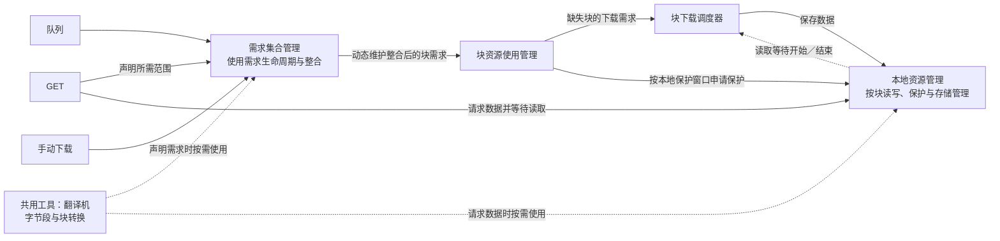

# 下载需求与资源管理设计

更新日期：2026-10-21。

本文是下载需求与资源管理的唯一权威设计文档（canonical）。第一部分维护现行规则及理由，第二部分记录实现接口、已落实的决策和验证边界。后续规则变化在这里更新，不另建并行的现行方案。

本文承接 2026-10-18 的手绘记录及后续讨论；原始记录保留为历史材料，发生冲突时以本文为准。2026-10-19 已完成本轮代码实现及开发验证，按独立目的分阶段提交；真实 VRC 播放表现仍按第二部分积攒，不外推为实机通过。不考虑旧配置、旧临时数据的兼容或迁移。

现有代码的架构依据、运行参数和落盘契约分别见[当前全局块调度设计](block-scheduler-design.md)、[下载并发规则](download-concurrency.md)和[存储约定](storage.md)。这些文档说明对应实现细节；本文负责统一规则、职责边界及决策状态。实现变化时同步更新对应说明，不能仅修改本文就宣称行为已经改变。

**实现状态（2026-10-21）：歌曲屏蔽与收藏已接入歌曲入口准入、本地资源管理及控制台。** 核心需求集合、块资源使用管理和块下载调度器保持不变；行为及验证边界见第 8 项和[开发验证记录](validation/song-policy-validation.md)。

## 术语与命名

视频业务中的“缓存”专指单次引擎运行内产生、可复用的视频块缓存，不跨运行恢复；已校验并正式发布、可跨运行保留的完整文件称为“本地视频”。两者合称“本地资源”。操作系统文件缓存、DNS 缓存等通用技术术语须带明确限定，不与视频持久化存储混用。

容量设置的全称为“本地视频持久化存储预算”，统一简称“视频存储预算”；界面标签为“视频存储预算（GiB）”，下方说明的第一句使用全称。预算仅针对完整本地视频，不计视频块缓存、合并临时副本或数据库，也不承诺实际磁盘占用的硬上限；零预算及保护、回收规则见第 6 项。

用户选择的位置称为“本地存储目录”，保存视频、歌曲资料及统计；视频块缓存的位置由程序管理，不提供独立的缓存位置设置。当前块文件位于该目录的 `tmp/` 下，因此切换存储目录会间接影响块文件位置。本轮统一名称，不改变配置键、接口、文件布局、预算与保护行为。旧验证报告、研究和原始证据中的“缓存”按当时语境解释，不追溯改写为新的运行期块语义。

## 一、已达成共识的事项

### 1. 目标与职责边界

以块需求统一表达 GET、队列和手动下载对视频内容的使用要求，分开处理使用需求、下载执行和本地资源保护。各模块是职责边界，不预先规定必须各自建立服务、工作协程或独立队列。

| 职责 | 已确认的目标 |
| --- | --- |
| 需求来源 | GET、队列、手动下载声明需要哪个视频、哪个范围、什么时候需要；需求的结束由来源自身决定。 |
| 翻译机（共用工具） | 提供可复用的视频字节段与视频块转换能力；来源向需求集合管理声明需求，或向本地资源管理请求数据时，均可按需使用。它不是流程中的独立必经阶段。 |
| 需求集合管理 | 根据上游使用需求的发布、更新与撤销进行整合，动态维护它对块资源使用管理的需求；不根据块是否已下载、本地是否存在来决定使用需求是否结束。 |
| 块资源使用管理 | 根据整合后的需求及本地保护提前窗口协调本地保护；缺失块交给块下载调度器，按下载窗口安排执行；窗口内已有及下载后形成的本地块都应受到相应保护。 |
| 块下载调度器 | 根据缺失块的普通下载需求与本地读取等待安排执行，独立维护 Blocking。下载任务的生命周期与使用需求的生命周期分开。 |
| 本地资源管理 | 对外提供按块使用视频的能力，统一负责文件组织、缓存读写、可用性、读取等待、保护、视频存储预算与预留、保留取舍、回收、合并、校验和发布。其他模块通过接口使用这些能力，不另行维护文件或存储预算。接口实现见第二部分。 |

上游来源身份及各自的需求贡献由需求集合管理维护。上游需求变化时，需求集合管理重新整合，向块资源使用管理新增、更新或撤销相应的块需求。块资源使用管理只关心整合后的块需求，不关心原始来源是谁，也不承担来源之间的整合。



转换工具的虚线表示按需复用，不是必经的调度阶段。字节/块计算复用 ranges.go 的范围工具；本地读取向块下载调度器成对报告缺块等待的开始与结束，由调度器维护 Blocking 并作用于既有共享块任务，不另建下载通道。

### 2. 使用需求独立于下载完成

使用需求的生命周期由需求本身决定，不能因下载完成而结束。块已经存在于本地、刚刚下载完成或仍然缺失，都可以同时有有效使用需求。

对于 GET，来源身份持续到该 GET 结束，所需范围随块级消费完成逐步缩减；尚未消费完成的块需求持续存在。预计的 need-by 或时间窗口到期不能自行将 GET 视为已经结束，但 GET 仍存在不赋予过期下载任务继续占用额度的资格：可以主动失败结束 GET，再撤销其剩余需求。块级消费与下载截止分别见第 3、4 项。

下载完成表示资源可用性发生变化；它可以结束相应下载工作，但不能自动抹掉仍有效的使用需求和本地保护依据。需求来源退出时，也必须区分该来源的贡献与其他来源仍保留的需求。

完整使用范围现由来源集合投影并生成无来源身份的 blockUse 摘要，下载协调器在此之后过滤已有块并提供缺块执行器，实际读取等待由调度器独立处理；本地保护复用同一投影和整合函数。摘要分别提供下载的最早有限 need-by、机会下载权限、最晚有效期和最早重算时刻，以及全部有限使用需求的最早本地保护 need-by。GET 过滤交接紧迫度只影响下载排序，不抹掉仍有效的交接使用与保护依据。来源登记、退出和交接转移在同一把锁下更新；唯一块引用归零时立即以真实事件时刻处理本地延续，再合并唤醒下游。无需另设常驻服务或来源保护记录。

### 3. GET 读取与急需信息

GET 收到请求后，一方面声明所需范围，另一方面向本地资源管理请求数据。正常缺块等待表现为读取返回较慢，GET 无需自己判断或操纵 Blocking；本地资源管理感知正在等待的缺块，并将急需信息传达给下载调度。

**Blocking 仅由块下载调度器解释和维护。** 需求集合管理、交接需求和块资源使用管理不保存、接收、整合或清除 Blocking；它不属于使用需求接口。需求集合仅按来源范围、时钟、退出原因和真实退出时刻生成交接，交接不继承读取等待的紧迫性，平移的 need-by 始终来自原来源时钟。

本地资源管理只报告“某块开始被读取等待／该等待结束”的事实。[`spoolReader.Read`](../internal/cacheproxy/stream.go) 在确实等待缺失数据时登记独立等待，本次 Read 正常返回或出错时撤销。GET 的读取被取消，无论客户端断开、服务端取消还是主动关闭 Reader，本地读取都必须通过同一清理路径及时撤销自己的等待；清理可重复调用，不影响其他读取者。GET 到达、已有本地数据及普通本地校验等待不产生等待登记。

调度器按块汇总实际等待：仍有任一读者等待就保持 Blocking，最后一个等待结束才解除。解除 Blocking 本身不取消仍有普通或交接需求的下载，也不暂停在途执行；需求截止、取消及清理规则继续独立适用。等待可以早于任务登记，或发生在旧任务收尾期间；不得丢失等待、复活已终止任务或建立同块并行执行。

协调器仍负责为缺块提供执行器。调度器向它提供当前需要取回的块号及注册顺序，以接入尚未登记的任务及激进回收后的重取；实际读取所需块优先注册，避免普通任务先占满元数据容量。该接口不暴露等待时刻、读者身份或紧迫属性。任务提交和普通需求更新均不携带 Blocking，真实等待与普通需求的调度合并只在调度器内部完成。

“持续等待并读完”描述正常读取路径，不表示忽略客户端取消或隐藏读取错误。

#### 按块确认消费并撤销需求

采用块级逐步撤销，继续使用现有 HTTP 传输机制。**消费完成表示某块中属于该 GET 的全部所需字节，已经被 HTTP 响应写入层接受。** 这个边界不表示客户端已经收到、解码或播放完成。

- 根据实际 200/206 视频响应的范围和写入返回的字节数推进消费位置；Reader 的读取或 Seek 位置不作为交付依据。
- 某块所需字节全部交付后，只撤销该 GET 对该块的贡献；首尾只请求了块内一部分时，该部分交付完成即可。
- GET 的来源身份仍持续到请求结束；取消或失败时统一撤销剩余需求。逐块完成与整个来源退出必须区分，不能把进度推进误当作来源退出交接。
- 其他来源的需求独立保留并重新参与整合；最后一份块需求结束后，按第 4 项进入本地延续保护，不直接等同于删除数据。

当前单个连续响应使用“响应范围与已交付位置”记录进度，仅在块需求结束时批量通知缩减范围，进度状态保持常数大小。冷热读取共用消费机制；消费位置与原始时间基准分离，不能因推进消费位置而改变剩余块的 need-by。

已实现 HTTP 层与 obtainDemand 共用同一 GET 来源；getConsumption 根据实际 200/206 响应范围和 Write 返回的已接受字节推进，只在跨过块所需范围时通知缩减。冷热读取共用路径，短写明确失败，原播放时钟不变。完整使用需求范围现由 projectUseLocked 统一投影，本地保护已按完整使用范围接入；本地块文件、运行期共享、按策略逐块回收及持久化预留均已接入。

#### GET 完成与持久化结果分开

**GET 所需字节正常交付完即算完成，不等待整视频 MD5 校验或持久化发布。** 交付继续以上述 HTTP 响应写入层实际接受字节的边界为准；完整 200 响应与范围 206 响应共用此规则，取消为等待校验和发布而扣留最后一个字节的行为。这里的完成不表示客户端已收到或播放完成，也不证明整视频 MD5 正确或正式视频已经发布。

请求范围、响应长度、资源一致性检查，以及读取、写入错误和客户端取消仍按各自规则处理，不能将短写或传输失败视为正常完成。完整视频持久化的校验与结果由本地资源管理按第 6 项独立处理，后续持久化失败不追溯改变已经正常完成的 GET。手动补齐仍以完整校验和发布完成作为整视频成功依据，不使用 GET 的完成条件替代。

已移除 spoolReader 的尾字节门槛、verifyFull 和完整 GET 的发布后歌曲记录等待。读取到完整所需字节即可正常交付；发布结果由工作会话独立处理。已收齐可读字节时，消费完成不再取消正在收尾的执行和发布。持久化准入、普通资源零预算不校验及逐块激进回收均已接入；收藏的预算例外见第 8 项。

### 4. 下载时间与本地保护生命周期

#### 队列预计使用时间

队列来源负责推导歌曲开始时刻及各块 need-by；需求整合、下载调度和本地保护共用该结果。存在有效 GET 播放时钟时，队首取其中最早的预计播放结束时刻，后续歌曲逐首累加前项时长，各块再加其字节位置对应的播放时间。GET 自身时钟仍固定为请求到达时刻与 Range 起点，读取和下载进度不移动它。

**没有有效 GET 时，仍在队列中的队首采用 `max(上次估算的开始时刻, 当前时间)`。** 首次观察到队列且没有既有估算时，从当前时间开始。最后一个 GET 传输结束不等于播放结束，尚在未来的估算必须保留；估算已过去而队首仍未离队时，按最早现在开始继续准备，不能仅凭时间经过就将未发生的播放视为已经错过。新 GET 按原规则重新建立起点，批量下载和 HEAD 不参与。

队列来源复用使用需求计时器，按现有来源续约的 10 秒节奏推进落后的起点，并统一通知下载与本地保护；无下载执行或新队列快照时也生效。到期的来源快照读取会补做重算，计时器延迟不能让快照持续使用旧估算。重复快照本身不重置基准；正常运行时无 GET 的起点允许在两次重算间落后不足一个重算间隔。队列为空或有有效 GET 时停止滚动；已退出成员及交接保留退出时冻结的时间，不随剩余队列更新。

**滚动阶段的入窗资格按相对距离判断，不能由两次刷新之间的墙钟推进获得。** 令 `Δ = 前置歌曲时长之和 + 本曲内块位置对应的时间`，下载入窗为 `Δ ≤ PrepareAhead`，保护入窗为 `Δ ≤ LocalProtectAhead`。10 秒刷新维护有限 need-by 与租约，不代表未消费的队列向前播放。无 GET 但保留未来估算时，仍等待该估算给出的绝对入窗时刻；同时预先约束上述相对距离，因此估算到点即遵循相对窗口，无需在到点时另设状态或回调。

来源层分别计算下载和保护资格，再合并同块来源。窗口外的队列贡献不能提前或阻止独立 GET、手动下载、交接的合法资格；若没有其他可准入贡献，仍保留队列的有限期限与租约，但等待任务不会自动入窗。保护窗口外不发布会随墙钟生效的保护时间；已完成资源的自动重取及执行会话内的已完成块也使用同一资格。新 GET、重排和元数据变化重新计算，交接仍使用退出时冻结的时钟，不记录“曾经保护过”等历史状态。

这是来源对预计使用时间和窗口资格的修正，下载执行仍须满足当前整合后的窗口、容量和每次网络尝试超时。在途任务不因窗口资格改变而抢占，继续按当前有效需求的租约与有限截止结束。已到期或已结束的下载任务仍先清理，不能由迟到的队列重算复活。

#### 窗口名称与覆盖原则

“四段保护窗口”统一指以下四项，分别属于下载和本地保护两套生命周期，并非依次发生的四个阶段：

| 名称 | 时间依据与作用 |
| --- | --- |
| 下载提前窗口 | 固定时钟从 `need-by - M` 起允许有期限需求参与下载；未消费队列的滚动时钟按上文相对窗口判断，实际执行仍须满足需求有效性与调度准入。 |
| 下载延续窗口 | 错过 need-by 后，下载资格最多延续至 `need-by + 30 秒`；需求提前结束时不能仅凭尚未到截止时刻继续下载。 |
| 本地保护提前窗口 | 固定时钟从 `need-by - 本地保护提前量` 起提供保护；滚动时钟按相对窗口判断，入窗后随有效使用需求持续，不因越过 need-by 而自行结束。 |
| 本地延续保护期 | 最后一份块需求真实结束后，已有保护再延续配置时长 G（默认 300 秒，0～10000 秒）；仅保留本地数据，不提供下载资格。 |

**本地保护窗口原则上应覆盖普通有限需求的有效下载窗口，避免仍有合法下载需求的块因缺少本地保护而被回收。** 覆盖关系比较实际起止时刻：

```text
本地保护开始时刻 ≤ 下载窗口开始时刻
本地保护结束时刻 ≥ 下载窗口结束时刻
```

提前侧按同一 need-by 比较时，等价于 **本地保护提前量 ≥ 下载提前量 M**，即本地保护不晚于下载入窗。延续侧必须比较实际结束时刻：下载截止从 need-by 起算，本地延续保护从最后一份块需求真实结束时刻起算，不能仅比较两个延续时长的大小来判断覆盖。需求提前结束且无其他下载依据时，有效下载窗口也随之结束，不要求为已经失效的下载资格保留到原定截止时刻。

该原则作为正常配置与验收约定，不新增运行时大小关系校验或补偿保护。need-by 后移、仅剩远期需求及无明确期限的手动下载仍按本节各自规则处理；顺序 200 回退可能提前下载窗口外的后续块，仍遵循第 7 项的尽力兼容边界，不据此扩大整视频保护。

#### 固定下载提前量

**下载提前窗口采用固定提前量 M，取消动态块耗时估算 T 对启动窗口的影响。** 对有期限需求，窗口开始时间为 `need-by - M`，即 `need-by <= now + M` 时进入下载提前窗口；实际启动仍需满足有效期、执行额度及既定调度规则。M 表示完整的下载提前量，不再使用原来的 `need-by - T - M`，也不额外叠加固定的 64 秒。

提前量按偏慢场景留足余量：本轮采用典型视频码率要求约 2 Mbps、16 路下载，单路最低吞吐按 `2 / 16 = 0.125 Mbps` 估算。按 1 MB 块粗算，纯传输耗时为 `8 Mbit / 0.125 Mbps = 64 秒`；当前实际标准块为 1 MiB，按十进制 Mbps 精确换算约为 67.1 秒。约 64 秒是本轮吞吐假设下的耗时设计基准，不是含连接、排队、重试等开销的网络耗时硬上限，也不作为单次尝试超时值。

**M 设置时应大于约 64 秒的基准，正常取值宜远大于这一量级，为传输及其他等待留出充分余量。** 当前默认 500 秒，建议范围为 200～2000 秒；设置与引擎配置接受 100～16000 秒，0 使用默认 500 秒。100 秒是在约 67 秒纯传输基准外留出余量的输入下限，不是完成时限保证；2000 秒是建议上限，不是输入限制。数值越大，越早下载预计播放的内容，也越早占用带宽和视频存储空间。范围外的非零值直接拒绝，不提供旧配置迁移。采用固定提前量的决策已确定，不再等待是否保留 T 的选择。

控制台按当前合法输入值显示临时缓存粗估：以 2 Mbps 视频码率计算，M 秒对应 `M × 2 / 8 = M / 4 MB`（十进制），默认 500 秒对应约 125 MB。此值只帮助理解提前窗口的空间量级，不是实际磁盘占用或保留上限；实际占用受视频码率、已有本地资源、需求容量、并行播放及保护延续等影响。空值或非法输入不显示估算。

本地保护继续使用独立的固定提前量，默认跟随下载提前量，也可设得更长；正常配置与验收约定有效本地保护提前量大于等于下载提前量。这是设计约定，不通过运行时配置校验强制。取消 T 对下载启动窗口的影响，不改变本地保护的启动、延续和释放规则，也不改变手动下载完成后被回收风险的处理边界。

#### 本地保护

**本地保护由“本地保护提前窗口”控制开始时机，不因需求登记而立即生效。** 需求集合管理按第 1 项的既定职责发布实时块需求及其 need-by；块资源使用管理依据本地保护提前窗口协调保护、检查已有块并派生缺失块的下载任务。需求方无需另行声明一套保护需求。

本地保护提前窗口与下载提前窗口保留独立语义，正常配置应让本地保护不晚于普通有限需求的下载入窗。对有限 need-by 的需求，本地保护开始时机按 `need-by - 本地保护提前量` 判断；引擎配置 LocalProtectAhead 为 0 时跟随有效 PrepareAhead（默认 500 秒），程序接受 0～24 小时的输入，不校验两个提前量的大小关系，也不自动抬高较短的值。较短保护窗口可以运行，但不符合正常配置与验收约定；常规测试遵守该约定，明确验证边界行为的测试可以例外，不据此增加补偿保护。现阶段无需新增控制台字段。遵守该约定也不保证顺序 200 回退中超出窗口的后续块受到保护，兼容边界见第 7 项。

| 需求与窗口状态 | 本地保护行为 |
| --- | --- |
| 需求已登记，但尚未进入本地保护提前窗口 | 该需求尚不提供本地保护；仍占用块需求容量。其他来源、已有延续保护及读取引用按各自规则处理。 |
| 已进入本地保护提前窗口，且对应需求仍有效 | 保护该块；已有本地块及此期间新形成的本地块都适用，不因 need-by 到期就自行结束仍有效的使用保护。 |
| 最后一份需求结束 | 已有保护从这次“有需求变为无需求”的真实时刻起，额外延续配置时长 G；G=0 时不延续。 |
| 延续保护到期，仍无需求 | 解除该规则提供的保护，是否实际清理由本地资源管理决定。 |

多个来源需要同一块时，退出一个来源只移除其贡献，剩余需求仍须结合本地保护提前窗口判断；不能仅凭还有远期需求就继续提供即时保护。**本地延续保护截止为该块最后一份需求真实结束时刻 E 加配置时长 G**，重复通知或检查不能自行刷新期限。延续期间出现的新需求也须经过本地保护提前窗口判断，不能仅凭重新登记就立即转为持续保护。

设置「本地延续保护时长（秒）」保存为 `localProtectionGraceSeconds`，默认 300，接受 0～10000 的整数，经引擎 `Config.LocalProtectionGrace` 生效。缺失或 null 使用默认值，显式 0 关闭延续保护，不替换为默认值；原本未生效的保护不因退出而获得尾期。0 不解除有效需求或必要读取引用提供的保护，也不要求立即删除文件。较长时长会延后回收，完整文件仍受任一块保护。保存并重启应用后生效，不热更新已经建立的尾期。该设置替代原固定 60 秒规则，仍从真实需求结束起算，不采用 `max(E, need-by) + G`。

**need-by 后移到保护窗口外，或入窗来源退出后只剩远期需求时，沿用上述通用规则，不增加特殊处理。** 这些情况的实际业务影响有限；只要遵守已确认的保护窗口、配置延续及通用读取引用边界，接受现有状态自然产生的保留或可回收结果，不另行保证一段补偿保护。不将讨论中“最后一份能提供即时保护的需求失效时，重新开始延续保护”的建议确认为新增规则，也不为此增加专属状态、计时器或逐来源保护记录。远期需求不能仅凭登记提供即时保护，也不能借重复事件或远期更新刷新已有延续期限。本项不再作为独立的待决机制展开。

下载与本地保护分别判断各自的提前窗口。需求登记可以早于两个窗口；若先进入本地保护提前窗口，可以先保护已有数据而等待下载准入。缺块期间保留满足窗口条件的保护依据，数据形成时衔接到本地块。延续保护仅用于保留本地数据，不产生新的使用需求或下载资格。

本次修订替代此前“需求一经登记就持续保护、取消本地保护提前窗口”的结论，恢复独立的本地保护提前窗口；本地延续期仍从最后一份需求结束起算，而非从 need-by 或下载完成起算，不恢复早期相对于 need-by 的本地延续区间公式。两个提前窗口分别调整时的覆盖关系，以及通知、读取引用与清理的并发边界，见第二部分；need-by 后移及只剩远期需求按上文通用规则处理，不预设新的例外或计时状态。

#### 常规播放交接与同块需求重新接入

**来源之间的短暂空档是常规播放路径，必须保留交接保障。** 场景包括首播 GET 退出后约半秒重新发起 GET，以及队首退出后由播放 GET 接手。[2026-10-20 实机测量](acceptance/live-acceptance-20261020-01.md)的九笔样本中，队列日志首次可读到首个同视频 GET 为 0.736–0.907 秒，SWD 发现变化到该 GET 最晚为 0.690 秒；这些是正常网络、已预缓存条件下的观测，不是最坏情况保证。交接覆盖新 GET 建立自身需求前的空档，实际开播前的等待不要求一直由队列交接承担，替代早期按约 10～20 秒开播等待估计 GET 空档的依据。本地延续保护期默认 300 秒，用于保留交接空档中的已有数据；用户可以缩短或设为 0，以更早允许回收。按每块最后一份需求结束的真实时刻判断覆盖，不能一律从整个 GET 结束时才起算。

**保留有界的特殊交接需求，由需求集合管理维护并整合，块资源使用管理不识别交接来源。** 交接关注需求本身的生命周期，不依附于缺块下载任务：从原来源退出时尚未结束的使用范围承接，包含已下载但尚未消费的块；已经消费并撤销需求的块不重新加入，按各自已有的本地延续保护处理。交接范围不随下载完成而缩小或消失，已移除旧实现只为未下载完成块生成交接的限制。

**只有客户端关闭 GET、队首从队列消失这两类事件产生交接。** 单次下载尝试失败、下载延续截止、消费完成及引擎关闭按各自生命周期处理，不作为额外的交接触发条件；普通队列或手动下载来源退出也不产生交接。当前实现的交接转换入口只接受 GET／队首的 `source_gone`；退出路径现已区分客户端关闭与正常交付/服务端失败。交接在来源退出时建立，不再等待下载任务观察消失；不得另行扩展交接策略。

原来源撤销与交接承接应在同一次整合结果更新中表达，避免中间出现虚假的无需求状态。交接到期以原来源真实退出时刻为基准，不因通知延迟、重复事件或新 GET 到来续长，也不由交接再次生成交接。新 GET 独立登记自己的范围，与交接及其他来源共享同一块；交接结束只撤销自己的贡献。沿用既定的唯一块计数，同一块的原来源、交接及新来源不分别占用槽位。

**交接有效期与 need-by 分别计算：** 设原来源真实退出时刻为 `E`，退出时该块原有的 need-by 为 `N`，转换时一次性确定以下值：

| 交接来源 | 交接需求结束时刻 | 交接块的 need-by |
| --- | --- | --- |
| 客户端关闭 GET | `E + 2 秒` | `N + 2 秒` |
| 队首从队列消失 | `E + 2 秒` | `N + 2 秒` |

2026-10-20 按上述证据与已确认的策略，将两类交接统一为 2 秒有效期和 2 秒 need-by 平移，替代队首原有的 `E + 20 秒 / N + 5 秒`。有效期调整覆盖已观测的短暂接手空档；need-by 平移统一是调度策略选择，不由 GET 到达间隔直接推导。超过有效期仍无其他需求的下载结束，已有完整块继续按本地保护规则保留；未完成块可能在后续接入时重新下载。历史报告保留当时参数及结果，不外推为新参数在所有网络条件下均已通过。

need-by 只在原值上平移，不取原值与退出时刻的较晚者，也不因延迟处理或后续检查重新计算。当前代码已改为原 need-by 直接加调整量；过期原值不因退出时刻被重新推迟。交接现覆盖完整未消费使用范围，包括已下载块；范围、原播放时钟及固定到期统一由需求集合持有，下载协调器只读取缺块投影。

本地延续保护用于保留已有数据，不自动维持网络下载。下载延续窗口按 `need-by + 30 秒` 截止，不等同于“来源退出后再延续同样时长”，也不单独提供来源消失后的执行资格。交接需求可以提供有效需求依据，但下载仍须满足下载窗口与调度准入条件；若按平移后的 need-by 计算，下载延续截止仍已过去，交接不提供继续下载的资格，本地保护仍按既定规则判断。没有其他需求时，交接结束与下载延续截止任一条件到达，都结束该交接所能提供的下载资格；不能借交接让已到期任务继续沿用过期资格。

**移除独立的离队后 30 秒文件保护，交接后的本地保留统一依赖配置的本地延续保护期。** 对每块按最后一份使用需求（包括交接需求）结束的真实时刻起算；交接仍有效时按既定本地保护提前窗口判断保护。若交接是最后一份需求，则在交接结束后再开始配置时长 G 的延续保护；统一延续保护结束后不再叠加一轮队列专属的 30 秒保护。现已移除独立队列保护映射和 API，完整文件回收及手动删除共用块保护；激进策略的临时块回收也复用同一保护结果。

**延续期内同一块重新出现需求时，块资源使用管理必须能够重新接管仍保留的本地块状态。** 按相同资源与块身份复用已完成的可读块，依据新的整合需求重新判断下载资格和本地保护窗口；仍合法执行的同块下载应继续共享，已经停止的下载按第 7 项重新建立，不恢复旧任务或半块前缀。新需求已进入本地保护窗口时，衔接到有需求保护，旧的到期通知或清理计划不得解除新保护或误删数据；新需求尚未入窗时，仍按既定规则处理已有延续保护，不因登记就额外延长。只接管新需求覆盖的块，其余块按各自原有期限处理。新需求是重新接入依据，不能借此恢复已撤销的旧来源或让已到期下载任务沿用过期资格。

上述要求用于保障正常播放交接，不改变手动下载完成后可被回收的既定边界，也不为手动下载增加保护例外。重新接入与到期、执行取消及本地清理的并发接口，仍需在第二部分确定并验证。

#### 单次尝试超时与下载延续截止

“下载超时”需要区分以下两个概念，不能共用一个含糊的生命周期规则：

| 概念 | 时间依据与目的 | 到期后的含义 |
| --- | --- | --- |
| 单次下载尝试超时 | 从一次连接或请求的尝试开始计时，限制该次尝试占用执行资源的时间，不包含后续重试。 | 本次尝试失败；在需求仍允许下载的前提下，通过适当的重试或换源等机制继续处理。沿用现有有界候选回退和验证规则，不新增并行冗余。 |
| 下载延续窗口 | 下载任务的 need-by 由需求集合整合得出；对有限 need-by，截止于 `need-by + 30 秒`，限制对存在过时风险的需求继续投入下载资源。 | 到期任务停止并结束。依据调整后的需求集合重算 need-by，重新满足下载窗口和调度准入条件后，才为仍缺失的块建立新下载任务。 |

**下载延续时长确定为统一固定的 30 秒。** 该值表达错过预计使用时间后仍愿意继续下载的时长；提前量 M 负责为提前出现的需求留出准备时间，两者用途不同。接受没有预下载的慢速 GET 可能在块下载完成前到期，并按下文规则明确失败结束，不为容纳最慢冷下载将延续期扩大到 120 秒。本地延续保护期独立按配置时长 G，从最后一份块需求结束时刻计时。

调度器已实现基于 need-by 的下载延续截止：排队与执行共用截止索引，有限任务在 `need-by + 30 秒` 结束并拒绝复活，清理完成前仍计入执行额度；来源截止通过共享会话原有失败路径反馈：结束仍附着的 GET，明确记录服务端需求结束并撤销其余范围，不生成客户端断连交接；仍有效的准备来源等待旧会话清理后重新进入统一调度。`DownloadTimeout` 已改为每次 HTTP 尝试的响应头及正文时限，默认 10 分钟；重试重新计时，不含调度等待，见 [`config.go`](../internal/cacheproxy/config.go) 和 [`routes.go`](../internal/cacheproxy/routes.go)。这与新的 `need-by + 30 秒` 是独立限制，执行时须同时满足适用的时限，先到的限制先结束执行；本次确定下载延续期不等于将现有执行超时改为 30 秒。

下载延续截止不随实际开工或重试重新起算。窗口到期与单次尝试超时是独立条件，不能依靠后续重试不断延长下载资格。不另设包含重试的一轮下载总时限；保留现有有界候选与重定向次数，父级取消和下载延续截止控制整轮生命周期。

每次块执行累计最多跟随 5 次重定向，首次响应、响应校验和正文失败后的重试共用计数；地址变化不重置预算。需要第 6 次跳转时结束本次执行，但已到达的最终地址仍可使用其剩余候选线路。不同块及后续新执行各自计数。

**到期的下载任务不能以任何理由持续占用下载额度。** GET 仍在等待、另一个来源也需要同一块、正在等待需求撤销或重新整合，都不能成为保留过期执行资格的例外。

过期任务停止并结束后，后续处理只有以下两种结果：

1. **不再建立下载任务。** 可以主动使相关 GET 明确失败并结束，由请求结束路径撤销属于它的需求；没有剩余需求需要下载时，不再建立任务。不能只停止下载，却让相关 GET 无期限等待。
2. **根据实际调整后的需求集合重新取得合法调度资格。** 需求集合管理接收旧 GET 等来源的撤销或更新，重新整合剩余需求并计算 need-by。仅在重新满足下载窗口与调度准入条件后，才为仍缺失的块建立新下载任务并占用下载额度；存在其他来源本身不构成许可。若重算后仍已到期，不能重新执行；若尚未进入启动窗口，应等待准入。完整块复用与未完成块重新下载遵循第 7 项。

need-by 的调整必须来自来源变化或上述队列时间推导规则，不能由下载执行为了保留额度而直接把旧任务的 need-by 向后移动。旧 GET 因超时被迫退出后，由剩余来源重算出较晚的 need-by，是这一过程的典型情形。撤销旧 GET 只移除它的贡献，不自动撤销其他来源；其他来源保留后是否支持下载，仍必须经过上述重算与合法性判断。

**失败反馈沿用现有处理机制，不新增按块故障隔离的改造目标。** 下载延续窗口到期时，按上述规则停止过期执行、使相关 GET 明确失败结束，并撤销其需求、重新整合剩余来源。其他下载错误继续复用现有错误传播与请求结束路径；接口迁移只作落实已确认生命周期规则所需的调整，不因改为按块管理就另行扩大错误隔离设计。

取消下载任务不等于使用需求已经撤销，本地保护仍按本节的窗口与配置延续规则处理。[`download_expiry.go`](../internal/cacheproxy/download_expiry.go) 负责把截止结果交回来源集合：使用带原因的来源上下文通知 GET/准备调用，原请求上下文保留用于 HTTP 错误反馈。Range 和顺序 200 都结束旧会话，完整块由本地资源保留；手动及尚有效的队列准备沿用原来源等待旧会话清理，再重新登记任务。不保留暂停状态等待恢复，响应和写入清理期间仍计入 active，清理完成后才释放额度。

预测性队列准备在自身所需块也已错过截止时明确失败，撤销该次整视频使用范围；重复快照或定时重试本身不能重新登记已失败的成员。新的连续成员、重置，或预计开始时刻（包括无 GET 时的滚动修正）/媒体时长和大小变化允许重新准备，仍须通过当前下载窗口及截止判断。若队列时刻仍有效，则只退出过期 GET、保留队列来源。交接使用范围仍保留到原 E+2 秒，其已错过下载截止的贡献只提供使用/保护依据，不再参与下载整合。手动无期限来源不因共享 GET 截止而结束。

#### 无明确期限的手动下载

**手动下载保留无明确期限的需求，不人为指定 need-by，通过下载调度顺序安排执行。** 下载提前窗口内有仍具备执行资格的有期限需求等待启动时，优先下载这些块；没有这类待启动需求时，安排无明确期限需求的缺失块。该顺序用于选择待启动任务，仍遵循统一执行额度，不新增对正在执行块的优先级抢占。有限 need-by 的下载延续截止不直接套用于无明确期限需求；单次尝试超时及通用失败处理仍适用。共享块已有的过期任务仍须按上文停止并重新取得合法资格，不能仅凭还有无期限需求继续占用额度。

**手动下载来源根据准备结果撤销已满足的需求，不持续占用已完成部分的块槽位。** 目标视频完整校验并发布为正式本地资源后，撤销该来源的剩余需求；本轮选择在整视频准备成功、失败或取消后统一撤销，不额外增加手动逐块完成协议。撤销只移除手动下载来源的贡献，最后一份块需求结束才释放该 unique 块槽位并支持回补。需求集合管理接收来源的撤销并重新整合，不自行因下载完成删除其他来源的使用需求。

**不因手动下载及其完成后被回收的风险改变本地保护行为。** 无明确期限需求的登记本身不提供额外保护；其他来源的本地保护窗口、已有延续保护及本地资源管理的通用读写、校验引用按各自规则处理。写入、校验和发布期间的数据保留复用通用资源生命周期，不以手动需求持续占槽位维持。整视频成功仍以完整校验和发布完成为准，来源在准备调用返回时撤销，因此不会以最后一块刚可读替代成功；校验/发布错误同样结束该次准备。

**承认完成后被回收是合法且风险较高的路径：** 手动下载完成后撤销需求，在其他保护和活动引用均已退出时，资源可以按本地回收规则被删除。下载成功只表示当时已完成校验和发布，不承诺之后持续保留；写入与校验期间的资源引用不能消除完成后的回收风险。

**该风险只能通过下载需求与资源回收的协调处理，不能反过来改变本地保护行为。** 手动下载需求的下发与本地资源回收必须尽量协调一致，在准备下载时兼顾资源保留取舍与存储容量，避免一边持续补齐、另一边持续删除同一批资源，或回收释放空间后又不断放行低保留价值的内容。块需求槽位释放只说明需求集合有余量，不能替代存储容量和回收策略的判断。这是来源接入、资源准备与本地回收之间的协调要求，不改变需求集合管理仅按上游需求维护整合结果的职责。本地保护的启动、范围、延续和释放仍遵循既定规则；不得为规避该风险新增保护例外、延长活动引用，或保留已完成需求来间接维持保护。存储预算、保留取舍与回收归本地资源管理统一负责，来源接入使用其结果；准备反馈与持久化准入接口见第二部分第 5、6 项。

### 5. 以需求集合管理的块需求容量为中心

后续设计以块为中心。**彻底去除队列“解析资源、登记需求”及手动下载的独立歌曲／视频并行数量限制**，不把原来的两个准备调用者仅改名为两个解析调用者继续保留。上游维护有序的歌曲待办，**按可用块需求槽位反向有序放行**，不等待前面的整首视频下载完成才处理下一项，也不以下载提前窗口是否有空缺作为上游登记的门槛。

**需求集合管理向块资源使用管理交付有需求的唯一块（unique 块）集合，容量上限约束这个集合的长度。** 同一资源的同一块被多个来源需要时只计一次；不同资源的块分别计数。内部可以采用紧凑范围等表示，但不能把该上限仅解释为内部逐块展开的工作量，而在上限之外另行承诺未计入的块需求。

计数不受本地命中或下载完成影响：只要仍有来源需要，该块就仍在集合内；最后一份需求结束后移出集合，后续本地延续保护不继续占用使用需求容量。

**unique 块需求集合的容量上限采用 4096。** 该值沿用现有下载任务容量的数值，计数对象按本节改为使用需求集合；不表示沿用下载完成即释放容量的生命周期。目标是以充足的常规容量让每个 GET 的完整需求即时进入，不再为典型使用场景另选百级容量。

容量依据采用本轮给出的经验值：每首歌约 45 MiB，准备 500 秒或更长至少约覆盖 2 首歌，准备 1000 秒约覆盖 5 首歌。按当前 [`rangeBlockSize`](../internal/cacheproxy/ranges.go) 的 1 MiB 块大小，分别约为 45、90 和 225 块；4096 块对该典型规模已有充分余量。这些是使用场景估算，不是视频大小或 GET 范围的硬上限，也不表示新需求集合已完成性能验证。

**极端容量压力按最小必要处理，采用简单准入门槛：**

- 非 GET 来源新增 unique 块时，接纳后的总集合长度不得超过 70% 上限，即 2867 块；GET 可使用剩余容量，但总长度不得超过 4096。非 GET 指队列、手动下载等业务来源，不按内部上游 HTTP 请求的方法分类。
- 完全共享已有块、不扩大集合的登记，以及不扩大集合的更新、缩减和撤销，不受新增块门槛阻挡。已接受的需求不因使用率越过 70% 被驱逐。
- 非 GET 容量不足时返回暂缓，由来源通过正常回补流程重试；极端情况下 GET 也无法容纳时，明确返回容量不足并结束该请求，保留其他已有请求。不为无法接纳的 GET 建立额外等待机制。

队列与手动下载共用上述块容量准入口径，按各自待办顺序逐步取得资源信息并登记需求；来源全部进入或没有可接纳的块容量时停止继续放行，容量释放后回补。手动补齐可能较快填至 70% 门槛，也可能在达到门槛前容纳全部需求。按每首约 45 块估算，2867 块约容纳 63 首歌；这是提前取得信息和登记需求的规模，不是新增的歌曲数限制，也不表示这些视频同时进行网络下载。元信息逐项解析后登记完整块范围，以 WithPreparationAdmission 区分准入与整视频完成；容量不足时仅保留一个已解析待接入项，不并发解析全部待办绕过块层放行。

**队列不设按位置或歌曲数量截断的独立上限。** 已移除「队列预加载数量」配置、界面和截断逻辑；完整队列共用上述块容量准入。非曲库条目只保留顺序和典型时长占位，不登记下载需求。重排不因位置变化撤销仍在队列中的已登记需求或清除准备结果；尚未准入的待办按最新顺序放行。

**需求登记与下载启动分开。** 有限 need-by 的需求即使提前登记，实际下载仍须满足下载提前窗口及网络执行准入；没有有限 need-by 的手动补齐按第 4 项在没有窗口内可启动的有期限需求时参与下载，仍受统一执行额度约束。

**本地保护独立按第 4 项的本地保护提前窗口启动。** 按槽位更早登记远期需求，不代表立即保护其已有本地数据；需求接入规模由块槽位控制，实际下载和本地保护分别由各自窗口管理。本地保护提前量默认跟随下载提前量，也可独立设得更长。

准入复用集合计数及本次需求合并结果，避免为此增加额外全量扫描、轮询或常驻监控。此类极端情况不值得引入复杂抢占、动态扩容、多层配额或专门的等待队列；满足有界、明确反馈和已有需求不受误伤即可，不继续以这些极端情况扩展设计。常规来源回补的接口仍见第二部分第 5 项。

保留职责不同的网络执行额度、本地校验额度及视频存储预算；已移除两个歌曲准备调用者、32 个资源会话和来源数量等重复门槛。使用需求容量在来源撤销时释放，任务容量在下载清理后释放，两者不能混同。

### 6. 本地资源管理的存储与外部契约

**采用按块临时文件、系统缓存读写、块级回收及完整视频合并持久化，作为可长期使用的存储方案。** 不将其仅视为过渡版本，也不预设必须继续迁移到纯内存存块或稀疏文件打洞。完整视频沿用现有 `videos/{md5}.mp4` 正式文件格式及长度、MD5 校验要求；不完整视频的生命周期仍只存在于单次引擎运行，不跨运行恢复。完整块文件、跨会话复用与合并校验已实现；持久化准入/预留及按策略逐块激进回收已接入。

**上述能力全部由本地资源管理负责。** 块文件与完整文件的组织、系统缓存读写方式、可读状态、必要的文件引用、保护执行、视频存储预算及其预留和结算、保留取舍、实际回收、合并、校验、发布及退出清理，都由它统一管理。块资源使用管理根据整合需求申请或解除保护；下载执行通过本地资源管理的接口提交数据；GET 通过接口取得数据。需求下发与资源准备使用本地资源管理提供的容量及准备结果，不各自维护另一份存储预算或直接操作文件、决定回收。通过 localResource/blockFiles、spoolReader 和持久化预留接口表达这些交互，见第二部分第 6 项；不为这些职责另建常驻服务。

单次运行不等于单次 GET 或单次下载会话：在同一运行内，后续需求可以复用仍保留的完整可读块；是否继续保留仍由既定保护、引用和回收规则决定，不承诺一直保留到退出。退出清理及异常退出后的残留清理沿用受管临时文件机制，下次启动不把这些残留作为可恢复资源。

**未完整视频以块为临时文件单位，由本地资源管理持有文件及完整可读状态。** 下载任务停止后，仍需保留的完整块继续由本地资源管理持有，供后续需求复用；未完成块按第 7 项重新下载。删除某个块文件可以释放该块的存储，不再因同一视频的其他块仍受保护而必须保留全部临时数据。

块文件采用普通文件的系统缓存读写，由操作系统决定内存缓存与磁盘写回；可以使用临时文件属性提示其生命周期，但不承诺数据始终驻留内存或完全不写盘，也不由应用另建一套保存全部块的内存缓存。Windows 的相关行为见[文件缓存说明](https://learn.microsoft.com/en-us/windows/win32/fileio/file-caching)。

**这些存储、预算和回收选择不改变块需求的本地资源保护期行为。** 保护仍按第 4 项的本地保护提前窗口、需求生命周期及最后一份需求结束后的配置延续执行；不会因预算为零、预算已满、资源分数变化或持久化准入结果而缩短、延长或重新开始。必要的读取、写入、校验引用继续按实际生命周期持有，不为等待持久化而人为延长。

**视频块缓存采用显式的「激进的缓存回收策略」，配置为 auto / on / off，默认 auto。** 设置页展示「自动（默认）／开启／关闭」，保存策略本身，不保存自动计算的布尔结果；修改视频存储预算不会覆盖手动选择。使用引导不提供该选项，沿用已保存策略，恢复本页默认也不重置策略；最终核对仅展示此前已保存、尚未生效的策略差异。所有设置保存后重启应用生效。

| 回收策略 | 视频保留选项 | 块文件的运行期回收行为 |
| --- | --- | --- |
| 自动 | 不保留（有效视频存储预算为 0） | 开启激进回收。 |
| 自动 | 限制为（包括预算已用满）、不限制 | 关闭激进回收。 |
| 开启 | 任意 | 块失去既定保护后安排回收，必要活动引用释放后删除，不等待本次运行结束。 |
| 关闭 | 任意 | 不因失去保护、当前无余量或尚未取得持久化预留而立即删除块，保留同次运行内复用及收齐的机会。 |

关闭激进回收不等于块仍处于保护期，也不改变完整本地视频的预算淘汰。选择「不保留」时即使关闭回收，普通资源也不合并、校验或发布完整本地视频，已有块仅在本次运行内复用；收藏的完整视频按第 8 项取得预算豁免，不扩大块保护。选择「限制为」或「不限制」时开启回收，可能在整视频收齐前丢失已下载块，增加重复下载并减少形成完整本地视频的机会。

保留已有块不产生下载需求，缺失块仍须由实际使用需求驱动下载；合并发布后的临时副本清理、无效数据清理与退出清理仍按各自生命周期处理。需求槽位释放不直接等同于物理空间释放。预算已满时，分数更高的视频仍可能替换已有低分视频，持久化准入不能仅凭没有空余额度拒绝它。

激进回收接入现有 retentionLoop，复用完成写入、来源变化通知和固定保护到期计时。整份会话或 reader 的存储引用不扩大块保护，实际块读取和合并快照引用才延迟对应文件的物理删除。防止回收后无期限反复补齐、当前有效需求的缺块重取及完成判断统一跟随回收策略，不再仅判断零预算。

**会话中的已完成记录只表示过去下载过，不表示块当前仍在本地，也不能阻止当前有效需求的缺块重取。** 先检查本地可用性：已有完整块直接复用；块被回收后，当前整合需求仍有有限 need-by 且已进入本地保护窗口时，重新交给正常调度，继续遵守下载提前窗口、截止及执行额度，无须等到真实 Read 产生 Blocking。该规则同样适用于已经登记、随后才入窗的需求；会话须保留这类待入窗工作，复用现有计时器到点重算，不能因各块过去都下载过而提前结束。

**准备命中正式视频、成功发布或 Range 返回 TEMP 后，仍有效的使用需求继续驱动缺块重取。** 引擎按资源保留轻量使用协调，观察同一份整合需求、正式文件及块回收通知和未来保护入窗时刻；满足重取条件时通过共用入口创建或共享下载会话。队列同一成员重排不需要撤销 prepared 或重新登记来源。本地 HIT 缺少下载地址时，在共享会话中复用既有已保存地址/API 解析，核对 MD5 和大小仍匹配原使用资源后才下载，不将不同内容替换为原需求的结果。协调本身不持有文件引用、执行额度或额外使用需求，来源全部结束或引擎关闭时退出；已有完整块照常复用。地址解析失败、身份不匹配及普通执行耗尽重试后的终止错误沿用失败日志并停止该协调，避免无限重试；未发布的顺序 200 仍遵循第 7 项边界。

防反复下载仅阻止已完成块因无期限准备或尚未进入保护窗口的需求而在回收后立即重取；仅剩保护尾期也不产生下载资格。需求撤销后重新整合，不为保留重取资格续期。仍在运行的下载会话可响应真实缺块 Read 重新请求，不保证已结束会话中的旧 reader 自动建立新会话。后续新会话仍按当前可用块和需求重新准备。以上使用同一份需求投影，不保存逐来源下载历史，不改变既定保护窗口及最后一份需求结束后的配置延续。顺序 200 的窗口外数据仍可回收，按第 7 项的尽力兼容边界处理。

**视频存储预算仍指持久化完整视频的容量，不是整个存储目录的硬性占用上限。** 临时块和合并期间的副本不计为已经持久化的库存；受保护的数据仍可能使实际占用超过该预算，不将所有临时数据强行合并为持久化库存统计。

**块收齐转为 MD5 命名的正式视频前，先由本地资源管理计算是否满足持久化落盘要求，再进行为此所需的合并、校验和发布。** 判断复用现有视频下载与保留优先级，见 [`priority.go`](../internal/cacheproxy/priority.go) 和 [`retention.go`](../internal/cacheproxy/retention.go)：结合完整视频大小、视频存储预算、已有库存及优先级取舍，评估新视频是否应进入保留集合，包括高分视频替换低分视频的情况。不能只看当前剩余额度，也不能明知按同一轮取舍应立即淘汰该视频，仍先合并落盘再删除。替换与实际回收继续遵守既定保护和必要引用，不为取得容量提前解除保护。

持久化准入同时考虑并发候选，由本地资源管理统一维护预计完整大小的容量预留及替换取舍，同一资源共享且只计一次；发布成功后转为正式占用，放弃持久化后释放预留。预留用于协调正式落盘，不是关闭激进回收时保留块文件的前提，也不能把低分视频的先到预留变成阻止正常优先级替换的永久资格。已用 publicationReservation 接入：同资源由共享会话单次预留，准入与最终重命名同回收串行，合并 I/O 独立执行；更高优先级候选可撤销低分预留并取消其等待/合并，发布前重新检查保留集合和保护，成功后结算为库存；单轮手动补齐仍不能因回收或预留释放而重新获得已消耗的补齐额度，避免滚动下载整个曲库。

**本下载流程中的整视频 MD5 仅在完整视频持久化发布前校验，由本地资源管理负责。** 未收齐或不准备持久化的数据不安排整视频 MD5 校验；不为校验而额外补齐视频、保留已消费块，或维护随下载推进的持续校验状态。块仍按既定保护、必要引用与回收规则处理；实际进行持久化合并和校验时，使用相应的必要引用。

**满足落盘要求后，由本地资源管理顺序合并为完整视频文件，通过长度和 MD5 校验后发布，再释放临时块文件。** 不满足要求时，不为生成正式视频而执行合并、MD5 校验或发布，已有块仍按上述回收策略及其保护、引用生命周期管理；不以持久化未准入为由改变回收策略。获得准入后、取得完整合并快照前若块已被正常回收，返回 ErrNotRetained，释放预留，不记为存储故障、不换源重下；已取得的完整快照仍由必要引用保护。持久化准入不能替代发布前的长度与 MD5 校验；GET 则按第 3 项的字节交付规则完成。发布与旧读取者的衔接必须保持可读性，仍被必要引用持有的块在引用释放后清理；字节收齐、合并中或尚未校验发布的数据均不算正式视频。完整视频继续按整文件回收，任一块仍受保护或文件仍有必要引用时不能删除整个文件。发布后因后续需求、评分或预算变化被正常回收，仍是合法路径，预判不构成永久保留承诺。

接受这一方案的文件操作和合并复制成本，以及合并期间临时块与完整文件可能同时占用空间。后续可根据实际测量优化内部读写与发布，不将稀疏文件、打洞或原地发布作为既定下一阶段。本决策替代此前“同一视频共用一个临时文件、仅整文件回收、接受暂时无法逐块释放空间”的第一版选择；块文件回收以本节显式策略为准，替代此前“仅视频存储预算为 0 时启用”的固定规则，也不按剩余额度或持久化保留资格另设回收条件。

在对外契约明确且保持兼容的前提下，内部的文件组织、写入、发布和清理方式可以持续改进，调用方不应依赖这些细节。若改动影响可读性、完整性、保护承诺、取消与错误语义或重启后的可用性，就需要重新评审对应契约，不能仅归为内部优化。具体接口与内部方案见第二部分第 6 项。

### 7. 不保留块下载暂停与恢复

**目标设计不保留块下载暂停／恢复。** 块下载因失去执行资格或生命周期取消而停止时，结束旧任务并完成响应与写入清理；后续仍需下载时，依据当时的整合需求重新判断资格并建立新任务。未完成块从块起点重新下载，接受已接收部分字节的重复传输。不保存供旧执行恢复的半块前缀、候选游标或已验证重定向等进度，也不保留供新需求重接的暂停任务；旧的无需求任务重接 30 秒元数据保留机制已删除。执行额度仍须等旧响应关闭和收尾完成后释放。

**完整块的保留与复用由本地资源管理承担，独立于下载任务。** 已完成且可读的块遵循既定保护、引用和回收规则，不能因下载任务结束而一并丢弃；新需求复用仍保留的完整块，只为缺失块重新安排下载。这不改变本地保护的范围和时长，也不增加跨引擎运行恢复能力。

常规播放交接继续依赖第 4 项的有界交接需求：整合后仍有合法下载资格的在途任务继续执行和共享，不因来源交接先停后启。普通下载失败后的重试、换源，以及尚未执行任务的容量延期不属于暂停／恢复，分别沿用错误处理和容量接入规则；不新增优先级抢占。上游顺序 200 回退仍不提供分段续传，停止后需要重新下载。

**上游忽略 Range 返回 200 时仅提供尽力兼容。** 一个顺序响应可能提前下载尚未进入本地保护窗口的后续块，即使两个提前量相等也会发生；激进回收开启时仍按通用规则回收这些块。若下载会话已结束，旧 GET 随后读到已回收的块，则记录缺块原因并明确失败：尚未发送正文时返回 502，已开始交付时中断响应，不将截断内容报告为完整成功。不为该情况自动整包重下、跨会话恢复旧 reader 或扩大整视频保护；已保留的块足够时仍可正常完成读取。

完整块现由 [local_resource.go](../internal/cacheproxy/local_resource.go) 的引擎注册表与 [local_blocks.go](../internal/cacheproxy/local_blocks.go) 的块文件持有，Range/顺序 200 共用；不保存半块前缀和跨会话候选游标，移除 32 个/512 MiB 检查点上限。新会话复用完整块并使用当前地址，合并快照和旧读者引用保持数据可读。调度核心的暂停、无需求 30 秒任务保留及首次响应头前的恢复游标均已移除，见 [scheduler.go](../internal/blocksched/scheduler.go) 和 [stop_test.go](../internal/blocksched/stop_test.go)。首份需求与任务通过 Schedule 原子登记，最后需求退出即结束旧任务；清理前拒绝重接并继续计入额度，清理后按当前摘要创建新任务。首次响应头、候选和重定向都重新开始；常规执行内的有界重试仍保留。Range 可在原资源会话中建立新任务，顺序 200 必须结束旧会话。

强 ETag 的实体条件不能跨地址沿用。保留块绑定强 ETag 且新会话地址改变时，退出旧块注册，按新地址重新取得响应和完整块；不携带旧 If-Match，也不拼接未经新实体确认的旧块。旧读者保留自己的引用，最后引用释放后清理旧块。同地址的强实体一致性检查继续生效；正式文件仍按 MD5 身份共享。

### 8. 歌曲屏蔽与收藏

本项维护歌曲偏好的唯一业务规则。数据结构及格式边界见[歌曲偏好存储](storage.md#歌曲偏好存储)，实现和浏览器证据见[开发验证](validation/song-policy-validation.md)。第 6 项的普通资源预算规则与本项的收藏例外共同适用。

#### 偏好与职责

每首歌曲只有普通、屏蔽、收藏三种互斥状态，无偏好记录表示普通。偏好属于本地曲库，按歌曲 ID 保存，与上游资料、需求统计和歌曲—MD5 映射分开。GET、队列预加载和手动补齐在产生需求前共用歌曲准入判断；本地资源管理在持久化准入和回收时共用由当前映射推导的资源策略。块下载调度器继续只处理整合后的资源与块需求，不新增资源名单、另一套评分或独立下载通道。

**实现边界：歌曲入口准入与本地资源管理。** 除偏好存储、接口与界面外，只调整三个来源在创建需求前的检查，以及本地完整视频的发布、预算和安全回收；临时块的黑名单清理也复用既有回收入口。核心需求集合管理、块资源使用管理及块下载调度器保持不变，不向这些核心机制传递名单状态或增加名单分支。队列继续把完整成员序列交给既有计时机制，在来源准备阶段跳过被屏蔽歌曲即可。

**收藏只做标记，不触发下载任务。** 添加收藏、应用启动、缺失文件检查及歌曲资源映射变化，都不能仅因收藏而产生、续约或恢复下载需求；也不建立常驻补齐任务、自动重试任务或永久使用需求。视频仍由正常播放、队列预加载或用户主动发起的手动补齐取得。收藏不修改播放时钟、下载期限、并发额度及需求容量，不新增或延长临时块保护，不改变激进回收策略。

收藏的承诺是：资源按既有流程收齐并通过校验后，可以突破视频存储预算发布；已保存的收藏视频不因预算被自动淘汰。标记收藏不表示已经完整下载，也不保证临时块必然收齐；现有流程因块回收而未能合并时，继续按未保留处理，不因收藏自动补下载。显式删除或外部文件丢失也不触发收藏自动恢复。

#### 黑名单在需求之前阻断

GET、队列预加载和手动补齐在每次新建歌曲需求前检查屏蔽状态，命中后不登记块使用需求、保护或下载任务。播放 API 在本地视频命中、上游加载及需求登记之前直接拒绝被屏蔽的歌曲，返回 403；HEAD 沿用相同的歌曲入口判断。后台准备显示为屏蔽跳过，不把它当作下载故障重试或换源。界面过滤不能替代业务准入检查，同一判断也无需在每个块的调度、写入和读取中重复执行。

当前范围是通过歌曲 API 返回视频，不增加客户端直接资源 URL 的名单拦截、歌曲身份推断或绕过防护。共享资源不承担歌曲请求的准入判断：A 被屏蔽、B 未屏蔽且共用 MD5 时，只阻止 A 产生新需求，B 继续正常使用共享资源。

**队列计时使用完整成员序列，屏蔽只过滤资源需求。** 黑名单歌曲与未知歌曲、外链视频一样参与预计开始时间及后续块 `need-by` 的计算；已知时长正常累加，未知时长复用现有估算规则。屏蔽不删除、重排队列条目，不改变队首身份，也不把下一首提前当成队首。队首推进继续由真实队列事件决定。例如 A（3 分钟）→ B（屏蔽，4 分钟）→ C，C 的预计开始时间仍是 A 开始后 7 分钟。取消屏蔽后新建需求时使用当时完整队列推导的时钟，不重新起算。

#### 生效边界与共享资源

偏好保存成功后供后续需求准入及资源取舍使用，不要求应用重启。已经登记的使用需求、在途请求和共享下载仍按原生命周期结束；不为名单变更强制撤销旧来源、追溯交接或中断读流。尚未产生需求的后台候选在新建需求前使用当时的偏好：队列（含本地命中）与手动补齐共用来源层准入循环，每次尝试登记前复查，容量等待唤醒后的重试也不例外。偏好保存失败则保留原决策依据。引擎未启动时，标记直接写入离线存储，不启动引擎或执行清理，避免先按旧偏好淘汰待收藏文件；下次正常启动使用已提交的偏好。引擎已运行时继续在提交后通知既有资源管理。

本地资源策略只通过当前 `song_media` 关联与歌曲偏好推导，不在数据库重复保存。多首歌共享一个 MD5 时只下载、保存和计量一份；标记不改写或放大原有需求分数，同类普通资源仍使用现有评分及同分排序。

| 当前关联 | 持久化与回收规则 |
| --- | --- |
| 至少存在一个关联，且所有关联歌曲均被屏蔽 | 不再取得完整视频发布资格；已有本地资源在既有使用保护及必要引用结束后清理。 |
| 任一关联歌曲被收藏 | 获得收藏保留资格，完整视频不参与预算淘汰；其他关联歌曲被屏蔽不影响该资格。 |
| 其他情况，包括没有已知关联 | 沿用普通资源的持久化与回收规则。 |

偏好或映射变化后，复用现有资源管理通知重算受影响资源；映射更换时同时考虑新旧 MD5。收藏跟随歌曲的当前关联，旧资源根据剩余关联重新取舍，不保留历史偏好副本，也不自动获取新资源。

黑名单清理复用现有回收机制，但不以超过预算为前提；未超限及不限容量时也应检查。已有保护、必要引用和删除预留规则继续有效，不强删共享读者仍在使用的文件。持久化准入与发布前复查共用同一策略，避免旧任务结束后重新保存全部关联都已屏蔽的资源；已有 GET 的字节交付结果仍独立于是否发布完整视频。

#### 收藏与同一视频存储预算

收藏是明确的保留资格，不用巨大常数、无穷大或改写需求统计来模拟。收藏的完整视频及并发发布预留仍计入同一预算，按 MD5 去重；先确定收藏占用，再按现有评分选择剩余额度内的普通资源，并继续尊重普通资源已有的使用保护与必要引用。

收藏资源允许突破视频存储预算，包括零预算和单视频大于预算；预算不足不能拒绝其持久化准入或使其成为自动淘汰对象。预算 10 GiB、收藏占用 3 GiB 时，普通资源使用剩余约 7 GiB；收藏占用 12 GiB 时保留这 12 GiB，普通资源按现有保护规则逐步回收。取消最后一个关联收藏后，下一轮取舍恢复普通规则，不在标记操作中直接删除文件。

已有手动补齐的候选选择、前置容量准入、发布预留及淘汰必须采用一致的收藏资格。用户主动补齐收藏时，不得被零预算的全局禁用或单视频超预算检查提前挡住；普通候选预算不足也不能跳过同轮仍可准入的收藏候选。普通补齐继续遵守单轮预算不能因回收而循环复用的约定。上述调整只作用于用户已发起的任务，不把收藏操作变为启动补齐的入口。

豁免只针对视频存储预算，长度与 MD5 校验、资源一致性、磁盘写入错误、网络与调度约束保持有效。存储界面需说明收藏计入实际占用且可以超过预算；收藏标记与完整文件是否存在分别展示，不把标记本身显示为下载成功。不增加收藏独立预算或更改激进回收的 auto/on/off 选择。

#### 实现与验证边界

实现集中在歌曲需求准入、本地资源管理的持久化准入及回收取舍，以及偏好持久化与展示；不为本项改造调度器、增加按歌曲强制取消或引入自动补齐。现有临时块保护不足以收齐视频时，维持现有结果，不扩大本项范围。

开发验证应覆盖三类来源不为屏蔽歌曲登记需求、队首/中间屏蔽及未知时长占位的时间计算、共享 MD5 的混合偏好、运行中只影响后续决策、未超限及不限容量下的黑名单清理、收藏零预算/超预算准入和去重计量，以及取消收藏后的普通取舍。另需确认添加收藏、重启、文件缺失和映射变化均不单独产生下载需求或额外块保护；曲库刷新与统计导入不覆盖偏好。上述范围由[开发验证](validation/song-policy-validation.md)记录实际覆盖与结果；仅播放器遭拒后的真实游戏表现合并到既有 LA-025，尚未实测。

## 二、实现接口、决策与验证边界

本部分替代开发期间的待讨论清单。职责优先复用现有机制，已选定的接口如下；本轮没有需要阻塞代码实现的未决事项。普通错误仍采用既有共享会话传播，不引入一般按块故障隔离、跨运行临时块恢复或新的保护例外。

### 1. 实时块需求的整合与动态维护

[usage_plan.go](../internal/cacheproxy/usage_plan.go) 持有包含本地已有块的完整来源投影，[block_demands.go](../internal/cacheproxy/block_demands.go) 生成不含来源身份的 blockUse。摘要分别携带下载时刻、机会权限、最晚有效期、最早重算时刻和本地保护时刻；下载协调器只在此后过滤可用块并提供缺块执行器，普通需求不携带 Blocking。GET 对交接的下载过滤、交接下载截止均不抹掉使用/保护依据。

[resource_use.go](../internal/cacheproxy/resource_use.go) 在正式视频 HIT、成功发布或 Range 临时准备结束后延续资源使用协调，复用 blockUse 的缺块重取资格和 [cache.go](../internal/cacheproxy/cache.go) 的共享会话入口，不保留旧执行器、候选游标或文件引用。来源变化、正式文件删除/目录核对和块可用性变化唤醒重算，未来入窗使用一次性计时器；同资源只保留一份协调，所有执行继续由块调度器管理。本地 HIT 的缺失地址由共享准备会话复用 [song_load.go](../internal/cacheproxy/song_load.go) 的解析策略补齐，资源身份不变。

来源范围保持为连续区间，唯一块引用索引负责容量和最后引用结束事件。保护与下载消费同一个投影，来源变更后在 Server.mu 下更新并合并唤醒；不通过下载完成通知重建来源生命周期，也不另设逐来源保护副本。

[reads.go](../internal/blocksched/reads.go) 的 ReadRequests 持有每个本地 Read 的等待登记，按相同任务键在调度器内部合入实际等待时刻和 Blocking；Requested 只向协调器提供待取块号，OrderRegistration 提供注册顺序。它独立于普通 Need 租约，允许等待先于任务登记、在旧任务清理后接入新任务；会话关闭撤销全部等待并拒绝旧读者重新登记。普通需求撤销只关闭自己的 Demand，不关闭仍有读取等待的 Task；普通租约容量不足时等待容量恢复，也不取消读取持有的执行。已被激进回收的完成块按第一部分第 6 项判断普通缺块重取，不能将 Blocking 当作当前有效需求重新下载的必要条件；仍在运行的会话内真实缺块读取也可重取。已结束会话的顺序 200 读取按第一部分第 7 项处理。

### 2. 消费完成、来源退出与截止反馈

[getConsumption](../internal/cacheproxy/get_consumption.go) 根据实际 200/206 响应范围和 Write 接受字节推进 GET 区间，Reader/Seek 不推进交付。HTTP 和 obtain 共用来源，完整本地视频命中也登记使用。来源身份持续至请求结束，消费完成逐块撤销；响应字节交付完即可结束，不等待持久化结果。

[demand.go](../internal/cacheproxy/demand.go) 与 [demand_capacity.go](../internal/cacheproxy/demand_capacity.go) 持有退出原因、真实退出时刻、连续队列成员及交接范围。客户端关闭和队首消失原子转成交接，正常完成、服务端失败与关闭不产生交接。交接只按原 E+2 秒结束，原 need-by 只平移一次；旧来源和新来源的释放不会混用身份。

[download_expiry.go](../internal/cacheproxy/download_expiry.go) 把任务截止交回来源集合。同一失败会话先标记全部 GET 退出，再统一重算，避免中间时钟影响队列。GET 使用带原因的自有上下文接收明确失败，原 HTTP 上下文保留用于响应错误处理；失败 GET 撤销使用，不假定客户端已关闭。队列准备自身过期时结束此次整视频使用范围，重复注册被拒绝，真实队列时钟变化才允许再准备。手动与较晚队列来源保留，在旧会话清理后重新整合；没有合法需求就不再执行。

手动准备采用整视频结果撤销：成功需完成校验发布，失败/取消同样结束该次来源；未加入可选的逐块撤销协议。队列的准备成功或 TEMP 不结束队列使用，成员退出、重置或自身截止失败才结束它。无需为最后一个下载块和发布收尾再增加来源状态。

### 3. 下载与本地保护的独立窗口

[deadline.go](../internal/blocksched/deadline.go) 用统一索引堆维护排队/执行截止，[control.go](../internal/blocksched/control.go) 处理入窗和额度；截止与租约都是独立事件。命令或完成与截止同时可观察时先落实已到期截止，清理结束才释放执行额度。每次 HTTP 尝试重新获得 DownloadTimeout，顺序 200 正文完成后的合并发布使用独立上下文。

[local_protection.go](../internal/cacheproxy/local_protection.go) 只保存当前窗口起点及已建立的尾期。最后 unique 使用引用结束的真实 E 决定 E+G，G 为运行配置 LocalProtectionGrace，重复事件不续期；保护判断与块可用性移除共用 retentionMu，I/O 引用延迟旧文件物理删除。两个提前窗口不等长、时刻后移和只剩远期需求均按第一部分处理，没有补偿保护或额外计时状态。

### 4. 固定提前量配置

启动、唤醒和容量优先级统一使用 ReadyBy−M；M 默认 500 秒，建议 200～2000 秒，设置与引擎接受 100～16000 秒，0 使用默认，范围外的非零值拒绝。LocalProtectAhead 为独立引擎配置，程序接受 0～24 小时，0 跟随有效 M；正常配置与验收遵守有效值不小于 M 的约定，运行时不强制两字段的大小关系。不新增控制台字段。保存后重启生效，旧值不迁移。

动态 T、衰减及 start_urgent 已移除；成功标准块的实际准入至可读耗时只保留为诊断和测速样本。固定 M 不能保证任意带宽、积压或网络下准时完成。

下载并发软上限与增长间隔作为独立设置接入同一个全局调度器，默认仍为 16 路和 250 ms，输入范围和零间隔语义以[运行参数](download-concurrency.md)为准。它们只影响普通执行额度，不改变使用容量、启动窗口、截止、Blocking 优先或本地保护。保存后重启生效，隔离测速保留原基准。

### 5. 容量接入、准备回补与保留取舍

[preparation.go](../internal/cacheproxy/preparation.go) 提供 WithPreparationAdmission 和 DemandCapacityChanged 通知。队列及批量调用按原顺序逐项解析、登记完整使用范围，准入后处理下一项；失败时只保留一个已解析待接入项，容量释放后回补。完成结果独立收集，取消、关闭及重排仍能结束尚未接入的等待。

已准备成员的自动重取也可能因下载截止而撤销使用。真实队列时钟或媒体信息变化重新赋予准备资格后，控制台在既有 worker 唤醒循环中通过 QueueNeedsPreparation 核对来源状态，解除旧 prepared 标记并重新有序准入；使用仍有效或仍处于失败截止状态时不重复准备，不另设重试计时器。

唯一使用块上限 4096，非 GET 新增后的总数不超过 2867，完全共享或缩减不受该新增门槛阻挡；GET 不足返回 503。调度器 MaxTasks 仍是下载任务元数据上限，独立于使用容量和网络 active。没有提前量内空位、整首完成或每视频并行数量等重复准入条件。

来源按现有优先级下发；[batch_budget.go](../internal/cacheproxy/batch_budget.go) 保留本轮补齐初始库存和已消耗额度，回收/释放预留不能滚动获得新补齐预算。本地资源管理统一决定最终保留集合，ErrNotRetained 表示未取得持久化资格；队列可以使用临时可读块，手动按正常预算停止，不能计为发布成功或换源绕过取舍。

### 6. 本地资源管理接口与所有权

| 能力 | 实现与生命周期 |
| --- | --- |
| 资源与块身份 | [local_resource.go](../internal/cacheproxy/local_resource.go) 的运行期注册表持有资源，资源键及块号决定共享；新会话使用当前地址，不持有旧候选或重定向游标。完整视频继续使用既有 MD5 身份。 |
| 完整块写入与可用性 | [local_blocks.go](../internal/cacheproxy/local_blocks.go) 的 store/has/available/ReadAt 统一维护完整块；普通写入关闭后可读，未完成块只在执行缓冲中存在。 |
| 跨块读取与等待 | [stream.go](../internal/cacheproxy/stream.go) 提供独立偏移、Read/Seek/Close；缺块回调向调度器登记独立读取等待，返回、出错或取消共用一次性撤销；不持有 Blocking 属性。终止错误及上下文原因明确返回，已有可读字节不受独立发布结果门控。 |
| 引用与回收 | 引擎、会话和 spool 持有存储引用，实际块 I/O 与合并 snapshot 持有文件引用；退休块先从可用集合移除，最后 I/O 引用释放后删除。替换块使用独立路径，旧删除不误伤新块。按 auto/on/off 策略逐块回收，auto 仅在有效视频存储预算为零时开启。 |
| 持久化准入 | [publication_admission.go](../internal/cacheproxy/publication_admission.go) 复用库存、资源评分和全部同分排序，按完整大小预留；较高分候选可撤销低分预留。普通资源预算为零、超预算或不应保留时不进入合并/MD5；共用第 8 项的屏蔽与收藏策略。 |
| 合并、校验与发布 | [block_publication.go](../internal/cacheproxy/block_publication.go) 的 publishBlocks 在预留后取得完整 snapshot，顺序合并、长度/MD5 检查，再同步关闭并原子发布。发布前重新核对保护及保留集合，与实际回收串行；成功转正式库存，放弃释放预留。 |
| 准备结果 | 完整块可读、GET 交付完成与正式发布成功是不同结果。共享 flight 反馈一次准备结果；来源自己决定退出，下载完成不删除队列或 GET 的使用依据。 |
| 退出与下一次启动 | 关闭引擎释放运行期资源；异常残留由既有受管临时文件清理删除，下次启动不恢复它们。完整文件校验、导入、库存、容量统计和正式格式保持既有契约。 |

不额外定义通用存储服务、每块工作协程或持久化状态数据库。块文件和合并副本不计入正式视频库存预算，不承诺目录总占用硬上限。发布完成后，旧读者通过原块引用继续读取，临时副本在引用结束后清理。

会话通过 `newLocalResource` / `acquireLocalResource` 取得执行引用；执行前由 `reuseLocalResource` 更新地址或退出不兼容的强 ETag 资源，结束时由 `finishLocalResource` 统一处理注册保留和执行引用释放。回收通过 `blockFiles.emptyAndUnshared` 判断能否摘除空闲注册，仍在 `retentionMu` 内完成保护判断与可用集合移除、锁外删除文件；文件 pin 与存储引用继续分别管理。

### 7. 实现与维护边界

每份来源、每个下载任务、每份本地资源分别由来源集合、调度器和本地资源管理持有。旧暂停任务、30 秒无需求重接、半块恢复、跨会话候选进度及独立离队文件保护均已移除。正常有界重试、共享、交接和取消清理继续使用同一机制；取消或到期不跳过必要清理。

[开发记录](validation/block-scheduler-validation.md) 按阶段保留实现、失败及修复证据；早期 T/M、固定 worker、暂停检查点及文件级保护记录只适用于相应历史提交，不作为现行规则。以后修改接口应同时核对读取、完整性、保护、错误、容量和重启契约，不因职责图相同就宣称行为未变。

### 8. 本轮验证映射

| 已实现规则 | 主要自动证据入口 |
| --- | --- |
| 读取等待独立、取消与多读者撤销、交接时钟隔离 | [reads_test.go](../internal/blocksched/reads_test.go)、[stream_wait_test.go](../internal/cacheproxy/stream_wait_test.go) |
| GET 实际交付、冷热范围、取消及发布独立 | [get_consumption_test.go](../internal/cacheproxy/get_consumption_test.go)、[get_range_demand_test.go](../internal/cacheproxy/get_range_demand_test.go) |
| 全使用投影、来源共享、固定交接及 4096/2867 容量 | [usage_plan_test.go](../internal/cacheproxy/usage_plan_test.go)、[demand_capacity_test.go](../internal/cacheproxy/demand_capacity_test.go)、[preparation_test.go](../internal/cacheproxy/preparation_test.go) |
| 固定 M、独立尝试超时、截止与重新准入 | [window_test.go](../internal/blocksched/window_test.go)、[attempt_timeout_test.go](../internal/cacheproxy/attempt_timeout_test.go)、[deadline_test.go](../internal/blocksched/deadline_test.go)、[download_expiry_test.go](../internal/cacheproxy/download_expiry_test.go) |
| 独立保护窗口、实际结束后的配置延续（含 0）、策略回收及当前需求入窗后的缺块重取 | [local_protection_test.go](../internal/cacheproxy/local_protection_test.go)、[block_reclamation_test.go](../internal/cacheproxy/block_reclamation_test.go)、[queue_reentry_test.go](../internal/cacheproxy/queue_reentry_test.go)、[retained_queue_test.go](../internal/cacheproxy/retained_queue_test.go)（含 TEMP、正式视频 HIT 及成功发布后的会话结束） |
| 默认保护窗口符合约定、较短值不被程序拒绝或抬高、顺序 200 尽力兼容 | [local_protection_test.go](../internal/cacheproxy/local_protection_test.go)、[sequential_blocks_test.go](../internal/cacheproxy/sequential_blocks_test.go) |
| 完整块复用、停止不恢复半块、读取与清理并发 | [local_blocks_test.go](../internal/cacheproxy/local_blocks_test.go)、[stopped_resource_test.go](../internal/cacheproxy/stopped_resource_test.go)、[stop_test.go](../internal/blocksched/stop_test.go) |
| 持久化预留/替换、零预算不校验、合并及结果区分 | [publication_admission_test.go](../internal/cacheproxy/publication_admission_test.go)、[execution_timeout_test.go](../internal/cacheproxy/execution_timeout_test.go)、[storage_test.go](../internal/cacheproxy/storage_test.go) |
| 队列/手动有序放行、容量等待和取消 | [queue_test.go](../internal/console/queue_test.go)、[batch_budget_test.go](../internal/console/batch_budget_test.go)、[queue_cancellation_test.go](../internal/console/queue_cancellation_test.go) |

各阶段已执行相关单元/集成、Windows 真实文件及竞态检查，UI 变化有既有浏览器记录；最终结果与日志定位见开发记录的本轮收尾条目。夹具验证只覆盖其条件，不证明真实公网吞吐或游戏体验。

### 9. 保留的实机范围与后续优化边界

本轮未启动 VRC、修改 hosts 或执行 push。真实慢网 GET 到期后播放器如何重连、Seek/多读者/后台竞争中的音画与卡顿，继续在 [LA-040](live-acceptance-backlog.md) 观察；真实队列日志到正式播放的空窗由 LA-041 观察；零预算下相同场景的保护与重连由 LA-047 覆盖。复用同一轮操作，不新增逐改动实机条目，历史失败及已覆盖样本保留。

目前没有待讨论且阻塞本轮实现的问题。文件数量、合并复制成本和更大负载下的性能，只在真实测量发现问题后再优化；不预设迁移到稀疏文件、另加缓存层或改变保护承诺。
