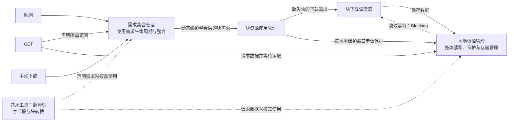

# 下载需求与资源管理设计

更新日期：2026-10-19。

本文是下载需求与资源管理后续设计的唯一权威文档（canonical）。前半部分维护已达成共识的目标与边界，后半部分维护已涉及但尚未决定的问题。讨论形成结论后，将结论移入前半部分并更新相关入口，不另建并行的现行方案。

本文承接 2026-10-18 的手绘记录及后续讨论；原始记录保留为历史材料，发生冲突时以本文的已确认事项为准。本文不表示目标已全部实现，也不把待讨论方案视为实施要求。当前按下述分阶段实现记录推进；不考虑旧配置、旧临时数据的兼容或迁移。

现有代码的架构依据、运行参数和落盘契约分别见[当前全局块调度设计](block-scheduler-design.md)、[下载并发规则](download-concurrency.md)和[存储约定](storage.md)。这些文档继续说明当前实现；本文负责后续目标及决策状态。实现变化时同步更新对应说明，不能仅修改本文就宣称行为已经改变。

## 一、已达成共识的事项

### 1. 目标与职责边界

以块需求统一表达 GET、队列和手动下载对视频内容的使用要求，分开处理使用需求、下载执行和本地资源保护。各模块是职责边界，不预先规定必须各自建立服务、工作协程或独立队列。

| 职责 | 已确认的目标 |
| --- | --- |
| 需求来源 | GET、队列、手动下载声明需要哪个视频、哪个范围、什么时候需要；需求的结束由来源自身决定。 |
| 翻译机（共用工具） | 提供可复用的视频字节段与视频块转换能力；来源向需求集合管理声明需求，或向本地资源管理请求数据时，均可按需使用。它不是流程中的独立必经阶段。 |
| 需求集合管理 | 根据上游使用需求的发布、更新与撤销进行整合，动态维护它对块资源使用管理的需求；不根据块是否已下载、本地是否存在来决定使用需求是否结束。 |
| 块资源使用管理 | 根据整合后的需求及本地保护提前窗口协调本地保护；缺失块交给块下载调度器，按下载窗口安排执行；窗口内已有及下载后形成的本地块都应受到相应保护。 |
| 块下载调度器 | 根据缺失块的下载需求安排执行。下载任务的生命周期与使用需求的生命周期分开。 |
| 本地资源管理 | 对外提供按块使用视频的能力，统一负责文件组织、缓存读写、可用性、读取等待、保护、持久化预算与预留、保留取舍、回收、合并、校验和发布。其他模块通过接口使用这些能力，不另行维护文件或存储预算。具体接口尚待讨论。 |

上游来源身份及各自的需求贡献由需求集合管理维护。上游需求变化时，需求集合管理重新整合，向块资源使用管理新增、更新或撤销相应的块需求。块资源使用管理只关心整合后的块需求，不关心原始来源是谁，也不承担来源之间的整合。

转换工具的虚线表示按需复用，不是必经的调度阶段，具体调用位置随接口确定。Blocking 虚线表达急需信息的逻辑关系，尚未选定是直接接口、回调还是经过协调层传递；它不意味着另建一套下载任务或绕过共享机制。

### 2. 使用需求独立于下载完成

使用需求的生命周期由需求本身决定，不能因下载完成而结束。块已经存在于本地、刚刚下载完成或仍然缺失，都可以同时有有效使用需求。

对于 GET，来源身份持续到该 GET 结束，所需范围随块级消费完成逐步缩减；尚未消费完成的块需求持续存在。预计的 need-by 或时间窗口到期不能自行将 GET 视为已经结束，但 GET 仍存在不赋予过期下载任务继续占用额度的资格：可以主动失败结束 GET，再撤销其剩余需求。块级消费与下载截止分别见第 3、4 项。

下载完成表示资源可用性发生变化；它可以结束相应下载工作，但不能自动抹掉仍有效的使用需求和本地保护依据。需求来源退出时，也必须区分该来源的贡献与其他来源仍保留的需求。

完整使用范围现由来源集合投影并生成无来源身份的 blockUse 摘要，下载协调器在此之后过滤已有块、叠加实际读取等待；本地保护复用同一投影和整合函数。摘要分别提供下载的最早有限 need-by、机会下载权限、最晚有效期和最早重算时刻，以及全部有限使用需求的最早本地保护 need-by。GET 过滤交接紧迫度只影响下载排序，不抹掉仍有效的交接使用与保护依据。来源登记、退出和交接转移在同一把锁下更新；唯一块引用归零时立即以真实事件时刻处理本地延续，再合并唤醒下游。无需另设常驻服务或来源保护记录。

### 3. GET 读取与急需信息

GET 收到请求后，一方面声明所需范围，另一方面向本地资源管理请求数据。正常缺块等待表现为读取返回较慢，GET 无需自己判断或操纵 Blocking；本地资源管理感知正在等待的缺块，并将急需信息传达给下载调度。

这里的急需信息对应当前实现的 `Blocking`：[`spoolReader.Read`](../internal/cacheproxy/stream.go) 在确实等待缺失数据时登记独立等待，由 [`downloadSession`](../internal/cacheproxy/scheduled_download.go) 汇入对应块的 Blocking 贡献；本次 Read 返回时撤销自己的等待。GET 到达或普通本地校验等待本身不产生该标记，多个读取者的等待独立登记和撤销。

“持续等待并读完”描述正常读取路径，不表示忽略客户端取消或隐藏读取错误。

#### 按块确认消费并撤销需求

采用块级逐步撤销，继续使用现有 HTTP 传输机制。**消费完成表示某块中属于该 GET 的全部所需字节，已经被 HTTP 响应写入层接受。** 这个边界不表示客户端已经收到、解码或播放完成。

- 根据实际 200/206 视频响应的范围和写入返回的字节数推进消费位置；Reader 的读取或 Seek 位置不作为交付依据。
- 某块所需字节全部交付后，只撤销该 GET 对该块的贡献；首尾只请求了块内一部分时，该部分交付完成即可。
- GET 的来源身份仍持续到请求结束；取消或失败时统一撤销剩余需求。逐块完成与整个来源退出必须区分，不能把进度推进误当作来源退出交接。
- 其他来源的需求独立保留并重新参与整合；最后一份块需求结束后，按第 4 项进入本地延续保护，不直接等同于删除数据。

当前单个连续响应使用“响应范围与已交付位置”记录进度，仅在块需求结束时批量通知缩减范围，进度状态保持常数大小。冷热缓存共用消费机制；消费位置与原始时间基准分离，不能因推进消费位置而改变剩余块的 need-by。

已实现 HTTP 层与 obtainDemand 共用同一 GET 来源；getConsumption 根据实际 200/206 响应范围和 Write 返回的已接受字节推进，只在跨过块所需范围时通知缩减。冷热读取共用路径，短写明确失败，原播放时钟不变。完整使用需求范围现由 projectUseLocked 统一投影，本地保护已按完整使用范围接入；本地块文件、运行期共享、零预算逐块回收及持久化预留均已接入。

#### GET 完成与持久化结果分开

**GET 所需字节正常交付完即算完成，不等待整视频 MD5 校验或持久化发布。** 交付继续以上述 HTTP 响应写入层实际接受字节的边界为准；完整 200 响应与范围 206 响应共用此规则，取消为等待校验和发布而扣留最后一个字节的行为。这里的完成不表示客户端已收到或播放完成，也不证明整视频 MD5 正确或正式缓存已经发布。

请求范围、响应长度、资源一致性检查，以及读取、写入错误和客户端取消仍按各自规则处理，不能将短写或传输失败视为正常完成。完整视频持久化的校验与结果由本地资源管理按第 6 项独立处理，后续持久化失败不追溯改变已经正常完成的 GET。手动补齐仍以完整校验和发布完成作为整视频成功依据，不使用 GET 的完成条件替代。

已移除 spoolReader 的尾字节门槛、verifyFull 和完整 GET 的发布后歌曲记录等待。读取到完整所需字节即可正常交付；发布结果由工作会话独立处理。已收齐可读字节时，消费完成不再取消正在收尾的执行和发布。持久化准入、零预算不校验及逐块积极回收均已接入。

### 4. 下载时间与本地保护生命周期

#### 固定下载提前量

**下载提前窗口采用固定提前量 M，取消动态块耗时估算 T 对启动窗口的影响。** 对有期限需求，窗口开始时间为 `need-by - M`，即 `need-by <= now + M` 时进入下载提前窗口；实际启动仍需满足有效期、执行额度及既定调度规则。M 表示完整的下载提前量，不再使用原来的 `need-by - T - M`，也不额外叠加固定的 64 秒。

提前量按偏慢场景留足余量：本轮采用典型视频码率要求约 2 Mbps、16 路下载，单路最低吞吐按 `2 / 16 = 0.125 Mbps` 估算。按 1 MB 块粗算，纯传输耗时为 `8 Mbit / 0.125 Mbps = 64 秒`；当前实际标准块为 1 MiB，按十进制 Mbps 精确换算约为 67.1 秒。约 64 秒是本轮吞吐假设下的耗时设计基准，不是含连接、排队、重试等开销的网络耗时硬上限，也不作为单次尝试超时值。

**M 设置时应大于约 64 秒的基准，正常取值宜远大于这一量级，为传输及其他等待留出充分余量。** 当前默认 500 秒符合这一量级要求；设置与引擎配置接受 120～86400 秒，0 使用默认 500 秒；120 秒是在约 67 秒纯传输基准外留出余量的输入下限，不是完成时限保证。较小非零值直接拒绝，不提供旧配置迁移。采用固定提前量的决策已确定，不再等待是否保留 T 的选择。

本地保护继续使用独立的固定提前量，通常与下载提前量取相同时长，但允许分别调整。取消 T 对下载启动窗口的影响，不改变本地保护的启动、延续和释放规则，也不改变手动下载完成后被回收风险的处理边界。

#### 本地保护

**本地保护由“本地保护提前窗口”控制开始时机，不因需求登记而立即生效。** 需求集合管理按第 1 项的既定职责发布实时块需求及其 need-by；块资源使用管理依据本地保护提前窗口协调保护、检查已有块并派生缺失块的下载任务。需求方无需另行声明一套保护需求。

本地保护提前窗口与下载提前窗口保留独立语义：通常采用相同的提前时长，但允许后续分别调整，不将二者合并为一个无法独立改变的规则。对有限 need-by 的需求，本地保护开始时机按 `need-by - 本地保护提前量` 判断；当前引擎配置 LocalProtectAhead 独立控制本地提前量，0 跟随 PrepareAhead（默认 500 秒），有效范围 0～24 小时；现阶段无需新增控制台字段。

| 需求与窗口状态 | 本地保护行为 |
| --- | --- |
| 需求已登记，但尚未进入本地保护提前窗口 | 该需求尚不提供本地保护；仍占用块需求容量。其他来源、已有延续保护及读取引用按各自规则处理。 |
| 已进入本地保护提前窗口，且对应需求仍有效 | 保护该块；已有本地块及此期间新形成的本地块都适用，不因 need-by 到期就自行结束仍有效的使用保护。 |
| 最后一份需求结束 | 已有保护从这次“有需求变为无需求”的真实时刻起，额外延续固定 1 分钟（60 秒）。 |
| 延续保护到期，仍无需求 | 解除该规则提供的保护，是否实际清理由本地资源管理决定。 |

多个来源需要同一块时，退出一个来源只移除其贡献，剩余需求仍须结合本地保护提前窗口判断；不能仅凭还有远期需求就继续提供即时保护。**本地延续保护截止为该块最后一份需求真实结束时刻加 1 分钟**，重复通知或检查不能自行刷新期限。延续期间出现的新需求也须经过本地保护提前窗口判断，不能仅凭重新登记就立即转为持续保护。

**need-by 后移到保护窗口外，或入窗来源退出后只剩远期需求时，沿用上述通用规则，不增加特殊处理。** 这些情况的实际业务影响有限；只要遵守已确认的保护窗口、固定延续及通用读取引用边界，接受现有状态自然产生的保留或可回收结果，不另行保证一段补偿保护。不将讨论中“最后一份能提供即时保护的需求失效时，重新开始延续保护”的建议确认为新增规则，也不为此增加专属状态、计时器或逐来源保护记录。远期需求不能仅凭登记提供即时保护，也不能借重复事件或远期更新刷新已有延续期限。本项不再作为独立的待决机制展开。

下载与本地保护分别判断各自的提前窗口。需求登记可以早于两个窗口；若先进入本地保护提前窗口，可以先保护已有数据而等待下载准入。缺块期间保留满足窗口条件的保护依据，数据形成时衔接到本地块。延续保护仅用于保留本地数据，不产生新的使用需求或下载资格。

本次修订替代此前“需求一经登记就持续保护、取消本地保护提前窗口”的结论，恢复独立的本地保护提前窗口；本地延续期仍从最后一份需求结束起算，而非从 need-by 或下载完成起算，不恢复早期相对于 need-by 的本地延续区间公式。两个提前窗口分别调整时的覆盖关系，以及通知、读取引用与清理的并发边界，见第二部分；need-by 后移及只剩远期需求按上文通用规则处理，不预设新的例外或计时状态。

#### 常规播放交接与同块需求重新接入

**来源之间的短暂空档是常规播放路径，必须保留交接保障。** 本轮给出的场景包括首播 GET 退出后约半秒重新发起 GET，以及队首歌曲消失后约 10～20 秒才出现正式播放 GET。不能将这些场景视为罕见重连，仅为简化状态就接受每次重新冷下载。本地延续保护期确定为 1 分钟，用于覆盖这些交接空档并留出余量；按每块最后一份需求结束的真实时刻判断覆盖，不能一律从整个 GET 结束时才起算。

**保留有界的特殊交接需求，由需求集合管理维护并整合，块资源使用管理不识别交接来源。** 交接关注需求本身的生命周期，不依附于缺块下载任务：从原来源退出时尚未结束的使用范围承接，包含已下载但尚未消费的块；已经消费并撤销需求的块不重新加入，按各自已有的本地延续保护处理。交接范围不随下载完成而缩小或消失，不能继续沿用当前实现只为未下载完成块生成交接的限制。

**只有客户端关闭 GET、队首从队列消失这两类事件产生交接。** 单次下载尝试失败、下载延续截止、消费完成及引擎关闭按各自生命周期处理，不作为额外的交接触发条件；普通队列或手动下载来源退出也不产生交接。当前实现的交接转换入口只接受 GET／队首的 `source_gone`；退出路径现已区分客户端关闭与正常交付/服务端失败。交接在来源退出时建立，不再等待下载任务观察消失；不得另行扩展交接策略。

原来源撤销与交接承接应在同一次整合结果更新中表达，避免中间出现虚假的无需求状态。交接到期以原来源真实退出时刻为基准，不因通知延迟、重复事件或新 GET 到来续长，也不由交接再次生成交接。新 GET 独立登记自己的范围，与交接及其他来源共享同一块；交接结束只撤销自己的贡献。沿用既定的唯一块计数，同一块的原来源、交接及新来源不分别占用槽位。

**交接有效期与 need-by 分别计算：** 设原来源真实退出时刻为 `E`，退出时该块原有的 need-by 为 `N`，转换时一次性确定以下值：

| 交接来源 | 交接需求结束时刻 | 交接块的 need-by |
| --- | --- | --- |
| 客户端关闭 GET | `E + 2 秒` | `N + 2 秒` |
| 队首从队列消失 | `E + 20 秒` | `N + 5 秒` |

need-by 只在原值上平移，不取原值与退出时刻的较晚者，也不因延迟处理或后续检查重新计算。当前代码已改为原 need-by 直接加调整量；过期原值不因退出时刻被重新推迟。交接现覆盖完整未消费使用范围，包括已下载块；范围、原播放时钟及固定到期统一由需求集合持有，下载协调器只读取缺块投影。

本地延续保护用于保留已有数据，不自动维持网络下载。下载延续窗口按 `need-by + 30 秒` 截止，不等同于“来源退出后再延续同样时长”，也不单独提供来源消失后的执行资格。交接需求可以提供有效需求依据，但下载仍须满足下载窗口与调度准入条件；若按平移后的 need-by 计算，下载延续截止仍已过去，交接不提供继续下载的资格，本地保护仍按既定规则判断。没有其他需求时，交接结束与下载延续截止任一条件到达，都结束该交接所能提供的下载资格；不能借交接让已到期任务继续沿用过期资格。

**移除独立的离队后 30 秒文件保护，交接后的本地保留统一依赖 1 分钟的本地延续保护期。** 对每块按最后一份使用需求（包括交接需求）结束的真实时刻起算；交接仍有效时按既定本地保护提前窗口判断保护。若交接是最后一份需求，则在交接结束后再开始这 1 分钟的延续保护；统一延续保护结束后不再叠加一轮队列专属的 30 秒保护。现已移除独立队列保护映射和 API，完整文件回收及手动删除共用块保护；零预算的临时块回收也复用同一保护结果。

**延续期内同一块重新出现需求时，块资源使用管理必须能够重新接管仍保留的本地块状态。** 按相同资源与块身份复用已完成的可读块，依据新的整合需求重新判断下载资格和本地保护窗口；仍合法执行的同块下载应继续共享，已经停止的下载按第 7 项重新建立，不恢复旧任务或半块前缀。新需求已进入本地保护窗口时，衔接到有需求保护，旧的到期通知或清理计划不得解除新保护或误删数据；新需求尚未入窗时，仍按既定规则处理已有延续保护，不因登记就额外延长。只接管新需求覆盖的块，其余块按各自原有期限处理。新需求是重新接入依据，不能借此恢复已撤销的旧来源或让已到期下载任务沿用过期资格。

上述要求用于保障正常播放交接，不改变手动下载完成后可被回收的既定边界，也不为手动下载增加保护例外。重新接入与到期、执行取消及本地清理的并发接口，仍需在第二部分确定并验证。

#### 单次尝试超时与下载延续截止

“下载超时”需要区分以下两个概念，不能共用一个含糊的生命周期规则：

| 概念 | 时间依据与目的 | 到期后的含义 |
| --- | --- | --- |
| 单次下载尝试超时 | 从一次连接或请求的尝试开始计时，限制该次尝试占用执行资源的时间，不包含后续重试。 | 本次尝试失败；在需求仍允许下载的前提下，通过适当的重试或换源等机制继续处理。沿用现有有界候选回退和验证规则，不新增并行冗余。 |
| 下载延续窗口 | 下载任务的 need-by 由需求集合整合得出；对有限 need-by，截止于 `need-by + 30 秒`，限制对存在过时风险的需求继续投入下载资源。 | 到期任务停止并结束。依据调整后的需求集合重算 need-by，重新满足下载窗口和调度准入条件后，才为仍缺失的块建立新下载任务。 |

**下载延续时长确定为统一固定的 30 秒。** 该值表达错过预计使用时间后仍愿意继续下载的时长；提前量 M 负责为提前出现的需求留出准备时间，两者用途不同。接受没有预下载的慢速 GET 可能在块下载完成前到期，并按下文规则明确失败结束，不为容纳最慢冷下载将延续期扩大到 120 秒。本地延续保护期独立取 1 分钟，从最后一份块需求结束时刻计时。

当前实现尚无基于 need-by 的下载延续截止；`DownloadTimeout` 已改为每次 HTTP 尝试的响应头及正文时限，默认 10 分钟；重试重新计时，不含调度等待，见 [`config.go`](../internal/cacheproxy/config.go) 和 [`routes.go`](../internal/cacheproxy/routes.go)。这与新的 `need-by + 30 秒` 是独立限制，执行时须同时满足适用的时限，先到的限制先结束执行；本次确定下载延续期不等于将现有执行超时改为 30 秒。

下载延续截止不随实际开工或重试重新起算。窗口到期与单次尝试超时是独立条件，不能依靠后续重试不断延长下载资格。不另设包含重试的一轮下载总时限；保留现有有界候选与重定向次数，父级取消和下载延续截止控制整轮生命周期。

**到期的下载任务不能以任何理由持续占用下载额度。** GET 仍在等待、另一个来源也需要同一块、正在等待需求撤销或重新整合，都不能成为保留过期执行资格的例外。

过期任务停止并结束后，后续处理只有以下两种结果：

1. **不再建立下载任务。** 可以主动使相关 GET 明确失败并结束，由请求结束路径撤销属于它的需求；没有剩余需求需要下载时，不再建立任务。不能只停止下载，却让相关 GET 无期限等待。
2. **根据实际调整后的需求集合重新取得合法调度资格。** 需求集合管理接收旧 GET 等来源的撤销或更新，重新整合剩余需求并计算 need-by。仅在重新满足下载窗口与调度准入条件后，才为仍缺失的块建立新下载任务并占用下载额度；存在其他来源本身不构成许可。若重算后仍已到期，不能重新执行；若尚未进入启动窗口，应等待准入。完整块复用与未完成块重新下载遵循第 7 项。

need-by 的调整必须来自需求集合的实际变化，不能为了保留执行而直接把旧任务的 need-by 向后移动。旧 GET 因超时被迫退出后，由剩余来源重算出较晚的 need-by，是这一过程的典型情形。撤销旧 GET 只移除它的贡献，不自动撤销其他来源；其他来源保留后是否支持下载，仍必须经过上述重算与合法性判断。

**失败反馈沿用现有处理机制，不新增按块故障隔离的改造目标。** 下载延续窗口到期时，按上述规则停止过期执行、使相关 GET 明确失败结束，并撤销其需求、重新整合剩余来源。其他下载错误继续复用现有错误传播与请求结束路径；接口迁移只作落实已确认生命周期规则所需的调整，不因改为按块管理就另行扩大错误隔离设计。

取消下载任务不等于使用需求已经撤销，本地保护仍按本节的窗口与固定 1 分钟延续规则处理。停止执行、失败通知、需求撤销与重新建立下载任务的具体接口，仍需在第二部分确定；不保留暂停状态等待恢复，也不得在等待这些步骤完成期间继续以过期任务占用下载额度。

#### 无明确期限的手动下载

**手动下载保留无明确期限的需求，不人为指定 need-by，通过下载调度顺序安排执行。** 下载提前窗口内有仍具备执行资格的有期限需求等待启动时，优先下载这些块；没有这类待启动需求时，安排无明确期限需求的缺失块。该顺序用于选择待启动任务，仍遵循统一执行额度，不新增对正在执行块的优先级抢占。有限 need-by 的下载延续截止不直接套用于无明确期限需求；单次尝试超时及通用失败处理仍适用。共享块已有的过期任务仍须按上文停止并重新取得合法资格，不能仅凭还有无期限需求继续占用额度。

**手动下载来源根据准备结果撤销已满足的需求，不持续占用已完成部分的块槽位。** 目标视频完整校验并发布为正式本地资源后，撤销该来源的剩余需求；也允许类似 GET 按块逐步撤销已确认完成的部分，具体块完成判定与反馈接口待定。撤销只移除手动下载来源的贡献，最后一份块需求结束才释放该 unique 块槽位并支持回补。需求集合管理接收来源的撤销并重新整合，不自行因下载完成删除其他来源的使用需求。

**不因手动下载及其完成后被回收的风险改变本地保护行为。** 无明确期限需求的登记本身不提供额外保护；其他来源的本地保护窗口、已有延续保护及本地资源管理的通用读写、校验引用按各自规则处理。写入、校验和发布期间的数据保留复用通用资源生命周期，不以手动需求持续占槽位维持。逐块撤销不等于整视频下载成功；整视频成功仍以完整校验和发布完成为准，最后一块需求撤销与校验发布收尾的衔接需在实现时验证。

**承认完成后被回收是合法且风险较高的路径：** 手动下载完成后撤销需求，在其他保护和活动引用均已退出时，资源可以按本地回收规则被删除。下载成功只表示当时已完成校验和发布，不承诺之后持续保留；写入与校验期间的资源引用不能消除完成后的回收风险。

**该风险只能通过下载需求与资源回收的协调处理，不能反过来改变本地保护行为。** 手动下载需求的下发与本地资源回收必须尽量协调一致，在准备下载时兼顾资源保留取舍与存储容量，避免一边持续补齐、另一边持续删除同一批资源，或回收释放空间后又不断放行低保留价值的内容。块需求槽位释放只说明需求集合有余量，不能替代存储容量和回收策略的判断。这是来源接入、资源准备与本地回收之间的协调要求，不改变需求集合管理仅按上游需求维护整合结果的职责。本地保护的启动、范围、延续和释放仍遵循既定规则；不得为规避该风险新增保护例外、延长活动引用，或保留已完成需求来间接维持保护。存储预算、保留取舍与回收归本地资源管理统一负责，来源接入使用其结果；具体反馈信息和接入接口仍待确定。

### 5. 以需求集合管理的块需求容量为中心

后续设计以块为中心。**彻底去除队列“解析资源、登记需求”及手动下载的独立歌曲／视频并行数量限制**，不把原来的两个准备调用者仅改名为两个解析调用者继续保留。上游维护有序的歌曲待办，**按可用块需求槽位反向有序放行**，不等待前面的整首视频下载完成才处理下一项，也不以下载提前窗口是否有空缺作为上游登记的门槛。

**需求集合管理向块资源使用管理交付有需求的唯一块（unique 块）集合，容量上限约束这个集合的长度。** 同一资源的同一块被多个来源需要时只计一次；不同资源的块分别计数。内部可以采用紧凑范围等表示，但不能把该上限仅解释为内部逐块展开的工作量，而在上限之外另行承诺未计入的块需求。

计数不受本地命中或下载完成影响：只要仍有来源需要，该块就仍在集合内；最后一份需求结束后移出集合，后续本地延续保护不继续占用使用需求容量。

**unique 块需求集合的容量上限采用 4096。** 该值沿用现有下载任务容量的数值，计数对象按本节改为使用需求集合；不表示沿用下载完成即释放容量的生命周期。目标是以充足的常规容量让每个 GET 的完整需求即时进入，不再为典型使用场景另选百级容量。

容量依据采用本轮给出的经验值：每首歌约 45 MiB，准备 500 秒或更长至少约覆盖 2 首歌，准备 1000 秒约覆盖 5 首歌。按当前 [`rangeBlockSize`](../internal/cacheproxy/ranges.go) 的 1 MiB 块大小，分别约为 45、90 和 225 块；4096 块对该典型规模已有充分余量。这些是使用场景估算，不是视频大小或 GET 范围的硬上限，也不表示新需求集合已完成性能验证。

**极端容量压力按最小必要处理，采用简单准入门槛：**

- 非 GET 来源新增 unique 块时，接纳后的总集合长度不得超过 70% 上限，即 2867 块；GET 可使用剩余容量，但总长度不得超过 4096。非 GET 指队列、手动下载等业务来源，不按内部上游 HTTP 请求的方法分类。
- 完全共享已有块、不扩大集合的登记，以及不扩大集合的更新、缩减和撤销，不受新增块门槛阻挡。已接受的需求不因使用率越过 70% 被驱逐。
- 非 GET 容量不足时返回暂缓，由来源通过正常回补流程重试；极端情况下 GET 也无法容纳时，明确返回容量不足并结束该请求，保留其他已有请求。不为无法接纳的 GET 建立额外等待机制。

队列与手动下载共用上述块容量准入口径，按各自待办顺序逐步取得资源信息并登记需求；来源全部进入或没有可接纳的块容量时停止继续放行，容量释放后回补。手动补齐可能较快填至 70% 门槛，也可能在达到门槛前容纳全部需求。按每首约 45 块估算，2867 块约容纳 63 首歌；这是提前取得信息和登记需求的规模，不是新增的歌曲数限制，也不表示这些视频同时进行网络下载。元信息取得前后的块数衔接与具体回补接口仍待确定，不以先并发解析全部待办的方式绕过块层放行。

**需求登记与下载启动分开。** 有限 need-by 的需求即使提前登记，实际下载仍须满足下载提前窗口及网络执行准入；没有有限 need-by 的手动补齐按第 4 项在没有窗口内可启动的有期限需求时参与下载，仍受统一执行额度约束。

**本地保护独立按第 4 项的本地保护提前窗口启动。** 按槽位更早登记远期需求，不代表立即保护其已有本地数据；需求接入规模由块槽位控制，实际下载和本地保护分别由各自窗口管理。两个提前窗口通常取相同时长，但保留后续独立调整的能力。

准入复用集合计数及本次需求合并结果，避免为此增加额外全量扫描、轮询或常驻监控。此类极端情况不值得引入复杂抢占、动态扩容、多层配额或专门的等待队列；满足有界、明确反馈和已有需求不受误伤即可，不继续以这些极端情况扩展设计。常规来源回补的接口仍见第二部分第 5 项。

这不预先决定所有限额都应删除。网络执行额度、本地校验能力和存储容量承担不同职责；它们与块需求容量如何衔接、哪些现有限制可以合并或去掉，待结合接口和回补机制确定。

### 6. 本地资源管理的存储与外部契约

**采用按块临时文件、系统缓存读写、块级回收及完整视频合并持久化，作为可长期使用的存储方案。** 不将其仅视为过渡版本，也不预设必须继续迁移到纯内存存块或稀疏文件打洞。完整视频沿用现有 `videos/{md5}.mp4` 正式文件格式及长度、MD5 校验要求；不完整视频的生命周期仍只存在于单次引擎运行，不跨运行恢复。完整块文件、跨会话复用与合并校验已实现；持久化准入/预留及零预算逐块积极回收已接入。

**上述能力全部由本地资源管理负责。** 块文件与完整文件的组织、系统缓存读写方式、可读状态、必要的文件引用、保护执行、持久化预算及其预留和结算、保留取舍、实际回收、合并、校验、发布及退出清理，都由它统一管理。块资源使用管理根据整合需求申请或解除保护；下载执行通过本地资源管理的接口提交数据；GET 通过接口取得数据。需求下发与资源准备使用本地资源管理提供的容量及准备结果，不各自维护另一份存储预算或直接操作文件、决定回收。接口如何表达这些交互仍待细化，不要求为这些职责分别建立服务。

单次运行不等于单次 GET 或单次下载会话：在同一运行内，后续需求可以复用仍保留的完整可读块；是否继续保留仍由既定保护、引用和回收规则决定，不承诺一直保留到退出。退出清理及异常退出后的残留清理沿用受管临时文件机制，下次启动不把这些残留作为可恢复资源。

**未完整视频以块为临时文件单位，由本地资源管理持有文件及完整可读状态。** 下载任务停止后，仍需保留的完整块继续由本地资源管理持有，供后续需求复用；未完成块按第 7 项重新下载。删除某个块文件可以释放该块的存储，不再因同一视频的其他块仍受保护而必须保留全部临时数据。

块文件采用普通缓存文件读写，由操作系统决定内存缓存与磁盘写回；可以使用临时文件属性提示其生命周期，但不承诺数据始终驻留内存或完全不写盘，也不由应用另建一套保存全部块的内存缓存。Windows 的相关行为见[文件缓存说明](https://learn.microsoft.com/en-us/windows/win32/fileio/file-caching)。

**这些存储、预算和回收选择不改变块需求的本地资源保护期行为。** 保护仍按第 4 项的本地保护提前窗口、需求生命周期及最后一份需求结束后的固定 1 分钟延续执行；不会因预算为零、预算已满、资源分数变化或持久化准入结果而缩短、延长或重新开始。必要的读取、写入、校验引用继续按实际生命周期持有，不为等待持久化而人为延长。

**只有持久化视频预算为 0 时，块文件采用积极回收；其他情况不积极回收。** 这里的预算为 0 指未开启“不限”且容量设置为 0，不是正预算暂时没有剩余额度。

| 持久化视频预算 | 块文件的运行期回收行为 |
| --- | --- |
| 有限预算为 0 | 块失去既定保护后积极安排回收，必要活动引用释放后删除，不等待本次运行结束。 |
| 有限预算大于 0，包括当前已满 | 块文件不积极回收，不因失去保护、当前无余量或尚未取得持久化预留就立即删除；保留后续收齐并参与视频保留优先级比较的机会。 |
| 不限 | 块文件不积极回收，仍遵循单次运行生命周期及通用清理规则。 |

不积极回收属于本地资源管理的保留策略，不等于块仍处于保护期。预算已满时，分数更高的视频仍可能替换已有低分视频，不能仅凭没有空余额度提前丢弃其块。保留已有块不产生下载需求，缺失块仍须由实际使用需求驱动下载；合并发布后的临时副本清理、无效数据清理与退出清理仍按各自生命周期处理。需求槽位释放不直接等同于物理空间释放。

零预算回收接入现有 retentionLoop，复用来源变化通知和固定保护到期计时。整份会话或 reader 的存储引用不扩大块保护，实际块读取和合并快照引用才延迟对应文件的物理删除。协调器只在当前零预算会话记录已完成的下载工作，回收不触发同一会话自动反复补齐；真实缺块 Read 仍可重新请求。下载窗口早于保护窗口时允许早下完的块被回收，不增加补偿保护。后续新会话仍按当前可用块和需求重新准备，不将旧会话完成记录视为本地可用性。

**缓存容量上限仍指持久化完整视频的容量，不是整个存储目录的硬性占用上限。** 临时块和合并期间的副本不计为已经持久化的库存；受保护的数据仍可能使实际占用超过该预算，不将所有临时数据强行合并为持久化库存统计。

**块收齐转为 MD5 命名的正式视频前，先由本地资源管理计算是否满足持久化落盘要求，再进行为此所需的合并、校验和发布。** 判断复用现有视频下载与保留优先级，见 [`priority.go`](../internal/cacheproxy/priority.go) 和 [`retention.go`](../internal/cacheproxy/retention.go)：结合完整视频大小、持久化预算、已有库存及优先级取舍，评估新视频是否应进入保留集合，包括高分视频替换低分视频的情况。不能只看当前剩余额度，也不能明知按同一轮取舍应立即淘汰该视频，仍先合并落盘再删除。替换与实际回收继续遵守既定保护和必要引用，不为取得容量提前解除保护。

持久化准入同时考虑并发候选，由本地资源管理统一维护预计完整大小的容量预留及替换取舍，同一资源共享且只计一次；发布成功后转为正式占用，放弃持久化后释放预留。预留用于协调正式落盘，不是预算非零时保留块文件的前提，也不能把低分视频的先到预留变成阻止正常优先级替换的永久资格。已用 publicationReservation 接入：同资源由共享会话单次预留，准入与最终重命名同回收串行，合并 I/O 独立执行；更高优先级候选可撤销低分预留并取消其等待/合并，发布前重新检查保留集合和保护，成功后结算为库存；单轮手动补齐仍不能因回收或预留释放而重新获得已消耗的补齐额度，避免滚动下载整个曲库。

**本下载流程中的整视频 MD5 仅在完整视频持久化发布前校验，由本地资源管理负责。** 未收齐或不准备持久化的数据不安排整视频 MD5 校验；不为校验而额外补齐视频、保留已消费块，或维护随下载推进的持续校验状态。块仍按既定保护、必要引用与回收规则处理；实际进行持久化合并和校验时，使用相应的必要引用。

**满足落盘要求后，由本地资源管理顺序合并为完整视频文件，通过长度和 MD5 校验后发布，再释放临时块文件。** 不满足要求时，不为生成正式缓存而执行合并、MD5 校验或发布，已有块仍按上述预算模式及其保护、引用生命周期管理；不以持久化未准入为由在非零预算下立即回收块。持久化准入不能替代发布前的长度与 MD5 校验；GET 则按第 3 项的字节交付规则完成。发布与旧读取者的衔接必须保持可读性，仍被必要引用持有的块在引用释放后清理；字节收齐、合并中或尚未校验发布的数据均不算正式缓存。完整视频继续按整文件回收，任一块仍受保护或文件仍有必要引用时不能删除整个文件。发布后因后续需求、评分或预算变化被正常回收，仍是合法路径，预判不构成永久保留承诺。

接受这一方案的文件操作和合并复制成本，以及合并期间临时块与完整文件可能同时占用空间。后续可根据实际测量优化内部读写与发布，不将稀疏文件、打洞或原地发布作为既定下一阶段。本决策替代此前“同一视频共用一个临时文件、仅整文件回收、接受暂时无法逐块释放空间”的第一版选择；块文件积极回收以本节“仅持久化预算为 0 时启用”为准，替代此前按保护结束、剩余额度或持久化保留资格决定积极回收的表述。

在对外契约明确且保持兼容的前提下，内部的文件组织、写入、发布和清理方式可以持续改进，调用方不应依赖这些细节。若改动影响可读性、完整性、保护承诺、取消与错误语义或重启后的可用性，就需要重新评审对应契约，不能仅归为内部优化。具体接口与内部方案见第二部分第 6 项。

### 7. 不保留块下载暂停与恢复

**目标设计不保留块下载暂停／恢复。** 块下载因失去执行资格或生命周期取消而停止时，结束旧任务并完成响应与写入清理；后续仍需下载时，依据当时的整合需求重新判断资格并建立新任务。未完成块从块起点重新下载，接受已接收部分字节的重复传输。不保存供旧执行恢复的半块前缀、候选游标或已验证重定向等进度，也不保留供新需求重接的暂停任务；当前用于无需求任务重接的 30 秒元数据保留机制不纳入目标设计。执行额度仍须等旧响应关闭和收尾完成后释放。

**完整块的保留与复用由本地资源管理承担，独立于下载任务。** 已完成且可读的块遵循既定保护、引用和回收规则，不能因下载任务结束而一并丢弃；新需求复用仍保留的完整块，只为缺失块重新安排下载。这不改变本地保护的范围和时长，也不增加跨引擎运行恢复能力。

常规播放交接继续依赖第 4 项的有界交接需求：整合后仍有合法下载资格的在途任务继续执行和共享，不因来源交接先停后启。普通下载失败后的重试、换源，以及尚未执行任务的容量延期不属于暂停／恢复，分别按错误处理和容量接入规则讨论；不新增优先级抢占。上游顺序 200 回退仍不提供分段续传，停止后需要重新下载。

完整块现由 [local_resource.go](../internal/cacheproxy/local_resource.go) 的引擎注册表与 [local_blocks.go](../internal/cacheproxy/local_blocks.go) 的块文件持有，Range/顺序 200 共用；不保存半块前缀和跨会话候选游标，移除 32 个/512 MiB 检查点上限。新会话复用完整块并使用当前地址，合并快照和旧读者引用保持数据可读。调度核心的暂停、无需求 30 秒任务保留及首次响应头前的恢复游标均已移除，见 [scheduler.go](../internal/blocksched/scheduler.go) 和 [stop_test.go](../internal/blocksched/stop_test.go)。首份需求与任务通过 Schedule 原子登记，最后需求退出即结束旧任务；清理前拒绝重接并继续计入额度，清理后按当前摘要创建新任务。首次响应头、候选和重定向都重新开始；常规执行内的有界重试仍保留。Range 可在原资源会话中建立新任务，顺序 200 必须结束旧会话。

## 二、涉及但尚待讨论的事项

### 1. 实时块需求的整合与动态维护（已实现）

[usage_plan.go](../internal/cacheproxy/usage_plan.go) 持有来源投影，[block_demands.go](../internal/cacheproxy/block_demands.go) 生成 blockUse；GET、队列、补齐及交接身份不进入下载协调器。完整缓存命中同样登记使用需求。来源以连续范围保存，唯一块引用索引负责容量和最后引用结束事件；准备完成不结束队列成员的使用范围。

下载协调器只消费通用摘要、过滤可用块并加入独立读取等待。有限下载时刻取参与调度的最早值，有效期取最晚值，同时按最早来源到期重算；有有效 GET 时抑制交接的下载紧迫属性，普通队列及机会下载权限独立保留。本地保护取全部有限使用需求的最早时刻，按独立窗口判断。保护延续从最后引用的真实结束时刻产生，不由可能合并的唤醒消息重建；延迟交接仍使用固定原到期，不重置尾期。

容量接入和来源有序回补已实现，见第 5 项。块文件、持久化及下载截止仍按后续事项推进；本节不再保留已落实的来源身份分离和摘要接口待决项。

### 2. 消费完成、取消与解除保护

第一部分第 3、4 项已确定块级消费的判定、逐步撤销、请求结束时撤销剩余需求、过期下载任务的退出与重算、本地保护提前窗口，以及最后需求结束后的固定延续保护；保留有界交接需求并按使用范围维护其生命周期，交接触发条件、2／20 秒有效期和原 need-by 加 2／5 秒的公式已确定，移除独立的离队后 30 秒文件保护，同块新需求必须正确重新接管。本节继续确定通知接口与生命周期衔接。

待决定：

- 块级消费进度如何更新来源范围并通知需求集合，如何与取消、失败、任务到期及重新整合衔接。
- 如何将已确定的交接触发条件、使用范围和时间公式接入来源生命周期；核对通用请求释放路径，避免将服务端主动失败结束请求误报为客户端关闭。交接策略本身不再列为待决事项。
- 来源交接与批量撤销如何传达最后需求结束，衔接固定延续保护，并在同块新需求到来时避免旧到期或清理通知误伤新状态。
- 队列来源的结束条件，以及手动下载按块撤销所需的完成判定与反馈接口；逐块撤销如何与整视频校验、发布及失败结果衔接。

HTTP 层和 [`obtainDemand`](../internal/cacheproxy/cache.go) 已共用 GET 消费进度与来源生命周期，正常完成及服务端失败不再误报为客户端关闭；已验证冷热缓存、If-Range 转完整响应、首尾部分块、短写或写入失败、取消与多 GET 共享。完整使用范围现由 projectUseLocked 维护，下载任务不再生成、续期或持有交接生命周期；统一保护摘要和固定延续已接入，块文件生命周期已由本地资源持有，积极回收及准入继续第 6 项。临时数据已确定按块文件回收，但逐块撤销仍需衔接延续保护、活动引用及持久化保留取舍，不能直接等同于减少磁盘占用。

GET 的尾字节等待校验与发布逻辑已移除；完整 200、范围 206 及 If-Range 转完整响应均按实际字节交付完成。后续本地资源接入继续保证：持久化未准入、尚未完成或后续失败不能使已正常交付完的 GET 继续等待或改为失败。同步核对请求完成记录、需求撤销与手动补齐结果，避免沿用共用下载会话的校验发布结果混淆 GET 完成和持久化成功。

第一部分确定了失败结束 GET 后撤销其来源需求、结束过期任务，并依据重新整合的剩余来源判断是否建立新下载任务的原则；具体事件协议必须保证过期任务不继续占用额度。停止执行、失败通知、撤销通知与新任务建立如何衔接仍待确定。消费完成或来源退出后，移除该来源贡献，依据剩余需求及本地保护窗口重新判断保护；最后需求结束时，已有保护按固定延续规则处理。来源更新和固定保护延续已实现；下载截止与块文件接口继续细化。只剩未入窗需求时沿用第一部分的通用保护边界，不另设特殊衔接策略。

### 3. 下载与本地保护窗口的名称、数值和边界

本地保护由独立的提前窗口控制开始时机，最后需求结束后固定延续 1 分钟。以下名称用于讨论，不作为最终配置名：

| 时间范围 | 时间依据 |
| --- | --- |
| 下载提前窗口 | need-by 之前的固定 M 时长；不再叠加动态 T |
| 下载延续窗口 | need-by 之后固定 30 秒，时长已确定 |
| 本地保护提前窗口 | need-by 之前开始保护本地块的范围；通常与下载提前窗口采用相同时长，但可独立调整 |
| 本地延续保护期 | 某块最后一份需求结束后固定 1 分钟（60 秒），时长已确定 |

下载采用固定提前量 M、M 应大于且宜远大于约 64 秒设计基准的原则已确定，具体配置衔接见第 4 项。下载延续期已确定为 30 秒，本地延续保护期已确定为 1 分钟；本地提前量采用独立 LocalProtectAhead，0 跟随下载 PrepareAhead，接受 0～24 小时；窗口起点含等号，固定延续期在截止时刻结束。现阶段不新增控制台字段。两个提前窗口的语义独立，不因通常取值相同而合并；本地延续保护仍按最后需求结束计时，不需要来源定时续租来表达仍有需求。

还需明确：

- 对没有实际 GET 使用的预测性需求，下载延续截止后由谁结束其使用需求；需求撤销后按第一部分规则处理本地保护。
- 已实现：复用 DownloadTimeout 作为单次 HTTP 尝试（含响应头和正文）的时限，默认 10 分钟；候选数量、验证和回退沿用现有规则，每次尝试独立计时，不按候选数分摊，也不增加整轮重试总时限。顺序 200 同样受尝试时限约束，本地校验与发布单独计时。更早的父级截止仍有效。下载延续截止的判断与通知、到期与完成同时发生时的处理继续后续阶段。
- 两个提前窗口分别调整时，如何衔接下载中数据与本地保护。需求撤销、need-by 后移及远期需求变更遵循第一部分已确认的通用边界，不再为这些情况单独设计补偿保护或计时状态。
- 入窗、固定延续保护到期、需求变更及读取引用释放的并发衔接。

### 4. 固定提前量的配置与实现衔接（已实现）

启动准入、定时唤醒及容量优先级比较统一使用 `ReadyBy - M`。默认 500 秒，设置与引擎配置接受 120～86400 秒；缺省或 0 使用默认值。低于下限的非零值直接拒绝，不兼容或迁移旧配置；保存仍在重启后生效。

已移除动态 T 的均值、衰减状态和基于 T 的紧迫诊断。保留成功标准块的实际准入至可读耗时事件，用于诊断和测速完成块计数；它不参与窗口或排序。日志保留 overdue，测速 BlockTimeMS 表示最近一个成功标准块的实际耗时。

同步实现及验证见[开发记录](block-scheduler-validation.md)。下载延续截止、使用需求和本地保护仍在后续阶段落实，不因本项完成就宣称全部生命周期已迁移。

### 5. 块需求容量、来源接入与回补

**现状：** 使用需求已由 `demand_capacity.go` 按资源及块号计数，独立于文件是否存在、是否已下载。GET 完整范围原子准入；4096 个唯一块为硬上限，非 GET 新增唯一块后的总数不得超过 2867，共享及不扩张更新仍可接入。消费、正常结束或交接到期释放引用，队列准备完成不释放队列引用；交接包含已下载但未消费的块。容量变化复用来源通知，定时器按真实退出时刻释放，延迟处理不重置期限。HTTP 容量不足明确返回 503，已有来源不被驱逐。

队列/手动有序回补及完整保护摘要已接入；下载交接已统一到完整使用需求记录，协调器仅持有本次投影用于调度与诊断。调度器的 `MaxTasks` 默认上限为 4096，当前 [`newDownloadScheduler`](../internal/cacheproxy/server.go) 未覆盖该值，见 [`scheduler.go`](../internal/blocksched/scheduler.go)。这是已注册下载任务的元数据容量，不是同时执行的网络请求数。按 1 MiB 标准块折算约对应 4 GiB 内容、约 91 首 45 MiB 的歌曲，明显高于前述约 2～5 首的典型准备规模；这不表示预先分配 4 GiB 内存，也不表示目标使用需求集合已完成性能验证。

调度器已有 `CapacityChanged`、延期注册和完成后的重新提交机制，相关代码在 [`registration.go`](../internal/blocksched/registration.go) 与 [`scheduled_download.go`](../internal/cacheproxy/scheduled_download.go)。这些主要管理已注册下载任务容量，不能直接视为已经实现目标中的使用需求容量。队列 [`queue.go`](../internal/console/queue.go) 与手动补齐 [`batch.go`](../internal/console/batch.go) 已移除两个调用者限制；资源会话也已移除 32 个数量门槛。来源沿用队列顺序/既有资源优先级排序逐项解析，成功登记需求后通过 `WithPreparationAdmission` 通知上游继续下一项，整视频完成或错误仍由原准备调用独立反馈。登记失败时只保留一个已解析待接入项，按容量变更通知重试，不重复解析；取消和关闭及时结束等待，重排可替换尚未准入的待办。准备与 obtain 共用同一来源，避免重复登记。

第一部分第 5 项已确定 unique 集合容量 4096、非 GET 新增需求的 70% 准入门槛、最小必要的容量不足反馈，以及去除上层独立歌曲／视频并行数量限制。放行依据已选定为可用块需求槽位；此前按下载提前窗口控制上游接入的备选方案不再作为待选项。极端容量压力不再单独展开机制设计，本节继续确定常规来源接入、记录和回补接口。

当前 [`control.go`](../internal/blocksched/control.go) 按 `ReadyBy - M` 判断有限 need-by 块的启动时机，并允许无有限 need-by 的后台工作在没有可启动的有期限任务时参与执行。该选择顺序可作为第一部分第 4 项的实现基础，已使用固定 M，不作为上游来源登记的时间门槛；使用需求的完成撤销与保护衔接仍需落实，不能据此视为目标已全部实现。

按槽位持续回补时，手动补齐由来源按第一部分第 4 项撤销已满足的需求，队列在下载完成后继续保留使用需求；需求集合不自行按下载完成删除需求。手动补齐的块完成判定、结果反馈及整视频收尾接口随第 2 项确定。

下载与回收已有协调基础：[`priority.go`](../internal/cacheproxy/priority.go) 提供补齐排序与回收共用的资源评分，补齐优先准备高分资源，回收优先淘汰低分资源；[`batch_budget.go`](../internal/cacheproxy/batch_budget.go) 在单轮补齐中保留初始库存及已完成资源的预算记账，不因回收而重新获得补齐额度，避免有限预算演变为滚动下载整个曲库。重构应复用这些机制或保留等效约束；它们不保证完成资源持续保留，也不表示新的块槽位接入与回收协调已实现。

待决定：

- 在不依赖本地可用性与下载进度的前提下，如何控制来源信息与范围展开规模，使需求容量记录保持有界。
- 在不改变本地保护行为的前提下，手动需求下发如何使用本地资源管理提供的容量和保留取舍结果，现有排序与单轮补齐预算如何衔接块槽位回补，减少反复下载、回收及无效补齐；存储预算和回收决策归本地资源管理，具体协调接口待定。
- 将完整使用需求摘要与缺块调度统一衔接；移除重复的下载交接记录时继续保证共享与固定到期语义。

来源准入通知与容量释放回补协议已实现；使用需求容量、网络执行、本地校验和存储预算各自独立。现有单轮补齐预算继续保留；本地资源准入与预留取舍已接入，拒绝保留不会被手动补齐计为发布成功，也不会通过换源绕过取舍。

### 6. 本地资源管理：对外契约与内部方案

第一部分已确定对外按块提供使用能力，文件组织、缓存读写、保护执行、持久化预算及预留、保留取舍、回收、合并校验和发布统一归本地资源管理。未完整视频以块为临时文件单位，仅在单次引擎运行内保留和复用，不跨运行恢复；完整视频沿用现有落盘格式与 MD5 机制。本节整理在这些边界下仍需落实的事项；具体接口及状态表示尚未选定。

**块文件、系统缓存读写、仅零预算时积极回收，以及合并持久化前按现有视频优先级预判落盘资格，已确定为可长期使用的方案，见第一部分第 6 项。** 正预算已满仍允许高分视频参与替换低分视频，块文件不因此积极回收；既定本地保护期行为不变。本节继续细化保护、引用、预算和发布的接口及并发衔接，不预设必须升级到稀疏文件。

| 事项 | 已有边界与仍需确定的内容 |
| --- | --- |
| 身份、组织与所有权 | 对外按相同资源与块身份共享；复用现有内容身份和实体一致性检查，完整视频沿用现有 MD5 文件，未完整数据按块建立受管临时文件。本地资源管理持有文件及块状态；需细化块可用信息的表示与访问接口，使本地数据生命周期独立于某一次下载会话。 |
| 写入、可读与发布（已实现） | 完整块 store 后可读，取得持久化预留后才 snapshot 并合并校验、原子发布。GET 按交付字节完成；未准入时队列可返回 TEMP，手动补齐返回 ErrNotRetained（正常预算停止）。零预算及优先级不足不触发整视频 MD5，临时可读不等于持久化成功。 |
| 读取、等待与错误 | GET 已独立声明需求，本地资源管理负责取得数据、等待缺块，并在真实缺块等待时传达 Blocking。需确定跨块文件读取、范围适配及取消关闭接口，衔接发布后的完整文件读取。按第一部分第 3 项移除完整响应尾字节的校验发布等待，其余读取错误和取消继续复用现有机制，不新增按块故障隔离目标；下载已结束且无法提供所需数据时，不能让读取无期限等待。 |
| 保护、引用与回收（已实现） | 保护启动和结束遵循第一部分的窗口及 1 分钟延续规则，不受预算模式或持久化取舍改变。仅有限预算为 0 时，块失去保护后积极安排回收，必要活动引用释放后删除；正预算及不限时块文件不积极回收，完整视频仍按优先级整文件回收。保护判断与可用性移除在 retentionMu 下完成，块 I/O 引用延迟实际文件删除；新写入使用唯一新路径，旧清理不会误删。完成写入、来源变化及保护到期均唤醒现有保留任务；不承诺需求槽位释放就立即释放同量磁盘空间。 |
| 可用性与准备结果反馈 | 下载完成只改变本地可用性，来源仍决定自身需求的结束。需向块资源使用管理和准备结果的调用方提供必要的状态变化，支持缺块调度、队列状态及手动下载完成撤销；不让完成等待重新成为独立的歌曲／视频放行门槛。 |
| 停止、复用与退出 | 第一部分第 7 项已确定结束旧下载任务、复用仍保留的完整可读块、未完成块重新下载，不保留暂停恢复。需明确完整块与文件引用如何脱离旧下载会话继续由本地资源管理持有，以及新读取、旧执行收尾和本地回收之间的衔接。第一版未完整视频不跨引擎运行恢复，退出及下次启动的临时残留清理复用现有机制。 |
| 容量与资源回收协调 | 本地资源管理统一维护完整视频库存、持久化预留及按现有优先级计算的替换取舍，向需求下发与资源准备提供必要结果；其他模块不维护另一份存储预算。需细化落盘前判断、并发候选与同资源共享、取舍调整、放弃释放和发布结算，避免先落盘后按同一取舍立即删除。预留不作为非零预算下保留块文件的门槛；复用单轮补齐预算约束，避免释放预留后滚动补齐，不为手动下载扩大保护或延长引用。 |

完整块提交、跨块读取、完整快照合并、运行期注册表、持久化准入及结果反馈、零预算保护回收均已实现。现有 [`stream.go`](../internal/cacheproxy/stream.go)、[`local_resource.go`](../internal/cacheproxy/local_resource.go)、[`cache.go`](../internal/cacheproxy/cache.go) 和 [`retention.go`](../internal/cacheproxy/retention.go) 可作为复用基础；具体函数签名、句柄结构和状态机尚未选定，不要求为每种状态新建对象、服务或独立计时机制。

### 7. 实现与维护边界

职责整理应优先复用现有的范围处理、共享执行、取消、校验和错误传播能力，并按第一部分第 3、6 项调整 GET 完成与持久化校验的边界；具体拆分方案仍需在接口确定后评审。尤其需要讨论：

- 如何明确每份来源、下载任务和本地状态的唯一管理者，避免多个模块分别维护同义状态和过期规则。
- 如何迁移现有检查点中的完整块和文件引用，并移除暂停任务、半块前缀续传及恢复专属进度；保留正常交接、同块共享、重试和取消收尾能力。
- 独立的离队后 30 秒文件保护已确定移除；如何将队列使用需求、交接需求和统一本地延续保护接入现有资源生命周期，处理与通用文件引用的衔接，避免新旧保护机制长期叠加。
- 如何将当前共用临时文件迁移为块文件，并由本地资源管理统一衔接块保护、文件引用、持久化预算与回收，避免旧清理误删重新被需要的块，或合并发布时破坏正在进行的读取。
- 迁移本地资源生命周期时，如何保持完整文件校验、导入、库存、容量统计、启动清理及持久化格式的既有契约。
- 如何用定向测试验证需求退出不误伤其他来源、保护覆盖、容量回补和取消唤醒；不以职责图代替行为验证。

新的讨论只在有结论后更新第一部分。任何实现变更都应说明本次落实的结论、仍未决定的部分及对应验证，不通过写入本节自动扩展实施范围。
