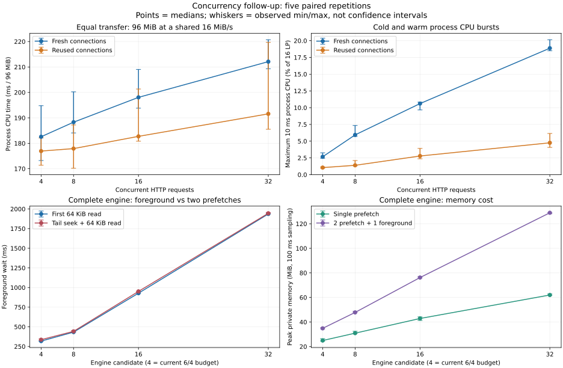

# Issue #20：等速 CPU 与完整缓存竞争补测（2026-10-14）

**共享带宽已经用满时，提高并发没有缩短本轮的整批完成时间，却显著增加了前台等待。** 两个后台预缓存同时运行时，当前产品基线的首读中位数为 318.3 ms，32 候选为 1936.5 ms；Seek 分别为 336.1 和 1945.0 ms。这是本地受控带宽下的机制证据，不是 CF 或 VRChat 实际帧率结果。

共完成五轮 **105 组**：40 个等速下载组、60 个完整引擎组、5 个空闲基线。正式本地正文发送（含预热）合计 **9332.50 MiB**，没有公网下载。预实验与 race 组单列保留。所有正式组内容、额度和清理检查通过；ETW 零 Events Lost/Buffers Lost，另做原生 xperf 总量交叉检查。

本次只有实验工具、opt-in 测试、文档与脱敏证据变化，产品默认值保持。**开发实验完成，LA-037 仍待 VRC 实机验收。** 没有启动游戏或修改 hosts、正式缓存、CPU 亲和性、优先级、电源计划。

## 实验口径

- 工作负载源码：`5c6b63d1f4cfee870e241bf4e73c9d816e0fbb32`；Windows amd64、Go 1.25.0、`-tags=no_easytier`。各实验 EXE 和 overlay 的 SHA256 见 [构建清单](evidence/cf-cpu-followup-20261014/builds.json)。
- 本机 8 个物理核心、16 个逻辑处理器，ETW 按实际拓扑计算。CPU 百分比采用 16 个逻辑处理器总容量归一化，只含目标进程并扣除 DPC/ISR；不含独立模拟上游进程的 CPU。
- 本地 TLS/HTTP 1.1 上游独立进程，TLS 证书验证开启，连接限定 IPv4 回环；总发送节拍 16 MiB/s，64 KiB 一片，每请求 20 ms 响应头延迟。两进程仍共享本机 CPU，且回环没有真实网卡/CF 路由成本。
- 等速组每次固定 96 MiB，4/8/16/32 路。热组在计时外每 worker 预热一块；正式热组全部为零 TLS 握手，冷组分别为 4/8/16/32 次。连接池最多保留 64 个空闲连接。冷/热是完整预热流程比较，既往分配和 GC 历史也可能有影响，不能把 CPU 差值全算作 TLS。
- 引擎组每文件 64 MiB，经实际初始化、spool 写盘、MD5、缓存发布、关闭；计时外独立读文件再验 MD5。前台由模块内 spoolReader 模拟，未覆盖 HTTP 播放器服务、解码、音画与帧时间。
- 固定种子、五轮随机顺序，各组新进程/缓存目录。所有编译、竞态检查、ETW 导出和分析均与正式测量错开。稳态假设不适用于短文件/取消组，引擎主要比较完整生命周期。

引擎候选标签不是单独的请求数量；同时调整实验构建的 worker 和请求预算，保留两个前台额度：

| 标签 | 总请求上限 | 后台请求上限 | 每视频后台 worker |
| --- | --- | --- | --- |
| 4（当前产品） | 6 | 4 | 3 |
| 8 | 8 | 6 | 7 |
| 16 | 16 | 14 | 15 |
| 32 | 32 | 30 | 31 |

这些变体通过 Go build overlay 和测试实例注入实现，没有改产品常量或配置。原始 HTTP 等速组则确实分别达到 4、8、16、32 个在途请求。

## 相同工作量下的 CPU

下表为五轮中位数；10 ms 列取五轮观测到的最大值。CPU 毫秒是所定义计时窗口内、目标进程所有线程的累计执行时间，不是墙钟时间。

| 并发 | 冷组耗时 s | 冷组 CPU ms | 热组 CPU ms | 冷组最大 10 ms % | 热组最大 10 ms % |
| --- | --- | --- | --- | --- | --- |
| 4 | 6.035 | 182.58 | 176.95 | 3.26 | 1.16 |
| 8 | 6.024 | 188.30 | 177.92 | 7.34 | 2.11 |
| 16 | 6.024 | 198.06 | 182.73 | 10.83 | 3.92 |
| 32 | 6.026 | 212.10 | 191.58 | 20.15 | 6.15 |

提高并发的 CPU 成本现在是在几乎相同总吞吐下比较。它包含缓冲区分配、网络读取、逐块 SHA256、调度和轻量采样；不能直接与前一轮 CF 的绝对 CPU 百分比相减。全部五个观测值、100 ms 峰值、实际并行核心/线程数、GC、分配和内存采样均保存在证据中。

空闲采样工具占整机 CPU 为 0.0046%–0.0059%，最大 10 ms 窗口为 0.1075%。这只量化进程内采样，不是全系统 ETW 的开销；本轮没有 ETW 开关配对。

## 完整模块：播放竞争

两个预缓存启动 250 ms 后，冷读第三文件的前 64 KiB，再 Seek 到倒数第二块并读 64 KiB。缓存按完成的 1 MiB 块向读者开放；前台需求保留至该文件完成。表中为五轮中位数。

| 候选 | 首读 ms | Seek ms | 三文件全流程 s | 进程 CPU ms | 私有内存峰值 MiB |
| --- | --- | --- | --- | --- | --- |
| 4 | 318.3 | 336.1 | 12.201 | 727.93 | 34.8 |
| 8 | 432.6 | 442.0 | 12.211 | 744.59 | 47.8 |
| 16 | 927.9 | 950.8 | 12.214 | 798.50 | 76.2 |
| 32 | 1936.5 | 1945.0 | 12.214 | 816.65 | 129.0 |

请求预留使前台能发出请求，但并不为正在接收正文的前台连接预留带宽。这里后台连接越多，固定共享带宽被越多在途请求分担；前台等一个完整 1 MiB 块的时间增加。这个解释与受控上游的发送规则和实际请求轨迹一致，不等同于已经测出 CF 的内部限速规则。

## 完整模块：单文件与取消后关闭

| 候选 | 单文件全流程 s | 单文件 CPU ms | 取消等待者 ms | 引擎关闭 ms | 遗留活动请求/分块 |
| --- | --- | --- | --- | --- | --- |
| 4 | 4.233 | 270.56 | 0.00 | 5.69 | 0 / 0 |
| 8 | 4.213 | 274.64 | 0.00 | 10.78 | 0 / 0 |
| 16 | 4.225 | 292.52 | 0.00 | 8.44 | 0 / 0 |
| 32 | 4.224 | 316.54 | 0.00 | 11.10 | 0 / 0 |

表中 0.00 ms 是观测值按小数位显示的结果，不表示取消没有成本。

取消组先取消两个 Prefetch 调用的等待上下文，等待返回后关闭引擎。它证明这一组合的退出和清理，不证明仅取消等待者就立即停止所有共享下载。内存峰值按 100 ms 采样，短峰可能遗漏；进程结束也不能替代长时间运行中的泄漏检查。

## 决策含义与边界

本轮支持把“可用带宽未吃满时提高并发”和“播放时后台让出资源”分开考虑。先前 CF 实验中的高并发吞吐收益仍然成立；本轮显示，它并不保证带宽饱和时的播放收益。现在没有依据直接把所有场景统一改成 32 路，也不能只凭低平均 CPU 推导 VRC 无感。

暂不继续提高并发上限。后续 VRC 实机应优先核对前台帧时间、首播和 Seek，再选择固定默认或有界渐增策略。本地单一 16 MiB/s、20 ms 响应头模型不能代表所有宽带、Wi-Fi、代理、丢包、CDN MISS 或 CF 节点。五次首读/Seek 足以呈现本次较大的差异，不能估计可靠的极端尾延迟或所有硬件上的上界。

## 检查、权限与证据

本轮仅批准一次 UAC，管理员辅助进程只处理固定 ETW start/stop/quit，普通实验进程不提权。辅助进程本轮上限 4 小时、单段 10 分钟；错误请求后继续采集的实测通过。最终退出与模拟上游/会话清理由清理回执确认。已清理 65 个本轮测试缓存目录，释放约 5.23 GiB；原始 ETL/CSV、JSON 和私密日志保留在忽略目录。

42 组独立 xperf CPU 总量校核全部通过，最大绝对差为 116 微秒。WPT 导出仍对部分其他内核事件报告 Invalid Event；零丢失只指 Events Lost/Buffers Lost，不表示所有事件类型都能解码。用于本报告的调度区间经过上述独立校核，导出警告次数保存在 checks.json。

预实验四组与 race 三组通过；缓存模块完整回归、vet 和已有八项 Python 分析回归通过。一次默认沙箱全包回归在既有文件发布路径遇到 Access denied，改用普通用户权限与仓库内测试临时目录后通过；原始私密复测日志留在忽略目录。没有把权限失败算作并发性能样本。

[实验设计](../experiments/cf-concurrency/FOLLOWUP.md)、[统计汇总](evidence/cf-cpu-followup-20261014/aggregates.json)、[调度分析](evidence/cf-cpu-followup-20261014/manifest.json)、[脱敏原始观测](evidence/cf-cpu-followup-20261014/manifest.json)、[完整性检查](evidence/cf-cpu-followup-20261014/checks.json)、[独立 xperf 校核](evidence/cf-cpu-followup-20261014/crosschecks.json)、[清理回执](evidence/cf-cpu-followup-20261014/cleanup.json)、[证据哈希清单](evidence/cf-cpu-followup-20261014/manifest.json)。原始 ETL/CSV、进程 PID、绝对路径和测试日志仅在忽略目录保留。
