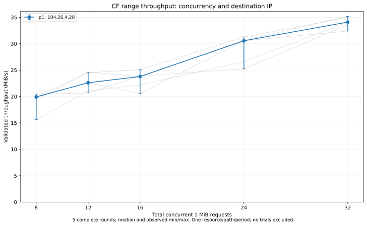

# Issue #20：单 IP 8/12/16/24/32 路 CF 对照（2026-10-14）

**到 32 路仍没有测到收益上限。** 本轮 32 路比 24 路五次全部更快，同轮吞吐增幅中位数 **14.8%**；96 MiB 下载的耗时中位数分别为 2.81 秒和 3.14 秒。12 → 16 路一度接近平段，但 24、32 路继续提速，不能把局部平段当作最终饱和。

这是用户指定的单 IP 扩展开发实验，不改变产品三路后台默认值、全局 6/4 请求预算、缓存引擎或游戏接入。工具与文档完成，**LA-037 仍待实机验收**；本次没有产品行为变化，不新增实机编号。

## 资源、路径与方法

- 产品基线 `d9ef49852f4f9b8a9c3a07c9827a2c0a41f5eb53`；实验源码 `a8a8e90a717a7f60b600df500fd0f97ffeb12788`，在该提交干净工作区编译。Go 1.25.0 / Windows amd64，`CGO_ENABLED=0`、`-tags=no_easytier -trimpath`。实测 EXE SHA256：`3da315fe49c503bce7698af1bd661bec5fb26d0201977417e1b8b78c9d8ead87`。
- [上一轮](issue-20-cf-multi-ip-20261014.md)只有 30 个 1 MiB 分块，不能真正跑满 32 路。本轮在正式测速前仅按资源元数据大小筛选，先尝试寻找至少 128 MiB 的文件；8 个候选均不足 128 MiB，最终选用首个满足 96 MiB 的公开候选 `song=10552`，大小 **103,118,762 字节**，约 98.34 MiB。筛选记录保存在[资源与 DNS 证据](evidence/cf-high-concurrency-20261014/selection.json)，没有按下载吞吐择优。
- 各档统一下载前 **96 MiB**，共 96 个互不重叠的 1 MiB 分块；8/12/16/24/32 都能整除 96，分别约 12/8/6/4/3 批。没有缩小分块、重复领取范围或引入其他 IP 来凑并发。新资源、新区间和新时段的绝对速度不能与上一轮直接相除，因此同期重测了 8、12 路。
- 固定 IP **104.26.4.28**，由本轮 DNS 答案确认，在观察性能前指定。资源仍为 `play.udon.dance`；每请求保留原 URL、Host/SNI 和 TLS 证书校验，使用产品 `upstreamrequest` 固定直连候选 Transport，并校验实际远端。预检通过独立 DNS 连到 IP2 不影响正式测试：正式预热和 25 组均明确固定 IP1。
- 先执行一次连续 96 MiB Range 预热并建立逐 MiB SHA256 参照，预热不算性能样本。每个正式请求检查 206、精确 Content-Range/长度、identity 编码、强 ETag、正文终止、远端地址与逐块哈希；没有实验层重试，标准库内部透明重试没有独立计数。
- 每组使用新连接池；连接、响应等待、读取、哈希和调度全部计时，结束后的池清理和文件写入不计时。请求并发覆盖整个请求生命周期，不能等同于同时传输正文的数量。
- 固定五轮完整对照，每档在五个测试位置各出现一次；不是所有前序组合完全平衡。顺序在测量前写入代码和结果文件。组间休息 2 秒，每组最多 120 秒，整批 30 分钟；429/503 或连续两组失败停止。

| 轮次 | 执行顺序 |
| --- | --- |
| 1 | 8、12、32、16、24 |
| 2 | 12、16、8、24、32 |
| 3 | 16、24、12、32、8 |
| 4 | 24、32、16、8、12 |
| 5 | 32、8、24、12、16 |

测量前已完成编译、race 和 vet，测量期间没有并行执行其他由本任务启动的编译或测速。未监控整机其他进程流量、未做 CPU/网卡隔离，不能排除系统 TUN/透明代理。

## 结果

吞吐、耗时各取五个样本的中位数；范围是实际最小–最大值，不是置信区间。相邻档增益先在同一轮计算吞吐比，再取五个比值的中位数，因此不等于直接相除表中吞吐中位数。

| 并发 | 吞吐中位数 | 吞吐范围 | 96 MiB 耗时中位数 | 相邻档同轮增益中位数 | 比较胜出次数 |
| --- | ---: | ---: | ---: | ---: | ---: |
| 8 | 19.92 MiB/s | 15.62–20.47 | 4.82 s | 基线 | — |
| 12 | 22.61 MiB/s | 20.67–24.61 | 4.25 s | +23.5% | 5/5 |
| 16 | 23.79 MiB/s | 20.56–25.08 | 4.04 s | +2.3% | 3/5 |
| 24 | 30.56 MiB/s | 25.24–31.29 | 3.14 s | +24.8% | 5/5 |
| 32 | 34.11 MiB/s | 32.41–35.19 | 2.81 s | +14.8% | 5/5 |

完整耗时如下，单位秒；没有删除首轮 16 路较慢或第三轮 8 路较慢的样本。

| 轮次 | 8 路 | 12 路 | 16 路 | 24 路 | 32 路 |
| --- | ---: | ---: | ---: | ---: | ---: |
| 1 | 4.799 | 4.245 | 4.669 | 3.141 | 2.962 |
| 2 | 4.952 | 3.916 | 3.828 | 3.068 | 2.741 |
| 3 | 6.148 | 4.555 | 4.325 | 3.605 | 2.815 |
| 4 | 4.690 | 4.643 | 4.018 | 3.803 | 2.856 |
| 5 | 4.820 | 3.901 | 4.036 | 3.132 | 2.728 |

32 路相对 24 路的五次吞吐增幅为 **6.0%、11.9%、28.1%、33.2%、14.8%**，每轮省下 **0.179 / 0.327 / 0.790 / 0.948 / 0.404 秒**，节省时间中位数 **0.404 秒**。两档耗时中位数的差约 0.326 秒，与配对节省时间的中位数是不同统计量。

32 路相对 8 路的同轮吞吐增幅中位数为 **76.6%**，配对耗时降幅中位数约 **43.4%**。请求额度增为四倍并没有使吞吐变成四倍；24 → 32 路增加约三分之一请求额度，得到的增益也明显小于三分之一，但尚未消失。

## 是否已经到头

取样前约定：相邻档增益中位数 ≤5% 且方向不一致，只视作“收益接近平台”的工程线索，不作为统计等效性证明。12 → 16 路确实满足这条局部线索（+2.3%，3 胜 2 负），但之后 16 → 24、24 → 32 路均五次全部更快。因此本轮排除了“在 16 路已饱和”的判断，**不能宣布 24 或 32 路是上限**。

如果继续寻找平台，后续可在同一单 IP 比较 24/32/48/64，并为最高档准备足够多的不同分块；这只是后续实验方向，本轮最高为 32，未执行 48/64。不能把“32 是已测最快档”替换成“32 是最佳产品默认值”。

本轮任务在高并发下只有约三批、2.7–3.0 秒，仍包含明显的建连和收尾阶段；不等于长时间稳态吞吐，也不证明任何 CF 单 IP/单连接限速规则。只有一个视频、一个时段和一条本地路径，不能外推到不同出口或全天表现。

## 请求、连接及内容核对

- 全批 **154.58 秒**完成；1 次预热 + 25 次正式测量全部成功，正文共 **2,496 MiB（约 2.44 GiB）**，另有 8 次候选预检与 1 次正式预检共 9 KiB、对应 API 和协议开销。没有补测、重跑覆盖或排除样本。
- **2,401 个 Range 请求**全部返回 206 / HTTP/1.1 / Cloudflare / HIT / SEA，所有远端均为 `104.26.4.28:443`；测试区间长度、强 ETag 和 SHA256 全部一致。只校验前 96 MiB，不冒充整文件 MD5 或缓存发布检查。
- 每组在途请求峰值实际达到 8/12/16/24/32；时间平均在途请求数的五轮中位数分别为 **7.83 / 11.47 / 13.50 / 21.42 / 29.11**，高并发不是只存在于配置中。
- 32 路五组各观测到 32 个连接 ID，每组 96 个请求中的 64 个标记为复用。其他档中部分组累计连接 ID 多于请求并发：16 路为 16–23，24 路为 24–31。累计连接 ID 和同一时刻请求数是不同量；工具没有记录完整拨号/TLS/透明重试链条，不据此确定额外连接来源或断言 CF 的行为。
- 产品 Transport 配置保持不变，没有为实验另行调优连接池。连接建立、复用、响应和正文阶段都会影响本曲线，不能只把差异归因为 CF 带宽。

## 开发检查与收尾

Windows 实验包 `go test -race -tags=no_easytier ./experiments/cf-concurrency -count=3 -timeout=120s` 通过；新增检查覆盖 16/24/32 路实际并行、五轮位置平衡、不足分块和超上限拒绝。vet、独立构建及 Python 两项端点精度检查通过；扩展后的分析脚本逐项复现上一轮序列化汇总，并对本轮计划顺序、完整性、每组峰值、逐块内容和实际远端全部核对通过。

[原始结果](evidence/cf-high-concurrency-20261014/manifest.json)、[分析汇总](evidence/cf-high-concurrency-20261014/summary.json)、[检查清单](evidence/cf-high-concurrency-20261014/checks.json)、[文件与源码哈希清单](evidence/cf-high-concurrency-20261014/manifest.json)作为同一报告变更交付。图表已渲染并检查。完整 URL、原始 ETag 和私密输入仅保留于忽略目录。

测速进程正常退出，无遗留 `high-probe` 进程。没有启动游戏、修改 hosts、代理设置或正式缓存，也没有发布或 push；按授权完成本地分批提交。实验工具完成，产品行为未改变，**LA-037 继续积攒待实机验收**。完整引擎下的首播、Seek、多视频公平性、CPU/内存/连接开销未在本轮验证。
