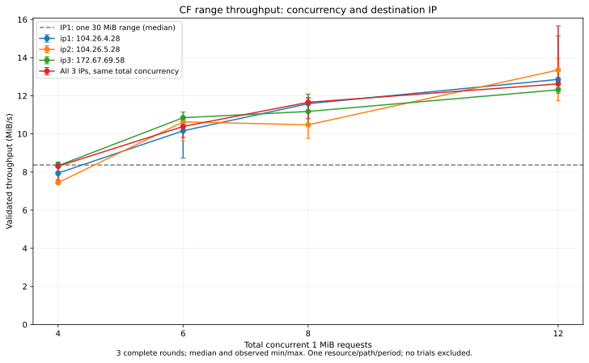

# Issue #20：CF 4–12 路与 DNS 多 IP 对照（2026-10-14）

**4 路不是本次路径的最优上限：单 IP 从 4 到 12 路仍明显提速，8 到 12 路也有收益。三个 DNS IP 同时使用，在相同总并发下没有显示稳定额外优势。** 单 IP 已可建立并使用 12 条连接，不需要先增加 IP 才能提高请求并发。

本轮只扩展[开发实验工具](../experiments/cf-concurrency/README.md)，不改变产品运行行为，不新增实机编号。默认后台三路、全局 6/4 请求预算保持原样；LA-037 仍待实机验收。没有启动游戏、修改 hosts、代理设置或正式缓存。

## 方法与可复核身份

- 产品基线仍为 `d9ef49852f4f9b8a9c3a07c9827a2c0a41f5eb53`；扩展实验源码固定在 `421683716ed3aa6b1ee82d5b76bfd783eecb215e`，在该提交的干净工作区编译。Go 1.25.0 / Windows amd64、`CGO_ENABLED=0`、`-tags=no_easytier -trimpath`，被测 EXE SHA256 为 `65d26d4db2b73f001e119bc2d868fb7b2667e1dd4bc0a0f1d1bb2f7d12f3b3e5`。
- `Resolve-DnsName play.udon.dance -Type A -DnsOnly -NoHostsFile` 返回三个 IPv4：[DNS 证据](evidence/cf-multi-ip-20261014/dns.json)。IP1=`104.26.4.28`、IP2=`104.26.5.28`、IP3=`172.67.69.58`。采用系统 DNS 查询结果并显式固定三个地址，实验中不随 TTL 换址；不是产品 DNS 生命周期测试，也不覆盖 IPv6。
- 重新调用 `node=cf&id=1343` API 获取资源，独立 DNS 预检实际连接 IP2，返回 HTTP/1.1、Cloudflare/HIT/SEA。资源大小仍为 32,867,177 字节，各组均下载同一前 **30 MiB**。完整资源 URL、原始 ETag 仅存于忽略目录。
- 保留资源 Host/SNI 和证书校验，使用产品固定直连候选 Transport。每个 IP 先执行一个 30 MiB 长 Range 预热，强 ETag 与逐 MiB SHA256 必须一致；三个 IP 的预热均成功，参照哈希也与[上一轮](issue-20-cf-concurrency-20261014.md)相同。
- 三个单 IP 各跑 4/6/8/12 路，三个 IP 合用也跑相同四档**总并发**，再加 IP1 的单个长 Range 对照，共 17 组。三轮随机完整区组，固定种子 `20261014`，事先生成所有顺序并随原始结果保存；三轮不是完整顺序平衡。
- 多 IP 的工作者固定归属，共享待下载分块队列；快 IP 可领取更多块。12 路为 4+4+4，6 路为 2+2+2，4 路为 2+1+1，8 路为 3+3+2；不能均分时，额外名额在三轮轮换。没有失败切换或实验层重试。
- 每组重建连接池，建连、响应等待、读取、哈希与调度均计时，结果文件写入与连接池清理不计时。组间 2 秒；每组 120 秒、整批 30 分钟上限；429/503 或连续两组失败停止。
- 测量前完成测试、vet、编译，测量期间没有并行运行编译、静态检查或另一个测速。未对整机其他进程做网卡级隔离，不能排除透明代理/TUN，也没有带宽、丢包或 TCP 窗口抓包证据。

三次预热与 51 个正式样本约 **261.8 秒**完成，验证正文共 **1,620 MiB**，另有 API、1 KiB 预检和协议开销。全部保留，无失败、补测或样本排除。完整顺序、请求时序与哈希在[原始结果](evidence/cf-multi-ip-20261014/manifest.json)，聚合与配对在[汇总](evidence/cf-multi-ip-20261014/summary.json)。

## 吞吐结果

单位 MiB/s，每格为三轮中位数（最小–最大）。合用列的数字是所有 IP 合计的请求并发，不能理解为“每 IP 各这么多路”。

| 总并发 | IP1：104.26.4.28 | IP2：104.26.5.28 | IP3：172.67.69.58 | 三 IP 合用 |
| --- | ---: | ---: | ---: | ---: |
| 4 | 7.94（7.91–8.53） | 7.44（7.37–7.81） | 8.33（8.22–8.48） | 8.31（7.59–8.43） |
| 6 | 10.16（8.73–10.47） | 10.63（9.62–10.84） | 10.85（10.33–11.15） | 10.39（9.81–10.46） |
| 8 | 11.59（11.53–11.88） | 10.48（9.76–12.09） | 11.18（10.48–12.08） | 11.66（10.80–11.89） |
| 12 | 12.86（12.75–15.14） | 13.35（11.74–13.96） | 12.31（12.13–12.42） | 12.62（12.34–15.67） |

IP1 单个 30 MiB 长 Range 的中位吞吐为 **8.37 MiB/s**（7.75–8.49），耗时 3.59 秒；同 IP 4/6/8/12 路的耗时中位数分别为 **3.78 / 2.95 / 2.59 / 2.33 秒**。多 IP 12 路耗时中位数为 2.38 秒。

本轮总体速度高于上一轮；即使资源、IP、区间、HIT/SEA 都相同，也不能假定线路条件相同。因此收益只从本轮同轮配对计算，不用上一轮三路的 4.45 MiB/s 来宣称本轮 12 路的加速倍数。

## 增加并发的收益

下表先在同一轮计算吞吐比，再对三个比值取中位数，不是直接相除前表的中位数。

| 路径 | 4 → 6 路 | 6 → 8 路 | 8 → 12 路 | 4 → 12 路 |
| --- | ---: | ---: | ---: | ---: |
| IP1 | +22.7% | +13.5% | +11.0% | +61.1% |
| IP2 | +36.2% | +1.6% | +12.0% | +71.1% |
| IP3 | +31.5% | +8.2% | +11.1% | +49.1% |
| 三 IP 合用 | +25.9% | +12.2% | +6.2% | +66.3% |

三个单 IP 的 8 → 12 路共九个配对全部更快，多 IP 三个配对也全部更快。单 IP 的最小增幅约 1.9%，不能说每次都有两位数收益；多 IP 的三次增幅为 6.2%、45.1%、5.9%，波动很大。IP2、IP3 也各有一轮 8 路慢于 6 路。

这支持“继续探索更高并发”，不支持“12 已经最优”。只有 30 个分块，12 路约 2.5 波请求，建连与结束阶段空闲占比不可忽略；未覆盖更长资源的稳态、其他时间段、其他线路、首播/Seek 或 CPU/内存/公平性成本。

## 多 IP 是否提高上限

同并发下，多 IP 相对固定 IP1 的配对中位增幅依次为 **−1.2%、+2.9%、约 0.0%、−4.0%**（4/6/8/12 路）。没有一致向上的收益。

为避免把某个较慢 IP 当成唯一基线，还比较了每轮相同并发下三个单 IP 中的最快观测值：

| 总并发 | 多 IP / 当轮最快单 IP：三轮增幅 | 增幅中位数 |
| --- | --- | ---: |
| 4 | −7.7%、−0.3%、−1.2% | −1.2% |
| 6 | −9.6%、−1.6%、−6.8% | −6.8% |
| 8 | −1.6%、−10.7%、+0.6% | −1.6% |
| 12 | −16.6%、+17.3%、−11.6% | −11.6% |

“当轮最快单 IP”是事后观察的参考上界，不是事先可知的选路策略，也不能据此证明多 IP 必然更慢。结合固定 IP1 对照，可以说**本轮没有观察到稳定的独立带宽叠加效果**，但不能证明多 IP 在其他条件下一概无收益。

全部 **1,446 个 Range 请求**均为 206、HTTP/1.1、Cloudflare、HIT、`CF-Ray` 后缀 SEA；实际远端与指定 IP 一致，长度/范围/强 ETag/逐块哈希校验均通过。每组峰值均达到声明并发；单 IP 12 路的九组各使用了 12 条连接，多 IP 的各地址名额也经时序复核。

Cloudflare 官方说明代理 IP 属于 Anycast 网络，同一地址可由全球多个数据中心宣告。因此，多个 DNS 地址不能直接等同于多个独立机房或带宽池。[Cloudflare IP 地址说明](https://developers.cloudflare.com/fundamentals/concepts/cloudflare-ip-addresses/)

本轮三个地址都报告 SEA，与共享某些路径资源的解释相容；这是有限推断，**没有证明同一物理服务器、瓶颈位置、每 IP 限速规则或可用带宽上限**。不同 IP 也没有提高协议允许的连接数量：本轮单 IP 自身已经完成 12 路。多 IP 的可用性、故障切换价值不在本轮性能实验范围内。

## 后续决策与交付

值得优先继续核对的是更高的**总并发**及其代价。可用第二时段和更长资源复测 4/8/12，再将 16 路作为下一档；如果 12 → 16 的增益不能超过波动，就不应仅为数字更大而上调。多 IP 可继续作为同总并发的对照组，但当前证据不足以把它作为提速的必要条件。本轮没有执行 16 路或更高档位。

产品要真正采用 8/12 路，还涉及现有全局请求预算，不能只把每视频工作者数改大。需要完整缓存引擎下核对首块、Seek 让位、多视频公平性、失败与上游请求成本；本次 HTTP 工具绕过了这些产品调度限制。此结论不自动授权或实施产品策略变更。

开发检查：实验包 Windows race 连续三次通过；vet、独立构建通过；分析对所有 54 组校验完整性，Python 两项边界回归通过。分析中发现浮点毫秒相加会在相邻请求端点产生约 `4.5e-13 ms` 的虚假重叠，已按 Go 原始纳秒单位重建整数端点；只影响离线的每 IP 峰值重建，不改变原始数据、实测总峰值、吞吐、时长或配对结果。该修正与本报告一起提交。

[检查清单](evidence/cf-multi-ip-20261014/checks.json)与[文件清单](evidence/cf-multi-ip-20261014/manifest.json)绑定源码、EXE 及脱敏证据。测速进程已正常退出，原始私密输入保留于忽略目录；所有变更仅作本地提交，未 push。开发实验完成，**LA-037 继续待实机验收**。
