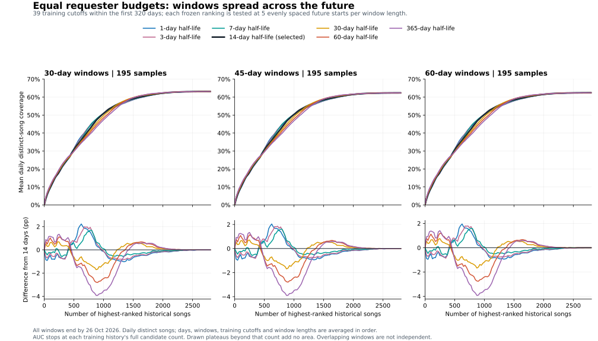

# 按人分配初始权重：30～60 天全曲线半衰期比较

本次恢复初始表按点歌人分配总份额的约束，并以 **14 天**作为默认半衰期。最终回测按用户修订：训练最多使用最前 320 天，每个训练截止点之后沿全部剩余区间均匀取多个 30／45／60 天连续测试窗。全部训练长度汇总时 14 天最高，7 天仅低 0.0415 个百分点；只看最长 320 天训练集则 3 天最高，不能称 14 天唯一最优。本地实际需求的 60 天衰减、初始分数被真实需求替代和共享资源汇总规则不变。现行规则统一维护于[视频保留排序规则](../cache-retention.md#排序规则)。

## 问题来源与约束

Git 提交 `0f4c3dc`（2026-10-03 23:28，北京时间）曾接入按人份额、个人内部 30 天衰减的初始表；`3775407`（2026-10-04 03:20）改成 60 天请求累计时同时去掉了按人归一化。此前研究中“先不考虑点歌人等权”的条件被带入初始表。本次用户明确恢复按人分配，并确认保留活跃日门槛。

对人 p 的总份额为 `b_p = min(1, 活跃日数 / 5)`。每个北京时间日期至少一个有效请求计一个活跃日，不要求连续。其歌曲 s 的贡献为：

```text
个人歌曲权重 w(p,s) = Σ 2^(-(T - 请求时间) / 半衰期)
个人分配给歌曲的份额 = b_p × w(p,s) / Σ歌曲 w(p,歌曲)
歌曲总权重 = Σ人 个人分配给歌曲的份额
```

未知、随机和归属冲突的记录共享总份额 0.25。达到五个活跃日后，一个人点 5 次或 500 次都不会扩大其总份额。固定历史时，指数中的共同 T 因子在个人归一化时抵消：半衰期改变该人的新旧歌曲比例，久未出现的人不会整体淡出。实现以每人最后一条历史记录为指数参考点，避免短半衰期下旧人的所有权重同时下溢。[共享计分实现](../../scripts/initial-priority.mjs)

## 数据与防止未来信息进入训练

数据来自本机 VRCX、DanceTrail 与 174 份 VRChat 日志的只读快照：去重后 **16,159 条、3,667 首歌**，北京时间日期范围为 2025-07-07 至 2026-10-26。公开元数据只保留日期，精确观测时刻留在私人快照与本地结果中。2026-10-26 为不完整日期，不进入测试期。完整快照识别到 399 人，其中 94 人满足五日门槛；12,290 条可归属，3,869 条进入未知池，55 个归属冲突。它是单一观察者及所到房间的样本，不代表全平台或播放完成统计。

保留原有来源顺序与去重：VRCX 同曲以有效事件为锚点，间隔大于 30 秒才接受；原始日志相同规则去重并与已有来源在 ±60 秒内查重；附近 ±10 分钟没有请求时才将播放开始作为补充；最后补 DanceTrail。为使结果稳定，所有来源按时间、歌曲 ID 排序。冻结到旧样本最后时刻后，16,159 条中的旧区间恰好重现原 15,186 条事件，歌曲 ID／时刻集合无增删。

每个预测切点均先过滤所有来源及身份信号到 `t < T`，再去重、处理播放补充、建立昵称到 ID 映射和 ±60 秒归属。活跃日同样只看此前历史。旧脚本先全量归并身份再切分，会使用未来别名信息，本次已修正。原始姓名和 ID 仅在抽取进程内使用，私人快照以临时 token 替代；包括临时 token、逐条事件和原始资料在内的输入均留在 Git 忽略目录。发布的表与报告只含聚合数据。[来源抽取](../../experiments/equal-priority/extract.mjs)

## 最终评价口径

用户最终指定 **30～60 天测试窗、全部有分数歌曲的数量—覆盖率曲线面积、沿训练后的整个剩余区间等间隔取窗、训练最多前 320 天**。此前 7 天／前 1,000 首探索和仅紧接训练的 30～60 天回测不再用于选型，分别保留在本地 artifacts/equal-priority-20261026/short-horizon/ 与 adjacent-windows/。旧口径推荐 14 天、后期观察 1 天最高，是旧实验结果，不能混入本次汇总。候选为 1、3、7、14、30、60、90、120、180、365 天及不衰减；1、3 天是早先探索发现 7 天位于搜索边界后补充的。本批数据已多次查看，本次是回顾性比较，不称全新盲留出。

每个训练截止点 T 仅用 t < T 的数据生成一次排名、身份映射和活跃日份额，之后所有测试窗始终复用这份排名。候选集合是 T 之前出现过的全部歌曲，数量记为 M，所有半衰期共用这个集合。不会在较晚测试窗开始时重新训练，也不加入 T 之后才出现的新歌；新歌仍在覆盖率分母内。

每一天的不同歌曲集合为 U，同日重复点歌只计一次：C(N) = |U ∩ 排名前 N 首| / |U|。没有观测的日期为缺测，不补零。汇总依次为：窗口内有效日期等权 → 同训练截止点、同长度的测试窗等权 → 训练截止点等权 → 30／45／60 天三种长度等权。旧训练集后续数据更多，不因此获得更多总份额。

    原始曲线面积 A = Σ(N=1..M) [C(N-1) + C(N)] / 2
    标准化面积 = A / M

积分到每个训练集自己的 M，**没有固定前 1,000 首限制**。A 的单位为“歌曲数 × 覆盖比例”；A/M 可解释为在 0～M 的所有保留数量上平均的覆盖水平，不是某个固定数量的命中率。选择参数用 A/M，避免历史曲库较大的训练集因横轴更长而被隐式加权，原始 A 同时保留。每个日目标在历史排名 r 的积分贡献为 max(0, M−r+0.5)，与逐点梯形完全等价。

训练从首个北京时间日期 2025-07-07 开始计日；最多前 320 个日历日，即训练严格早于 **2026-05-23 00:00**，最后训练日期为 05-22。测试资料截止 **2026-10-26 00:00**，排除不完整当日，最长训练集后还剩 **156 天**。沿用原探索从 2025-09-01 起每 7 天一个训练切点，额外包括精确 320 天切点，共 **39 个切点（训练 56～320 天）**。

每个 T、测试长度 H 默认取 **5 个窗口**。令剩余完整天数为 D，起点偏移为 round(i × (D−H) / 4) 天，i=0…4；首窗紧接训练，末窗恰好到资料末端，其余均匀分布，取整使相邻间隔至多差一天。每个窗内部均连续。窗口起点重复时只计一次，未来不足 H 天时不生成窗口。[取窗实现与边界测试](../../experiments/equal-priority/windows.test.mjs)

最长 320 天训练集有 10,820 条训练记录、2,809 首候选，取窗如下（全部为 2026 年，结束日期不包含在内）：

| 窗长 | 五个测试起点 | 起点相对训练末端的天数 | 最后一个窗口结束 |
| --- | --- | --- | --- |
| 30 天 | 05-23、06-24、07-25、08-26、09-26 | 0、32、63、95、126 | 10-26 |
| 45 天 | 05-23、06-20、07-18、08-14、09-11 | 0、28、56、83、111 | 10-26 |
| 60 天 | 05-23、06-16、07-10、08-03、08-27 | 0、24、48、72、96 | 10-26 |

每种长度 39×5=195 窗，合计 **585 窗 × 11 个半衰期 = 6,435 组**。各训练集有 760～2,809 首候选；并非现在的 3,667 首都能回到过去参与排名。较早／较晚训练切点以 2026-04-01 为界，仅用于检查训练长度差异；两组都测试到全部剩余未来资料，**不是独立训练／验证划分**。训练集互相嵌套，测试窗在同一切点、不同切点及不同长度间均可能重叠，不能把 585 窗当作 585 份独立样本。[回测源码](../../experiments/equal-priority/backtest.mjs) · [完整聚合输入](equal-requester-priority-20261026/summary.json)

## 结果

以下为全部 39 个训练截止点汇总的**全曲线标准化面积**，以百分数表示；越高越好。

| 半衰期 | 测试窗 30 天 | 测试窗 45 天 | 测试窗 60 天 | 三种长度平均 |
| --- | ---: | ---: | ---: | ---: |
| 1 天 | 43.89% | 43.37% | 43.34% | 43.53% |
| 3 天 | 44.00% | 43.49% | 43.46% | 43.65% |
| 7 天 | 44.12% | 43.62% | 43.60% | 43.78% |
| **14 天** | **44.16%** | **43.66%** | **43.65%** | **43.82%** |
| 30 天 | 44.01% | 43.51% | 43.50% | 43.67% |
| 60 天 | 43.77% | 43.27% | 43.26% | 43.43% |
| 90 天 | 43.66% | 43.15% | 43.15% | 43.32% |
| 120 天 | 43.60% | 43.09% | 43.09% | 43.26% |
| 180 天 | 43.53% | 43.03% | 43.02% | 43.19% |
| 365 天 | 43.46% | 42.96% | 42.96% | 43.13% |
| 不衰减 | 43.34% | 42.84% | 42.84% | 43.01% |



图上方是按上述逐层等权汇总的曲线，下方是相对 14 天的覆盖差。为在同一数量轴上比较，超过某训练集候选数后延长其平台；**表中积分仍只到该训练集自己的 M**，不会把延长的平台额外计入。折线每 25 首采一个绘图点，面积计算使用精确逐整数定义。不同算法在部分数量区间交叉，但选型使用整条曲线。全候选平台低于 100% 是因为未来有此前未见歌曲；该平台对各半衰期相同。

| 半衰期 | 全部训练集 A/M | 较早训练切点 A/M | 较晚训练切点 A/M | 最长 320 天 A/M | 全部原始 A |
| --- | ---: | ---: | ---: | ---: | ---: |
| 1 天 | 43.5309% | 41.5795% | 51.0928% | 52.4465% | 894.394 |
| 3 天 | 43.6481% | 41.7178% | 51.1280% | **52.5023%** | 895.878 |
| 7 天 | 43.7807% | 41.8743% | **51.1680%** | 52.4477% | 897.468 |
| **14 天** | **43.8221%** | **41.9468%** | 51.0891% | 52.3072% | **897.474** |
| 30 天 | 43.6738% | 41.8081% | 50.9031% | 52.1007% | 894.166 |
| 60 天 | 43.4327% | 41.5721% | 50.6427% | 51.7955% | 889.046 |

14 天在全部训练长度、三种测试窗长度的汇总上最高，比 7 天仅高 **0.0415 个百分点**，比 60 天高 **0.3894 个百分点**。原始面积也仅比 7 天高 0.006，实质近乎持平。只看最长 320 天训练集时，3 天最高，比 14 天高 **0.1950 个百分点**；较晚训练切点整体则 7 天最高。维持 14 天默认依据是跨全部训练长度的主指标，7 天同样合理；不把这个微小差距解释为稳定唯一最优。

除默认每种长度 5 窗外，分别改成 3 窗和 7 窗复算：全部训练集仍为 14 天最高，最长 320 天仍为 3 天最高。取 3／5／7 窗时，14 天主指标分别为 **44.1065%／43.8221%／43.7228%**，7 天分别为 **44.0630%／43.7807%／43.6750%**。不同采样密度改变绝对水平，当前差距很小，不能把重复取窗当成额外独立证据。短至 1 天不代表只看一天历史：所有人的历史和活跃日仍保留，只是个人内部更集中于最后点过的歌。

新结果比旧紧邻窗口结果低，不意味着算法退步：训练截止时间现在更早，固定排名还要面对较远的未来、新歌曲和口味变化；两次绝对分数对应的样本与任务不同，不能直接相减当作算法收益。

## 恢复实现与验证

用户最终确认：内置初始分数采用 14 天半衰期，用户本地真实需求继续采用 60 天半衰期。两者职责独立；同一首歌首次有真实需求后，由本地分数完全替换初始分数。嵌入表契约测试固定检查 14 天，运行时既有回归检查 60 天减半及替换行为。

初始表仍用完整快照重新生成 3,667 首歌曲，采用 14 天、五活跃日门槛和未知池 0.25，归一化尺度恢复原等权表的 log1p 规则。320 天上限用于回测训练和评估，不会把生成正式初始表时已有的后续资料删除。初始表最高仍为 0.5，不写本地使用次数。历史 data/initial-priority/evaluation.json 保留 2026-10-03 的 30 天按事件命中评估，其指标与本次按天去重歌曲的面积不可直接比较。

12 项 Node 回归通过：原有 9 项覆盖个人份额守恒、百倍频次不扩大总份额、北京时间跨日、未知池上限、衰减比例、旧人短半衰期稳定性、未来别名及来源不能修改训练数据，以及发布结果无身份字段；新增 3 项验证未来 120 天取窗例子、实际 320 天训练边界及最后完整窗、取整重复去重与未来不足排除。图表已渲染检查，报告链接、公开输出结构与身份字段扫描、Git 忽略范围及 git diff --check 均通过。

生产生成器拒绝纯歌曲 ID／时间数组，嵌入数据测试要求按人模型与五日门槛，防止再次无声退回请求等权。该嵌入契约测试在旧表上先失败，报告 Model:exponential，再在新表上通过。嵌入表、有效优先级、补齐候选、淘汰排序、曲库分数与曲库 API 定向 Go 回归通过；首次较宽的沙箱内检查有 Windows renameat 句柄错误及锁文件清理失败，原始 go-tests.log 保留；相同临时目录入口在沙箱外复跑本次相关用例通过，见 go-tests-outside-sandbox.log。没有修改文件操作代码绕过错误，不将定向通过表述为控制台全套通过。本轮仅修改离线评价与图表，不重复声称运行时有新增功能。

前一轮紧邻窗口实验曾独立重建 9 组来源归并、身份与排名，并显式逐梯形验证 330 个有效日；历史结果在 long-numeric-review.md，仅证明旧窗口配置的数值。新版独立 Python 核查重建 4 个固定训练／测试窗组合 × 1／14／60 天共 12 个案例，在 465 个有效日显式逐整数积分，原始面积最大误差 2.27e-13、标准化面积最大误差 1.11e-16；39 个训练切点、585 个取窗边界、320 天上限及全部 6,435 个模型窗口的分层汇总均一致，独立汇总仍选 14 天。公开 summary 十位小数以约 5e-11 容差核对。3／7 窗敏感性独立核验采样并摘录其汇总输出，未独立重建其全部排名或逐日面积。新记录在本地 spread-method-review.md 及 spread-numeric-review.md，私人输入和完整核验轨迹均在忽略目录 artifacts/equal-priority-20261026/。

数学和数据验证不代表实际动态缓存或字节节省验证。研究按歌曲数量，不按视频大小；共享资源、活动保护、下载失败和当前曲库中缺失历史歌曲会改变实际下载集合。无需启动 VRC 来验证本次离线权重规则，也不新增游戏验收项。

## 复算

Node 24（内置 SQLite）和 Python＋Matplotlib；来源参数由本机提供，不写入公开脚本。命令从仓库根目录运行：

    node experiments/equal-priority/extract.mjs <VRCX.sqlite3> <DanceTrail.sqlite3> <原始日志目录> artifacts/equal-priority-20261026/sources.local.json
    node experiments/equal-priority/backtest.mjs artifacts/equal-priority-20261026/sources.local.json artifacts/equal-priority-20261026/spread-windows 5
    node experiments/equal-priority/backtest.mjs artifacts/equal-priority-20261026/sources.local.json artifacts/equal-priority-20261026/spread-3 3
    node experiments/equal-priority/backtest.mjs artifacts/equal-priority-20261026/sources.local.json artifacts/equal-priority-20261026/spread-7 7
    node scripts/build-initial-priority.mjs artifacts/equal-priority-20261026/sources.local.json data/initial-priority/song-priority.json 14
    ./scripts/with-test-temp.ps1 node --test scripts/initial-priority.test.mjs experiments/equal-priority/windows.test.mjs
    python experiments/equal-priority/plot.py docs/research/equal-requester-priority-20261026/summary.json docs/research/equal-requester-priority-20261026/coverage.svg

公开 summary 按小数点后十位保存以控制体积，完整精度结果保留在私人输出。公开文件含每个训练切点的候选数量和测试起点／有效日数量，不包含玩家身份或逐日歌单。输入 SHA-256 为 f133aae6cdd424475d2f7a37fe893c9bbfc79efe91f346bb5130499190fe912c。实际重新抽取会纳入新增记录，应视为新批次，不声称仍复现本快照数值。
