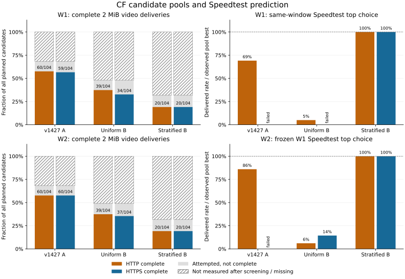

# #21：HTTP/HTTPS、104 地址名单与 Speedtest 预测力

本轮按[公开实验协议](../../experiments/cf-block-paths/TRIAD.md)开展统一对照研究：区分 VRChatUrlLogger 收益中的地址名单、HTTP/HTTPS 访问路径与通用测速筛选。两个窗口均完成，使用隔离测试构建，没有修改产品下载、Monitor、缓存或公网 HTTP 规则。

本轮仅覆盖单线路，未覆盖独立网络；结论不能外推至其他线路、地区或运营商。

本轮得到三个结论：

1. **少数入口上的 HTTP/HTTPS 巨大差异重复出现，但并非 HTTP 普遍大幅更快。** `172.64.144.1` 两个窗口、四次相同 8 MiB 对照均为 HTTP 完成、HTTPS 20 秒未完成。完整池双方完成子集的 HTTP 优势中位数约 10%–19%；严重 HTTPS 退化主要落在正文阶段。
2. **固定 104 名单在本轮更容易找到可交付地址，尚不能证明作者逐地址做过性能筛选或其最佳地址独有优势。** A 两窗 HTTP 均完成 60/104；等概率随机池均为 39/104。随机池仍找到了相当或更快的 HTTP 最佳值，以及更快的 HTTPS 最佳值。名单本身是规则地址网格。
3. **Speedtest 预测力依赖候选池和目标协议。** W1 的 Speedtest 第一名在 W2 独立视频上，HTTP 达到各池实测最佳的 86.0%、6.1%、100%，HTTPS 为未完成、14.4%、100%。A 的前 3 名能覆盖 W2 HTTP 最佳，却不能据此推断 HTTPS 也有效。现有证据不支持直接移植为通用的视频选点策略。

| 窗口（2026-10-22，北京时间下午） | 完整池视频 | 计划记录 | 会话分钟 | 实际读入正文 MiB |
| --- | --- | ---: | ---: | ---: |
| W1 | 1343 | 2,011 / 2,011 | 71.77 | 1,177.49 |
| W2 | 1344 | 2,012 / 2,012 | 69.52 | 1,186.98 |

记录数包含筛选后未复测的占位记录，不是全部发起的网络请求数。W1 结束约 14 秒后冻结选择，再过约 76 秒启动 W2；两窗起点相隔 73.3 分钟。W2 同时更换视频和时段，只能评价两者共同变化的留出表现。同视频跨窗证据由各窗重复的 pilot 提供。

图左的斜线部分为筛选后未复测，灰色为实际尝试后未完成；图右以该窗有限池内实测最佳为分母。W1 为同窗诊断，W2 使用提前冻结的 W1 选择。图中没有把未测地址赋为零速。

## 候选池与 DNS 基线

下表为“完成 / 实测未完成 / 筛选后未复测”；没有缺失的计划记录。C 包含 6 个固定 DNS 地址和 1 条普通 DNS 路径，单列基线，不与 104 地址池宣称相同搜索规模。

| 窗口与池 | 2 MiB HTTP | 2 MiB HTTPS | HTTP 最佳 MiB/s | HTTPS 最佳 MiB/s |
| --- | ---: | ---: | ---: | ---: |
| W1 A：固定 104 | 60 / 11 / 33 | 59 / 12 / 33 | 4.824 | 1.182 |
| W1 B_uniform：等概率 104 | 39 / 11 / 54 | 34 / 16 / 54 | 4.649 | 1.394 |
| W1 B_stratified：分层 104 | 20 / 13 / 71 | 20 / 13 / 71 | 1.589 | 1.331 |
| W1 C：DNS 与普通路径 7 | 7 / 0 / 0 | 7 / 0 / 0 | 0.965 | 0.781 |
| W2 A | 60 / 11 / 33 | 60 / 11 / 33 | 4.999 | 1.242 |
| W2 B_uniform | 39 / 12 / 53 | 37 / 14 / 53 | 5.057 | 1.524 |
| W2 B_stratified | 20 / 13 / 71 | 20 / 13 / 71 | 1.506 | 1.333 |
| W2 C | 7 / 0 / 0 | 7 / 0 / 0 | 0.990 | 1.155 |

每窗、每个 104 池均完整复测 8 个筛选全失败地址，三种端点均未完成；这个小规模审计不能证明其余未复测地址都不可用。完整交付比例只能给观测上下界，例如 W1 A HTTP 为 60/104–93/104，B_uniform 为 39/104–93/104。A 找到更多可交付地址是本次相同规则下的观测收益，不能当作已知道所有未知地址后的总体成功率差异。

全量 1 KiB HTTP 筛选中，A 两窗均完成 61/104（58.65%）。随机池的抽样不确定性如下；区间只描述各窗地址样本，不覆盖时间波动，也不代表完整视频成功率。

| 窗口 | B_uniform HTTP：完成比例、Wilson 95% | B_uniform HTTPS：完成比例、Wilson 95% | B_stratified HTTP/HTTPS：地址加权估计、bootstrap 95% |
| --- | --- | --- | --- |
| W1 | 38.46%；29.68%–48.06% | 39.42%；30.57%–49.03% | 24.95%；12.63%–39.46% |
| W2 | 39.42%；30.57%–49.03% | 37.50%；28.80%–47.09% | 24.95%；12.67%–38.46% |

分层池两窗原始比例均为 20/104（19.23%），不能直接当作地址空间总体比例；加权及逐层数据见摘要。小层样本全零或全一会使条件 bootstrap 低估不确定性，两窗区间的细小差别也不能作为时间变化证据。

普通 DNS 路径 W1 HTTP/HTTPS 为 0.965/0.470 MiB/s，W2 为 0.706/0.680 MiB/s。固定 DNS 候选与普通路径均完成，但 C 的最佳值未必就是普通路径。普通 Speedtest 与视频解析不同主机，不保证使用同一远端；它是实际路径基线，不作为固定 IP 的协议配对归因。

## 协议差异及其阶段

双方完成子集的结果如下。正时间差表示 HTTPS 更慢；只比较相同 IP、视频和 Range，不混入 pilot 的 8 MiB 结果。

| 窗口与池 | 双方完成数 | HTTP/HTTPS 吞吐比中位数 | HTTPS−HTTP 首字节 ms | HTTPS−HTTP 正文 ms | 仅 HTTP / 仅 HTTPS 完成 |
| --- | ---: | ---: | ---: | ---: | ---: |
| W1 A | 57 | 1.100 | 208 | −66 | 3 / 2 |
| W1 B_uniform | 34 | 1.122 | 209 | −4 | 5 / 0 |
| W1 B_stratified | 20 | 1.100 | 214 | −35 | 0 / 0 |
| W2 A | 58 | 1.192 | 208 | 85 | 2 / 2 |
| W2 B_uniform | 37 | 1.157 | 203 | 48 | 2 / 0 |
| W2 B_stratified | 20 | 1.162 | 209 | 43 | 0 / 0 |

典型差异主要体现于首字节前约 0.2 秒，W2 正文也有较小的中位差异。共同成功子集不能掩盖单边失败，也不能证明 HTTP 对全部候选更快：例如 W2 C 的配对比值中位数约 0.968，且 A 两窗都出现仅 HTTPS 完成的地址。

W1 的 8 个“HTTP 完成、HTTPS 正文超时”配对均有两端 HKG 后缀：6 个为 `104.17.*`，另有 `104.19.35.65`、`172.64.144.1`，横跨 A 和随机池。W2 剩下 4 个相同类型配对，也都属于这 8 个地址且两端记录 HKG。该特征是描述性线索，不能推广为所有 HKG 地址或相关前缀均异常。

A 的 W1 Speedtest 前三名为 `104.17.96.1`、`104.17.160.1`、`172.64.144.1`，HTTP 均完成，HTTPS 均在 10 秒内未完成 2 MiB。其 TLS 握手仅 158–225 ms，收到头部约 474–594 ms，正文读取持续约 9.4–9.5 秒才超时。W2 中 `104.17.160.1` 的 HTTPS 可以完成，但 HTTP 仍快约 7.62 倍；另两名 HTTPS 仍超时。这支持入口与端口/目标服务之间存在严重性能差异，不能归因为 TLS 加密成本。

同视频 pilot 每窗有 32 个 8 MiB 配对：均为 16 个双方完成、8 个仅 HTTP 完成、8 个双方未完成；双方完成的比值中位数为 W1 1.100、W2 1.161。`172.64.144.1` 四次 HTTP 用时分别为 2.082、0.554、0.654、0.616 秒；四次 HTTPS 都在 20 秒内未完成，Speedtest 均完成。W2 两轮实际交换了协议先后，W1 的顺序偏差见下文。该反例在本线路两个下午窗口中重复，不构成跨日、晚高峰或跨网络稳定性证明。

## Speedtest 排名与冻结预测

相关性同时给“双方完成子集 / 实测失败并列末尾”的 Spearman 系数；筛选后未测者另列，未伪造零速。错误推荐列为“目标视频未完成数 + 已完成但低于本池最佳 50% 的数量 / Speedtest 完成数”，两类互斥。

| 窗口与池 | HTTP Spearman | HTTPS Spearman | HTTP 错误或慢推荐 | HTTPS 错误或慢推荐 |
| --- | ---: | ---: | ---: | ---: |
| W1 A | 0.228 / 0.417 | 0.237 / 0.277 | (3 + 57) / 63 | (4 + 0) / 63 |
| W1 B_uniform | 0.286 / 0.658 | 0.544 / 0.425 | (0 + 35) / 39 | (5 + 2) / 39 |
| W1 B_stratified | 0.111 / 0.464 | 0.251 / 0.493 | (5 + 1) / 25 | (5 + 0) / 25 |
| W2 A | 0.363 / 0.472 | 0.194 / 0.297 | (3 + 57) / 63 | (3 + 1) / 63 |
| W2 B_uniform | 0.395 / 0.726 | 0.067 / 0.462 | (0 + 35) / 39 | (2 + 5) / 39 |
| W2 B_stratified | 0.206 / 0.544 | 0.453 / 0.610 | (5 + 0) / 25 | (5 + 0) / 25 |

纳入失败后的正相关也可能主要反映端点共同不可用，不能替代成功候选之间的精细排序。少数高速 HTTP 入口会把“最佳 50%”门槛抬高，因此慢推荐比例描述相对机会损失，不意味着这些地址不能播放视频。

同窗 Speedtest Top-1/3/5 与实际视频 Top-5 的交集数量如下。括号给首次包含实际最佳的 k；“无”表示前 5 名未包含。

| 窗口与池 | HTTP：命中数 1/3/5（含最佳） | HTTPS：命中数 1/3/5（含最佳） |
| --- | --- | --- |
| W1 A | 1 / 3 / 3（3） | 0 / 0 / 0（无） |
| W1 B_uniform | 0 / 2 / 4（5） | 0 / 0 / 0（无） |
| W1 B_stratified | 1 / 1 / 1（1） | 1 / 1 / 1（1） |
| W2 A | 1 / 3 / 4（3） | 0 / 0 / 1（5） |
| W2 B_uniform | 1 / 2 / 4（5） | 0 / 0 / 0（无） |
| W2 B_stratified | 1 / 1 / 1（1） | 1 / 1 / 2（1） |

真正的留出验证使用 W1 冻结选择。下表前三个百分比为冻结 Speedtest Top-1/3/5 中**实际最好者**相对 W2 有限池最佳的吞吐；不是已验证的重试或聚合下载策略，Top-k 最好者需要事后查看真实视频才能识别。0 表示实际尝试未完成，本表没有未知项。

| 池与 W2 目标 | Speedtest Top-1/3/5 相对最佳 | Top-1/3/5 中完成数 | W1 同协议视频第一名相对 W2 最佳 |
| --- | --- | --- | ---: |
| A HTTP | 86.0% / 100% / 100% | 1 / 3 / 4 | 93.8% |
| A HTTPS | 0% / 52.9% / 83.4% | 0 / 1 / 2 | 91.9% |
| B_uniform HTTP | 6.1% / 100% / 100% | 1 / 3 / 5 | 94.8% |
| B_uniform HTTPS | 14.4% / 15.5% / 19.5% | 1 / 2 / 3 | 100% |
| B_stratified HTTP | 100% / 100% / 100% | 1 / 2 / 3 | 100% |
| B_stratified HTTPS | 100% / 100% / 100% | 1 / 2 / 3 | 100% |

B_uniform 的 W1 Speedtest 第一名 `104.19.35.65` 在 W1 HTTP 也只达到实际最佳的 5.0%；W2 重新测速再选择可达到 98.7%，但这属于同窗重选，不能覆盖原先冻结预测只有 6.1% 的结果。分层池中的 `162.159.146.57` 则两窗、两种视频协议都表现良好，不能把其他池的失败推广成 Speedtest 在所有候选中完全无用。

按真实目标协议筛选的 W1 第一名，本轮留出表现较好，尤其 HTTPS；这仅支持“目标资源验证值得保留”的研究方向，不证明额外探测已回本或产品应加入新机制。C 的冻结 Speedtest 第一名为普通路径，在 W2 HTTP/HTTPS 分别为 C 最佳的 71.4%/58.8%，两者均完成；完整 C 与跨源协议选择结果见摘要 JSON。

## 测量成本

以下剔除 pilot 与参考请求，保留超时及部分正文成本。请求分钟是串行请求耗时之和，不能直接当作原程序八路并发的墙钟耗时。

| 窗口与池 | 筛选及完整测量请求分钟 | 正文 MiB | 其中 Speedtest 分钟 / MiB |
| --- | ---: | ---: | ---: |
| W1 A | 19.13 | 369.27 | 6.20 / 126.06 |
| W1 B_uniform | 20.65 | 233.16 | 6.62 / 79.33 |
| W1 B_stratified | 20.58 | 130.06 | 7.03 / 50.02 |
| W1 C | 1.39 | 42.02 | 0.43 / 14.01 |
| W2 A | 18.44 | 370.17 | 5.98 / 126.06 |
| W2 B_uniform | 20.47 | 236.73 | 6.50 / 79.35 |
| W2 B_stratified | 20.39 | 130.06 | 6.94 / 50.02 |
| W2 C | 1.07 | 42.02 | 0.39 / 14.01 |

三个 104 池使用相同逐项上限与筛选/审计规则，实际耗费随成功、超时和淘汰数量变化，不宣称实际时间或字节完全相等。Speedtest 栏是三端点协议中的组成部分，完整测量资格由任一端点筛选成功决定，不能当作另行验证过的纯 Speedtest 算法成本。既未测串行/并行成本差，也未测真实多任务会话收益，不能仅由最快地址的吞吐倍数宣布探测回本。

## 名单的离线结构

从此前已核对的 v1427 DLL 反编译文件提取全部 104 个 IPv4，逐个与历史抓包的实际目标集合核对，104/104 均有对应记录。DLL 与原程序身份沿用[原调查](../validation/issue-21-vrchaturllogger-20261021.md)，没有复制反编译源码进仓库。

这份名单**精确等于两个规则网格的并集**：

- `104.{16..27}.{0,32,64,96,128,160,192,224}.1`：96 个。
- `172.64.{128,144,160,176,192,208,224,240}.1`：8 个。

全部末字节为 1，分别落在 104 个 /24。它不是从完整 CF 地址空间等概率抽取的名单；可见结构也不证明作者逐地址做过性能筛选。

| 官方前缀 | A 名单数量 | A 占比 | 该前缀地址数 |
| --- | ---: | ---: | ---: |
| 104.16.0.0/13 | 64 | 61.54% | 524,288 |
| 104.24.0.0/14 | 32 | 30.77% | 262,144 |
| 172.64.0.0/13 | 8 | 7.69% | 524,288 |

[Cloudflare 官方 IPv4 列表](https://www.cloudflare.com/ips-v4)于本轮核对为 15 个前缀、1,524,736 个地址；名单覆盖其中 3 个前缀，这三个前缀合计占地址空间约 85.96%。这不表示 104 个地址覆盖了同等比例的路径或机房。历史测速赢家 `172.64.144.1`、两名备选 `104.17.160.1` / `104.17.96.1` 及后续实验代表 `104.16.0.1` 都在名单内；原程序默认高速地址 `172.64.229.213` 不在名单内。

两个对照池各有 104 个不重复地址：B_uniform 按完整地址空间等概率不放回抽样，覆盖 8 个前缀；B_stratified 对 14 个前缀各抽 7 个，对另一个抽 6 个，覆盖全部 15 个前缀。两者与 A 均无重合。种子、完整名单、静态分布与源文件 SHA256 在采样前冻结。分层池服务于前缀均衡比较，不能把未加权结果当作地址空间总体比例。

## 固定实验方法

详细依据为采样前冻结的 [TRIAD 协议](../../experiments/cf-block-paths/TRIAD.md)，候选生成器为 [prepare_triad.py](../../experiments/cf-block-paths/prepare_triad.py)。普通 DNS/DoH、固定目标和 API 共用[指定网卡绑定机制](../../experiments/cf-block-paths/network.md)，HTTP 只存在于显式运行的实验入口。

每窗先用同一首 1343 的前 8 MiB，在历史代表、少量随机地址、全部 DNS 地址和普通 DNS 路径上做两轮相邻 HTTP/HTTPS 对照；Speedtest 取 2 MiB。之后交错三个完整候选池，先以各端点 1 KiB 检查可用性，再对通过任一端点的地址及每池前 8 个全失败地址测三项 2 MiB；后者用于检查廉价筛选是否漏选。C 是当窗 DNS 的全部地址，普通解析另列，保留其较小候选数。

W1 完整池使用 1343；W2 至少晚一小时，使用未参与 W1 的 1344，名单不变并反转顺序。W1 选择在 W2 前冻结。每请求新建 HTTP/1.1 连接，无并发测速竞争，HTTP 与 HTTPS 相邻并平衡先后。保留正常 Host、SNI、证书、精确范围/长度、ETag 与内容哈希；重定向不跟随、不计 HTTP 成功。记录 TCP/TLS/首字节/正文时间及 256 KiB 进度、缓存状态、Age、CF-Ray 和源/远端。

串行是为减少候选同时争抢本地带宽、排队和连接资源而作出的实验设计选择，没有经过本线路的串行/并行对照来证明最优。代价是窗口较长、时段漂移更大；交错与反转顺序只能缓解该问题。因此这些测量评价单连接选点和协议差异，不能直接代表 v1427 八路并发筛选或 SWD 多路下载的吞吐与成本。[RFC 6349 §3.3](https://www.rfc-editor.org/rfc/rfc6349.html#section-3.3)同样要求按测试目的选择连接数，并指出某些网络行为需要多连接才能观察；这项短 Range 研究不声称遵循其持续 TCP 吞吐测试流程。

每窗上限为 150 分钟、3 GiB 应用读取正文；超时、部分读取、筛选未复测与未执行计划分别保留。429/503、内容不一致、身份/绑定失败及预算耗尽停止窗口，不通过延长或换样挽救结果。原始 URL、源地址、GUID 和网络错误留在忽略目录，不入库。

W1 pilot 的顺序检查发现脚本偏差：16 个候选轮转后，同 IP 两轮没有按原意翻转 HTTP/HTTPS 先后；跨 IP 仍有两种顺序。原始数据保留，不能把这两轮称为每 IP 完整位置平衡。后续构建修正 pilot 排列，并新增 15/16/17 候选的检查；完整池顺序不受影响。代码复核还修正了迟到连接回调与返回记录共享状态的问题；没有证据表明 W1 已发生数据竞争。普通 DNS 的多地址尝试可能混合 TCP 时间，因此不使用其单一 TCP 字段归因。具体构建和修订边界见协议中的方法偏差记录。

## 解释范围

HTTP:80 与 HTTPS:443 的差值包含入口、端口、路径、握手和服务处理，不能当成 TLS 加密成本。[支持这两个端口](https://developers.cloudflare.com/fundamentals/reference/network-ports/)不代表性能相同；[缓存键中的 scheme](https://developers.cloudflare.com/cache/how-to/cache-keys/#impact-of-ssl-settings-on-cache-behavior)也受配置影响，两个 HIT 不能证明路径等价，CF-Ray 后缀不单独证明地理位置或因果。

池成功率、有效吞吐与成本按窗口分别统计；筛选未复测者不能冒充完整交付失败或成功。排名相关性同时给共同成功子集和失败并列末尾口径，另列未测；Top-k 和收益损失使用该窗实际完整交付的有限参考最佳。W2 结果用于评价冻结预测。随机池置信区间只反映当前网络条件下的抽样不确定性，不把数百地址当作数百次独立网络会话。

W2 完整池同时更换视频和时段，是两者共同变化的留出验证，不能单独归因于时间或资源；同一视频的跨窗比较仅由重复 pilot 支持。流量统计为媒体和测速响应实际读入的正文，含准备阶段的单字节 Range；不含 API JSON、DNS、响应头、TLS 和重传开销，因此不能称为网卡总流量。

这项研究不依赖 VRC；本轮不新增游戏待验项。指定网络之外、跨日和晚高峰、CDN MISS、完整视频以及首帧/播放体验均不能由上述 Range 实验外推。此前虚拟机结果和其他产品预取窗口保留各自构建/网络边界，不合并成新实验的样本量。

## 验证与证据

两个实验进程正常退出，逐行计划、响应/进度、串行执行、筛选审计及网卡绑定核对通过。W1 的已知 pilot 先后偏差原样保留；W2 每地址两轮先后翻转通过。三个 104 池的 W2 执行顺序确为 W1 反序；C 按协议另行插入，普通 DNS 位于起点，并不是把含 C 的整个列表倒转。

全部冻结 EXE、实验源文件、协议和 W1 预测指纹一致。W2 的 1344 参考、258 个成功 1 KiB 请求及 250 个成功 2 MiB 请求，均与此前独立保存的完整视频切片哈希相符；两窗 1343 的 8 MiB 内容与历史 24 个成功样本一致。内容核对范围见[最终检查](../evidence/cf-triad-20261022/final-verification.json)。

Go 定向 race、vet 及 Python 分析与脱敏检查通过，包含证书、重定向、长度/内容、部分超时、顺序、迟到回调及公开时间字段夹具。新文件另做制品、隐私与链接检查。全仓库历史制品检查仍有一项本轮之前已存在的错误：WebUI `app.js` 的 1,191,805 字节历史 blob 缺少精确大小例外；没有修改该产物或放宽策略。历史失败与方法偏差保留，操作明细不进入公开报告。

完整摘要、随机名单、冻结选择、检查和图在[证据目录](../evidence/cf-triad-20261022/README.md)，文件身份见[清单](../evidence/cf-triad-20261022/manifest.json)。完整私有原件用于全部统计与网络/内容复核；脱敏 ZIP 保留相对轨迹、版本源文件和基础源码快照。公开摘要及附件仅保留日期、粗粒度时段、持续时间和冻结先后间隔，省去原始 URL、源地址、ETag 与错误细节，不替代私有原件的全部可验证性。公开协议副本移除了内部任务来源，与冻结原版分别记录哈希；源码快照用于复核实际逻辑，不声称 EXE 可逐字节重建。备份校验及附件发布状态见[保留记录](../evidence/cf-triad-20261022/retention.json)。
