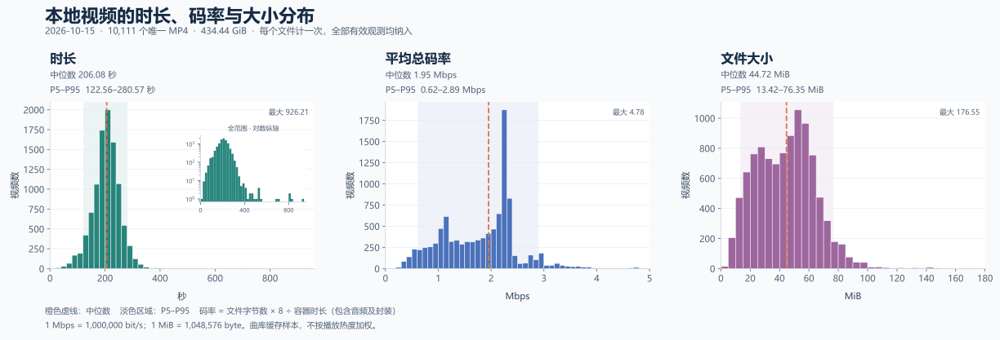

# 视频时长、码率和大小：获取方式、实测分布与缺失值建议

2026-10-15 对现有本地缓存进行只读分析，并获取当天歌曲清单及少量远端视频片段。结论是：**日常业务估算可直接组合同一资源版本的歌曲清单 `end` 与视频资源 URL 的 `s`；需要容器时长时，通常也只需 Range 读取少量 MP4 元数据，无须完整下载。**

本次依据为 10,111 个本地唯一 MP4、256 条可与本地文件核对的已保存资源 URL，以及 13 个远端抽样。三项都未知时，建议暂用 **210 秒、1.8 Mbps、45 MiB**；这些是估算值，不是资源事实或容量上限。下面分别说明信息来源、版本匹配、精度和适用边界。

## 信息从哪里获得

| 信息 | 歌曲清单 | 视频资源 URL 字符串 | 请求响应头 | 读取 MP4 元数据 |
| --- | --- | --- | --- | --- |
| 文件字节数 | 本次两份清单均没有大小字段 | `s` 给出文件字节数 | HEAD 的 `Content-Length`，或 206 的 `Content-Range` 总长度 | 本地文件长度可直接核对 |
| 完整视频时长 | `end` 是很好的秒级近似，但属于歌曲播放参数 | 没有直接时长参数 | 本次未见时长字段 | `moov/mvhd` 的 duration ÷ timescale |
| 平均总码率 | 没有码率字段；结合大小可计算近似值 | 没有码率参数；`s` 单独不够 | 本次未见码率字段 | 文件字节数 × 8 ÷ 容器时长 |
| 视频轨码率 | 没有 | 没有 | 本次未见 | 需要轨道/样本表；不能把总码率称为纯视频码率 |

这里的“码率”统一指**整文件平均总码率**，包括视频、音频及封装开销，单位 Mbps = 1,000,000 bit/s；不是瞬时峰值，也不是上游下载速度。文件大小用 MiB = 1,048,576 byte。

播放器 API 地址 `/Api/Songs/play?id=...` 本身不含大小，需要先取得它返回的资源 URL。观察到的资源形式为 `/files/.../....mp4?e=<MD5>&s=<字节数>`；264 条已保存 URL 的参数键均只有 `e`、`s`。`e` 是内容标识，不编码时长或码率。路径中的编号、版本字符串也不能代替媒体参数。清单 `originalUrl` 指向原始发布来源，不保证与实际播放的转码版本相同。

上述协议与现有实现相符：[`internal/videometa/parse.go`](../../internal/videometa/parse.go) 解析 `e/s`，[`internal/cacheproxy/catalog.go`](../../internal/cacheproxy/catalog.go) 保存歌曲的 `start/end` 和歌曲—MD5 关联；本次没有修改这些产品代码。

## 数据范围和版本匹配

本地数据库快照包含 10,463 首歌曲、10,129 个当前唯一资源。目录中有 **10,111 个唯一 MP4，共 434.44 GiB**，全部成功读取容器时长；其中 10,067 个仍被当前歌曲引用，44 个是未被当前映射引用的缓存。当前资源覆盖率为 99.39%，仍有 62 个当前资源未缓存。

直方图按目录中的唯一文件等权统计，包含这 44 个旧资源，不按歌曲数量或播放热度加权。数据库中的大小与这 10,111 个实际文件长度全部一致。没有对全部文件重新解码或全量计算 MD5；13 个 HTTP 对照样本另做了整文件 MD5 检查，全部符合 URL 的 `e`。

当天直接读取的 [Kiva 清单](https://x.kiva.moe/api/v2/wanna/songs) 与 [Udon 清单](https://api.udon.dance/Api/Songs/list) 均为版本 `20261014231343`，各有 10,463 个唯一歌曲 ID。两者的 `start/end` 完全一致，均没有独立的大小、时长或码率字段；Kiva 另有 `checksum`。本地清单版本为 `20261014145614`，有 12 首歌曲的资源 MD5 和 `end` 已被新清单更新；另新增 ID 11496、移出 ID 5274，总数恰好不变。

因此，精确关联采用 **Kiva checksum → 本地文件 MD5**，不能只按歌曲 ID 拼接旧视频与新清单。新清单可精确匹配 10,398 首；本地旧快照可匹配 10,399 首。这两个样本数对应不同版本，不能混用。Udon 的对照借助同版本 Kiva 的 checksum，并先核对两份清单的 `start/end`。

## 清单和 URL 与实际文件的差异

**文件大小可以在下载前取得。** 264 条保存的 URL 中，256 条能对应本地文件；它们的 `s` 全部等于文件实际字节数。余下 8 条没有本地文件，未作文件长度验证。13 个远端样本的 HEAD 均返回 200，`Content-Length` 与 URL `s` 和本地大小一致；Range 响应的总长度也一致。

**清单 `end` 适合业务估算，不应标成精确容器时长。** 新清单的 10,398 个匹配歌曲中，10,394 个（**99.96%**）误差不超过 1 秒；绝对误差中位数 0.371 秒、P95 为 0.920 秒，最大 8.067 秒。本地旧清单的对应结果为 10,395/10,399。

| 歌曲 ID | 清单 end，秒 | 容器时长，秒 | end − 容器时长，秒 |
| --- | ---: | ---: | ---: |
| 3914 | 192 | 200.067 | −8.067 |
| 4293 | 313 | 310.110 | +2.890 |
| 1519 | 233 | 235.102 | −2.102 |
| 4365 | 220 | 218.118 | +1.882 |

完整文件时长应近似取 `end`，**不要机械地取 `end - start`**。本地有 5 首 `start > 0`，例如 1519 的 start=16，而完整文件长 235.102 秒；另有 3049 的 start=194、end=193，直接相减会得到负数。若业务需要“歌曲选段播放时长”，应独立处理有效的播放起止参数，并验证游戏语义；这不等于整个媒体文件的时长。

对同一资源版本，下载前可计算：

```text
大小 byte       = URL.s
完整时长估计 s  = catalog.end
平均总码率 Mbps ≈ 8 × URL.s / catalog.end / 1,000,000
```

将新清单 `end` 代入、以实测文件大小比较，码率相对误差的中位数为 **0.179%**、P95 为 **0.535%**、P99 为 **0.824%**。这里评估的是时长近似引入的误差；URL 大小正确性的独立证据是上述 256 条及 13 个远端样本。极短视频更容易受整秒取值影响，最大相对误差为 8.55%。

## 精确值是否必须下载整个视频

**不必。** MP4 的 `moov` 中包含 `mvhd`，其 duration 和 timescale 给出容器时间轴长度；按 box 长度跳过 `mdat`，可以直接请求元数据所在位置。参见 [Apple 的 Movie header atom 文档](https://developer.apple.com/documentation/quicktime-file-format/movie_header_atom)。

本地 9,988/10,111 个文件（98.78%）的 `moov` 位于媒体数据前，123 个在媒体数据后。远端选取 10 个覆盖已观测 URL 大小分位的样本，以及 3 个尾部索引样本：

| 样本 | 每个视频读取量 | 结果 |
| --- | ---: | --- |
| 10 个前置 moov 视频 | 64 KiB，1 次 Range | 全部取得与本地相同的容器时长 |
| 3 个后置 moov 视频 | 128 KiB，2 次 Range | 跳过媒体正文后，全部取得相同时长 |
| 合计 | **1 MiB** | 13/13 成功；取得的每个片段均与本地字节一致 |

这只是获取时长，不要求把整个 `moov` 都下载。全体文件 `moov` 大小中位数约 191 KiB、P95 约 297 KiB；若后续还需要轨道码率、分辨率、帧率等，读取量可能更多。是否能少量读取取决于容器结构和上游 Range 支持；分片格式、缺失索引或拒绝 Range 时不能照搬本次结论。完整 MD5 校验仍需读取整个文件。

13 个样本最初使用 Python 默认 User-Agent 时 HEAD/Range 均失败，保存的 Range 错误均为 403（HEAD 只记录了 `HTTPError` 类型，未保留状态码）；改用 `Mozilla/5.0` 后全部成功，失败记录一并保留。生产探测应复用已有的可用请求通道、头部和重定向策略，不把某次 403 当作“必须完整下载”。本次使用 HTTPS，证书校验开启，没有修改 hosts 或程序配置。

读取大小时还应注意：**206 的 Content-Length 是本次片段长度，完整长度在 Content-Range 的斜杠后**。如 `bytes 0-65535/47582656`，完整文件是 47,582,656 字节，而非 65,536。服务器也可能不返回 HEAD 长度或忽略 Range；相关语义见 [RFC 9110](https://www.rfc-editor.org/rfc/rfc9110.html#name-content-range)。

用 PyAV 19.0.1（FFmpeg 解复用器）独立复核了固定随机样本、极值、清单误差异常项及非零 start 项，共 89 个文件。与 `mvhd` 口径最大时长差约 0.167 秒、总码率差约 0.00179 Mbps；解复用器按轨道时间轴确定总时长时可有微小差异。本报告统一采用 `mvhd` 容器时间轴，不声称是逐帧解码后的实际音画结束时刻。

## 三项指标的分布



图中每个文件只计一次，长尾未剔除；时长插图以对数纵轴显示稀少的长视频。直方图箱宽依次为 20 秒、0.1 Mbps、5 MiB。

| 指标 | 均值 | P5 | 中位数 | P95 | 最大值 |
| --- | ---: | ---: | ---: | ---: | ---: |
| 时长，秒 | 205.34 | 122.56 | 206.08 | 280.57 | 926.21 |
| 平均总码率，Mbps | 1.80 | 0.62 | 1.95 | 2.89 | 4.78 |
| 文件大小，MiB | 44.00 | 13.42 | 44.72 | 76.35 | 176.55 |

时长主要集中在约 2–5 分钟；码率有明显多峰，最大频数落在约 2.2 Mbps 附近，同时存在较低码率的一大批文件。因此不能假设所有视频采用同一个固定编码码率。时长与大小相关系数约 0.493，单凭大小反推时长仍有明显误差。

## 缺失时的推荐值和取值顺序

建议优先级为：**已有本地文件/元数据 → 同版本清单和资源 URL → 有预算的 Range 元数据探测 → 典型值兜底**。未知值与估计值应有来源标记，避免估计值以后被当作实测值。以下为研究建议，尚未写入产品逻辑。

| 用途 | 时长 | 平均总码率 | 大小 |
| --- | ---: | ---: | ---: |
| 一般估算，三项都未知 | **210 秒（3 分 30 秒）** | **1.8 Mbps** | **45 MiB** |
| 单独展示常见码率 | — | 可四舍五入为 **2 Mbps** | — |
| 较保守的单项预留 | 285 秒 | 3 Mbps | 80 MiB |

第一行接近本次均值/中位数，且数值互相协调：210 秒 × 1.8 Mbps ÷ 8 = 45.06 MiB。若选 210 秒和 2 Mbps，则推导大小应为约 **50 MiB**，不能再把 45 MiB 当成公式精确结果。

有 `s` 和有效 `end` 时，直接使用它们，收益远大于全局默认值。有大小和精确时长时，码率直接派生，不需要额外保存一份可能失配的码率。只缺大小时可按时长乘典型码率估计；只缺时长且无法读取元数据时，可以暂用 210 秒，或用大小与典型码率推导并标明粗估。

典型值不是上界：固定 210 秒的平均绝对误差约 36.8 秒，P90 绝对误差约 79 秒；固定 45 MiB 的平均绝对误差约 16.5 MiB。较保守的 285 秒、3 Mbps、80 MiB 在本样本中分别覆盖约 95.9%、96.9%、96.2%，不是联合保证，更不是最大值。平均码率的 P95 也不能保证瞬时带宽足够，下载调度仍需利用缓冲和实际吞吐。

以上范围仅代表这个本地曲库快照，不代表未来新增歌曲或按播放次数加权的需求分布；清单更新或转码策略变化后应重算。

## 与产品实现的关系

资源大小应存放在现有 `media.byte_size`：未知为 NULL，同一 MD5 被多首歌曲引用时共用。后续实现已在提交 `41450dd`（`feat(cache): persist media metadata during URL resolution`）中落地：接受新的有效 URL 观察时，将 `s` 与来源路径立即写入资源表，和 `song_urls` 同一事务提交，不等待视频下载。参见[存储约定](../storage.md)与[开发验证记录](../song-url-metadata-validation.md)。该功能待实机验收 **LA-042**。

本文的时长/码率兜底值与 Range 探测仍为研究建议，尚未写入产品逻辑；不应把 45 MiB 等估计值填入表示实际资源字节数的 `media.byte_size`。本次整理只提交研究工具、脱敏数据和文档，不改变产品运行行为，因此不新增实机验收项，也不改变 LA-042 等既有台账状态。

## 数据与复现入口

- [`summary.json`](video-metadata-20261015/summary.json)：本地样本范围、分位数、清单误差与验证摘要。
- [`measurements.csv`](video-metadata-20261015/measurements.csv)：10,111 个匿名资源的逐文件数据；`resource_no` 仅在本次快照内稳定，`song_count` 来自本地旧清单映射。
- [`catalog-comparison.csv`](video-metadata-20261015/catalog-comparison.csv)：本地版本 `20261014145614` 的 10,399 首匹配歌曲；[`catalog-comparison-current.csv`](video-metadata-20261015/catalog-comparison-current.csv)：当天版本 `20261014231343` 的 10,398 首匹配歌曲。后者使用 Kiva checksum 精确关联，并核对同版本 Udon 的 `start/end`，对应正文 99.96% 和码率估计误差。
- [`catalog-fields.json`](video-metadata-20261015/catalog-fields.json)：两份新清单字段覆盖、版本、哈希及对照统计。
- [`http-probes.json`](video-metadata-20261015/http-probes.json)、[`http-probes-default-ua.json`](video-metadata-20261015/http-probes-default-ua.json)：成功抽样及初次 403；不包含完整资源 URL。
- [`independent-validation.json`](video-metadata-20261015/independent-validation.json)、[`fallback-analysis.json`](video-metadata-20261015/fallback-analysis.json)、[`histogram-bins.json`](video-metadata-20261015/histogram-bins.json)：独立复核、兜底误差和直方图箱计数。
- [`checks.json`](video-metadata-20261015/checks.json)、[`manifest.json`](video-metadata-20261015/manifest.json)：离线数据校验及交付文件的字节数、SHA-256。哈希按 LF 归一化 UTF-8 字节计算，与本仓库 Git blob 内容一致；清单不包含自身。
- 脚本统一放在 [`scripts/video-metadata-study/`](../../scripts/video-metadata-study/)：[`analyze.py`](../../scripts/video-metadata-study/analyze.py) 读取离线数据库快照和视频元数据；[`probe.py`](../../scripts/video-metadata-study/probe.py) 比对冻结清单并可选探测 HTTP；[`plot.py`](../../scripts/video-metadata-study/plot.py) 生成直方图及兜底误差；[`verify.py`](../../scripts/video-metadata-study/verify.py) 只用已发布数据离线重算和校验。

所有统计使用 NumPy 默认线性插值分位数，标准差按总体计算（`ddof=0`）。CSV 中的布尔值用 `True/False`，秒、Mbps 与 MiB 均保留计算精度；正文和图中再四舍五入。整数歌曲 ID 为公开曲库编号，资源 MD5、歌曲标题、完整 URL、个人路径和原始数据库不随研究提交。

2026-10-15 整理验证：17 项离线校验全部通过；从冻结私有清单重算的字段统计与原记录一致；从公开逐文件数据重画的 SVG、分箱计数和兜底误差文件与整理后的交付逐字节相同（统一 LF，清理 SVG 行尾空格），并已检查图中文字和长尾范围。三份 CSV 保留逐条数值，以支持离线复算而无需分发原始曲库。此次整理没有重新访问远端视频，历史 HTTP 成功与失败记录均保留。

### 只用仓库数据校验与重画

以下 PowerShell 命令从仓库根目录执行。原始环境为 Python 3.12.14、NumPy 2.5.4、Matplotlib 3.11.2、PyAV 19.0.1，版本见 [`requirements.txt`](../../scripts/video-metadata-study/requirements.txt)。独立环境与重画产物均放在忽略目录。

```powershell
python -m venv artifacts/video-metadata-repro/venv
& artifacts/video-metadata-repro/venv/Scripts/python.exe -m pip install -r scripts/video-metadata-study/requirements.txt
& artifacts/video-metadata-repro/venv/Scripts/python.exe scripts/video-metadata-study/verify.py
New-Item -ItemType Directory -Force artifacts/video-metadata-repro/plot | Out-Null
Copy-Item docs/research/video-metadata-20261015/measurements.csv,docs/research/video-metadata-20261015/summary.json artifacts/video-metadata-repro/plot/
& artifacts/video-metadata-repro/venv/Scripts/python.exe scripts/video-metadata-study/plot.py --input artifacts/video-metadata-repro/plot --png artifacts/video-metadata-repro/histograms.png
```

`verify.py` 核对逐文件公式、汇总与分位数、全部直方图箱计数、新旧清单误差、兜底值误差、远端抽样证据、独立解复用结果、脱敏字段、文档链接及交付哈希；它不会请求网络或读取日常库。更新研究内容后，可显式使用 `--refresh-manifest` 在数据校验通过后刷新校验记录及哈希，然后再运行默认校验。画图默认用 Windows 的 Microsoft YaHei；其他环境需安装支持中文的字体并传 `--font`，字体差异可改变 SVG 字节但不改变数值。

### 有私有输入时重跑采集

原始数据库副本、两份清单、URL 和资源映射保留在忽略目录 `artifacts/video-metadata-20261015/`。采集时数据库源文件无 WAL，复制后通过 SQLite `quick_check`；重新采集须先取得一致的离线快照，不能把运行中数据库主文件直接复制后按 immutable 打开。分析器只读取视频头部元数据；可选 PyAV 抽样读取解复用信息，HTTP 探测另对 13 个已有本地文件计算完整 MD5。

```powershell
$studyPrivate = 'artifacts/video-metadata-20261015'
$studyVideos = '<本地缓存视频目录>' # 替换为实际路径
& artifacts/video-metadata-repro/venv/Scripts/python.exe scripts/video-metadata-study/analyze.py --database "$studyPrivate/storage-snapshot.sqlite" --videos $studyVideos --private artifacts/video-metadata-repro/private --output artifacts/video-metadata-repro/local
& artifacts/video-metadata-repro/venv/Scripts/python.exe scripts/video-metadata-study/probe.py --private $studyPrivate --videos $studyVideos --output artifacts/video-metadata-repro/catalog --catalog-only
# 下行才会访问远端；沿用冻结快照的资源映射和 URL。
& artifacts/video-metadata-repro/venv/Scripts/python.exe scripts/video-metadata-study/probe.py --private $studyPrivate --videos $studyVideos --output artifacts/video-metadata-repro/http
```

`probe.py --catalog-only` 不访问网络，要求私有目录中存在 `storage-snapshot.sqlite`、`resource-map.json`、`urls.json`、`kiva-catalog.json` 与 `udon-catalog.json`。远端探测每个样本最多读取四段 64 KiB，拒绝将忽略 Range 的 200 响应当作元数据片段；旧 URL 可能失效，重跑结果不能覆盖本次历史成功/失败证据。重新采集清单后须核对版本，不能拿新清单冒充本次冻结输入。
